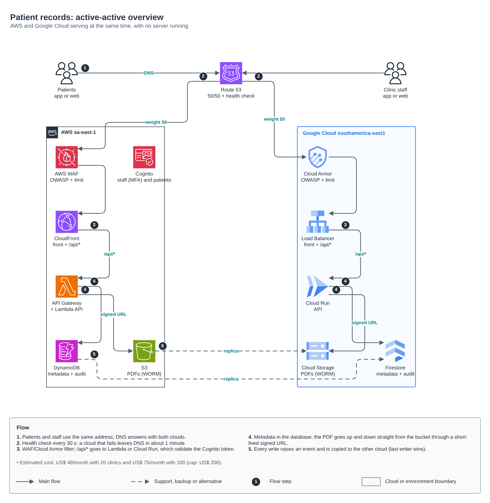
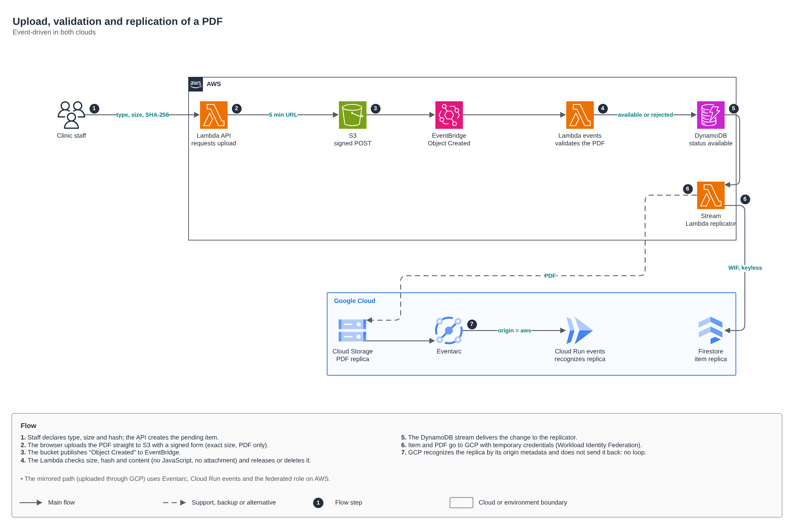
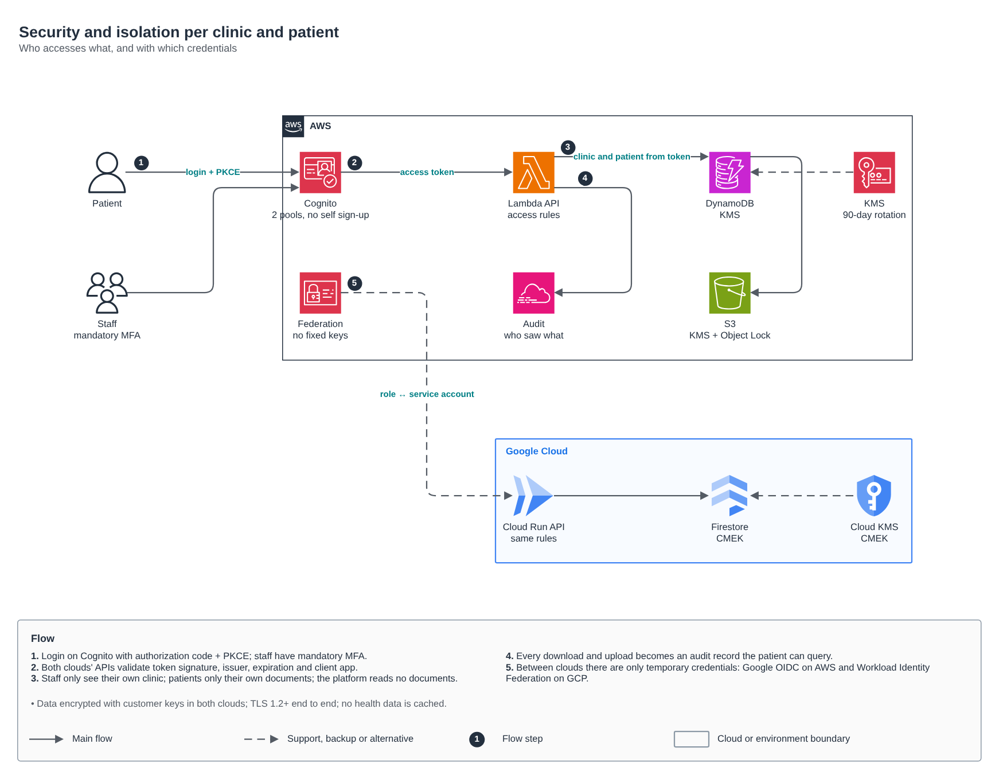

# Patient records: active-active serverless app on AWS and Google Cloud

[Português](README.md) · **English**

Clinics store exams, diagnoses and prescriptions as PDFs, and each patient opens their own on a phone or in a browser. The platform runs on AWS and Google Cloud at the same time, with no server running. It is event-driven, keeps data in Brazil, puts security first, and costs less than US$ 200 a month up to 100 clinics.

| Requirement | How it was met |
|---|---|
| Platform data security | Customer-managed keys in both clouds, WAF and Cloud Armor, WORM PDFs, no fixed key between clouds, TLS 1.2+ and no health data in caches |
| Each customer sees only their own data | Staff only see their own clinic and patients only their own documents. The platform reads no documents. The rules are tested |
| Exams, diagnoses and prescriptions one tap away | Installable PWA (Android, iPhone, desktop) with a filter by type and download through a 60-second signed URL |
| Distributed, serverless and event-driven | Lambda and Cloud Run scale from zero. PDF arrival and replication are triggered by events (EventBridge, DynamoDB Streams, Eventarc) |
| AWS and GCP | Active-active: DNS sends half the traffic to each cloud and takes the failing one out |
| From 20 to 3,000 clinics | Nothing to re-provision. On-demand database, functions and Cloud Run with adjustable limits and a partition key per clinic |
| Up to US$ 200/month with 20 to 100 clinics | Estimated at US$ 48 (20 clinics) and US$ 75 (100 clinics). See [Cost](#cost) |

## Architecture







Editable source: [`diagram.drawio`](diagram.drawio), with pages 1 to 3 in Portuguese and 4 to 6 in English.

## Decisions

| # | Decision | Why | Cost of the decision |
|---|---|---|---|
| 1 | **Active-active through DNS**: weighted 50/50 Route 53 with an HTTPS health check on each cloud's `/api/health` | It is the only entry point that does not depend on a single cloud. A failing cloud leaves DNS in about 1 minute | Clients with cached DNS can take up to the TTL (60 s) to switch clouds |
| 2 | **One identity, in Cognito**: two pools, staff with mandatory MFA and patients with optional MFA, no self sign-up | Passwords cannot be exported between providers. A single IdP avoids two diverging user bases | If the AWS region goes down, new logins stop; signed-in users keep going until the token expires. GCP validates tokens on its own, with the cached JWKS |
| 3 | **Single table replicated by events**: DynamoDB and Firestore with the same (pk, sk) model; last writer wins by (timestamp, version, origin) | Local writes in both clouds, with no paid multi-cloud database | Eventual consistency across clouds (seconds). The timestamp never goes backwards and the version breaks ties |
| 4 | **PDF straight to the bucket through a signed URL**: form with the exact size, PDF only and a fixed origin | The API does not carry files: lower cost and smaller attack surface | The document only shows up after the automatic validation |
| 5 | **Validation when the PDF arrives**: size, SHA-256 and content (blocks JavaScript, Launch, embedded files, XFA) | A malicious PDF never reaches the patient | It is not an antivirus (see [Limitations](#limitations-and-next-steps)) |
| 6 | **Authorization in code, the same in both clouds**: user type comes from the token's signed issuer; clinic and role come from the membership record in the database | Editable IdP attributes do not decide access. There is one rule and it is tested | One extra membership record per staff user |
| 7 | **No keys between clouds**: GCP reaches AWS through Google OIDC and AWS reaches GCP through Workload Identity Federation | There is no secret to leak or rotate | Trust policies bind each side to the other's exact account ID |
| 8 | **Legal retention**: S3 with Object Lock and GCS with a retention policy, both 20 years in production | Medical records: 20 years (CFM Resolution 1,821/2007) | GOVERNANCE on S3 and no lock on GCS until legal validates; then COMPLIANCE and lock |
| 9 | **Audit the patient can see**: every upload and download becomes a record shown under "Who accessed my documents" | Transparency to the data subject (LGPD, art. 18) and a trail for investigations | One extra item per access (negligible cost) |
| 10 | **Data in Brazil**: `sa-east-1` and `southamerica-east1` | Health data is sensitive personal data (LGPD, art. 11) | Slightly higher prices than US regions |

## Security

- **Edge:** AWS WAF (OWASP, bad inputs, IP reputation, per-IP limit, Brazil only) and Cloud Armor (OWASP sqli/xss/lfi/rce, ban on excess, Brazil only). `/api/health` is exempt from the geo rule, because the Route 53 health check comes from the US.
- **Transport:** TLS 1.2+ (`MODERN` policy on GCP), HSTS and a strict CSP (own origin, Cognito and the buckets only).
- **Identity:**
  - authorization code with PKCE, no secret in the browser;
  - a token is only valid if the RS256 signature, issuer, expiration, `token_use=access` and client app all match;
  - tokens from another pool, ID tokens, `alg=none` and HS256 are rejected, and tests cover each case.
- **Isolation:**
  - someone else's document answers 404, the same as a missing one, so its existence does not leak;
  - IDs only enter database and object keys in `[a-z0-9]` form, which blocks path traversal.
- **Data:**
  - AWS KMS with 90-day rotation and CMEK on GCP, also with 90-day rotation;
  - PITR on both databases, daily Firestore backup and bucket versioning;
  - the only public bucket holds the app shell (HTML, JS and CSS).
- **Least privilege:**
  - each Lambda and each service account has only what it uses;
  - no role has `DeleteItem` or `UpdateItem`;
  - the GCP federated role only reaches the table, the bucket's `clinicas/` prefix and the two pools.
- **App:** the service worker caches only the shell. API responses and PDFs are never cached, and the API answers with `Cache-Control: no-store`.

## LGPD (Brazilian data protection law)

> This is the architecture view, not legal advice. Validate it with the data protection officer (DPO) and the operation's legal team.

- Typical legal basis for the processing: health protection (art. 11, II, f). The clinic's role (controller) and the platform's role (processor) need to be in the contract.
- Data subject rights the app already covers: access to the documents and to who accessed them.
- Not implemented yet: bulk correction and portability, and the deletion flow, which conflicts with the 20-year legal retention and needs a defined process.
- Incidents: the audit logs (database + CloudWatch/Cloud Logging) show who accessed what and when.

## Cost

Generated by [`docs/custo.py`](docs/custo.py) (`python3 docs/custo.py 20 100 3000`). These are November 2026 list prices for `sa-east-1` and `southamerica-east1`, without discounts, at month 12 (with 12 months of PDFs stored).

Assumptions per clinic per month, editable at the top of the script:
- 150 PDFs of 0.8 MB, each downloaded twice;
- 100 active patients and 8 staff;
- 10,000 API calls;
- traffic split half and half between the clouds.

| Item | 20 clinics | 100 clinics | 3000 clinics |
|---|---:|---:|---:|
| **AWS** | | | |
| S3 (2 classes + requests) | 0.71 | 3.55 | 106.51 |
| DynamoDB on-demand + PITR | 0.13 | 0.66 | 19.91 |
| Lambda (API, events, replica) | 0.00 | 0.00 | 46.32 |
| API Gateway HTTP | 0.19 | 0.95 | 28.50 |
| Data transfer out (downloads + replica to GCP) | 0.53 | 2.64 | 79.10 |
| KMS (2 keys + usage) | 2.35 | 3.77 | 55.10 |
| Cognito Essentials (2 pools) | 0.00 | 12.00 | 4,710.00 |
| Route 53 (zone + health checks) | 4.75 | 4.75 | 4.75 |
| WAF on CloudFront | 9.06 | 9.30 | 18.00 |
| CloudWatch (logs + 10 alarms) | 1.75 | 1.75 | 23.50 |
| *Subtotal AWS* | *19.47* | *39.37* | *5,091.70* |
| **GCP** | | | |
| Cloud Storage (2 classes + operations) | 0.63 | 3.15 | 94.51 |
| Firestore + PITR | 0.03 | 0.13 | 34.85 |
| Cloud Run (API and events, minimum 0) | 0.00 | 0.00 | 171.82 |
| Load Balancer global | 18.28 | 18.42 | 23.46 |
| Cloud Armor | 9.15 | 9.75 | 31.50 |
| Data transfer out (downloads + replica to AWS) | 0.42 | 2.11 | 63.28 |
| Cloud KMS | 0.47 | 1.89 | 53.22 |
| *Subtotal GCP* | *28.99* | *35.45* | *472.64* |
| **Total per month (USD)** | **48.46** | **74.82** | **5,564.34** |
| Per clinic | 2.42 | 0.75 | 1.85 |

What the table shows:
- **Up to 100 clinics the cost is almost all fixed:** the GCP Load Balancer, WAF, Cloud Armor, KMS and health checks add up to about US$ 45. That leaves more than US$ 120 of headroom under the cap.
- **Not modeled** (under US$ 5/month at this volume): CloudFront and Cloud CDN (within free tiers), Eventarc and logs within the free quota.
- **At 3,000 clinics Cognito becomes 85% of the cost** (324,000 active users). At that scale:
  - the Lite tier costs about US$ 1,700/month instead of US$ 4,700, but the login page is in English;
  - another option is a volume discount negotiated with AWS;
  - or measure the real MAU: the assumption of 100 active patients per clinic is conservative.

## Scaling to 3,000 clinics

Nothing changes shape: only limits and alarms.
- **DynamoDB:** on-demand with the `CLINICA#<id>` partition key, which spreads the load.
- **Firestore:** scales by itself.
- **Compute:** raise `max_instancias_api`, the Lambdas' reserved concurrency and the API Gateway limits, based on monitoring.
- **Before passing about 300 clinics:**
  - load testing;
  - pagination in listings (today up to 200 items per call);
  - a Cognito review, as in the cost note above.

## Layout

```text
apps/docs-pacientes/
├── app/                 single codebase for both clouds (Python 3.12)
│   ├── docs_pacientes/
│   │   ├── core/        model, access rules, PDF validation, use cases, replication, audit
│   │   ├── adapters/    AWS (DynamoDB, S3, Cognito), GCP (Firestore, GCS over REST), federation, in-memory
│   │   └── entry/       single HTTP router, Lambda (api, objeto_criado, stream), Cloud Run (api, events)
│   ├── tests/           57 tests (isolation, PDF, replication, JWT, HTTP, adapters)
│   ├── Dockerfile       Cloud Run image
│   └── Makefile         make teste | make lambda | make imagem
├── web/                 dependency-free PWA (PKCE login, filters, direct upload to the bucket)
├── infra/               Terraform roots: one state per resource and environment
│   ├── gcp/base         KMS, Firestore, bucket, service accounts, AWS -> GCP federation
│   ├── aws/base         KMS, DynamoDB (stream), bucket (Object Lock), failure queue, alerts
│   ├── aws/identidade   Cognito: staff pool and patient pool
│   ├── aws/app          Lambdas, API, CloudFront + WAF + certificate, GCP -> AWS federated role
│   ├── gcp/app          Cloud Run (api and events), Eventarc, front end, LB + Cloud Armor
│   └── global/dns       weighted Route 53 with health checks and GCP certificate validation
│       └── envs/{dev,hml,prd}/backend.hcl + terraform.tfvars   (in every root)
├── docs/                diagrams and cost model
└── diagram.drawio
```

The roots use the monorepo modules (`aws/*` and `gcp/*`), each with an example, README, diagram and `terraform test`:
- **New on AWS:** `dynamodb-table`, `waf-web-acl`, `route53-health-routing`, `iam-role-gcp-federation`, `route53-records`, `acm-certificate`.
- **New on GCP:** `kms-key`, `gcs-bucket`, `firestore-database`, `cloud-run-service`, `eventarc-trigger`, `workload-identity-aws`, `service-accounts`, `serverless-edge`.
- **Extended without breaking current users:** `s3-bucket`, `lambda-function`, `cognito-user-pool`, `cloudfront-spa`, `static-site`.

## Deployment

The order follows the dependencies: each root reads the previous ones' outputs through `terraform_remote_state`.

```bash
# 0. Per-environment prerequisites: S3 and GCS state buckets, the domain zone in Route 53,
#    a GCP project with the APIs (run, firestore, eventarc, certificatemanager, compute, kms, iamcredentials)
#    and an Artifact Registry repository. Adjust the example values in envs/<environment>/terraform.tfvars.

make -C app teste lambda                           # tests + Lambda package (arm64)
make -C app imagem REGISTRO=southamerica-east1-docker.pkg.dev/<project>/docs TAG=$(git rev-parse --short HEAD)

for root in gcp/base aws/base aws/identidade aws/app gcp/app global/dns; do
  terraform -chdir=infra/$root init -backend-config=envs/dev/backend.hcl
  terraform -chdir=infra/$root apply -var-file=envs/dev/terraform.tfvars   # gcp/app: -var imagem=...
done
```

First access:
1. Create the first platform admin in the staff pool.
2. Write their membership record (`USUARIO#<sub>` / `VINCULO`, role `plataforma_admin`).
3. From then on everything goes through the app: the platform creates clinics and admins, and each clinic creates its staff and patients.

In the pipeline the same flow runs with OIDC (GitHub/GitLab to AWS and GCP), plan on PR and apply with approval per environment. It is the [`padrao-iac/`](../../padrao-iac) pattern.

## Tests

- **App:** `make -C app teste` runs 57 tests with no cloud. They cover:
  - isolation between clinics and patients;
  - PDF rules;
  - active-active convergence without loops;
  - JWT verification;
  - the HTTP router;
  - GCS V4 signing and the S3 form.
- **Modules:** `terraform test` with mocked providers in every new or changed module, with assertions on what matters (isolation, retention, WAF rules etc.).
- **CI:** the `apps` job of `terraform-ci` runs the app tests, `fmt`, `validate` of every root and `tflint`. Modules run in the AWS and Google Cloud blocks.

## Limitations and next steps

- **Not deployed to real accounts yet:** the code passed the tests and `validate`, but the first apply in `dev` and an end-to-end test across both clouds are still missing.
- **Antivirus:** the PDF gets structural validation, not a malware scan. Next step: GuardDuty Malware Protection for S3 on the documents bucket, and on GCP release only after the scan.
- **Alarms:** today only DNS alerts when a cloud goes down. Lambda error alarms, replication failure queue alarms, API 5xx and Cloud Run alarms are still missing.
- **Identity in one cloud:** see decision 2.
- **Native app:** the delivery is a PWA, which installs on Android and iPhone. A store app (React Native/Flutter) would use the same API.
- **Data subject and staff flows:** deletion, correction, user offboarding and clinic changes have no screen or route yet.
- **Domain and pool names:** `example.com` and the Cognito domain prefixes are examples. The Cognito prefixes must be unique in the region.
