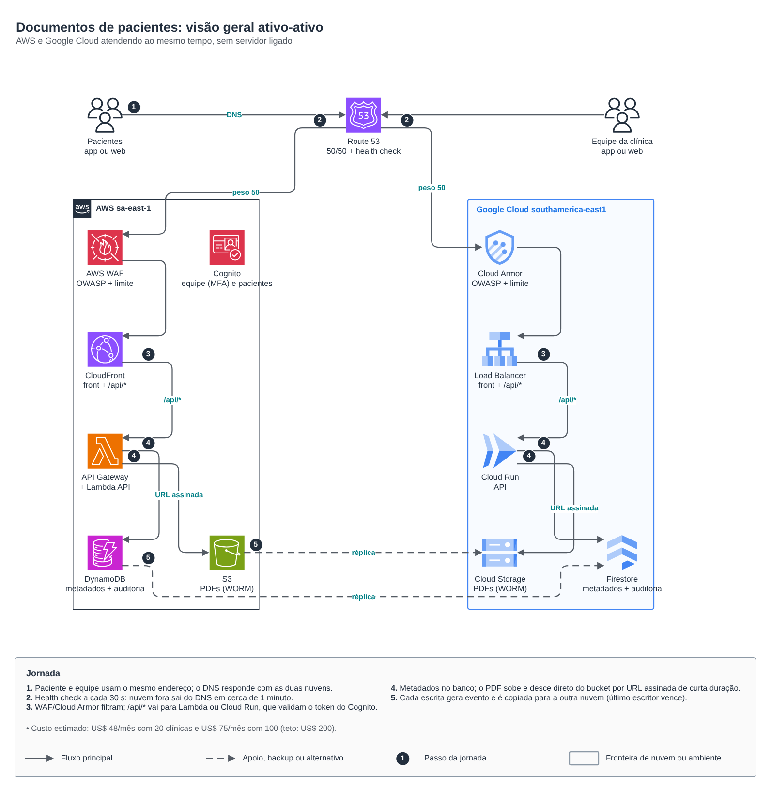
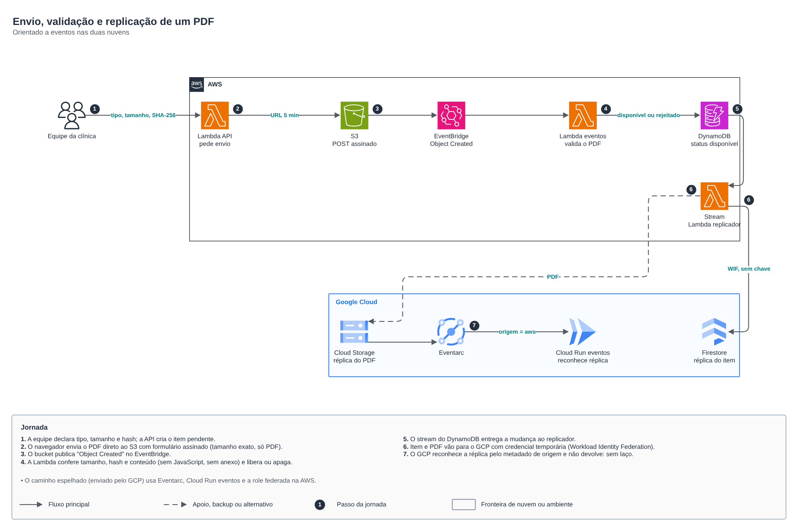
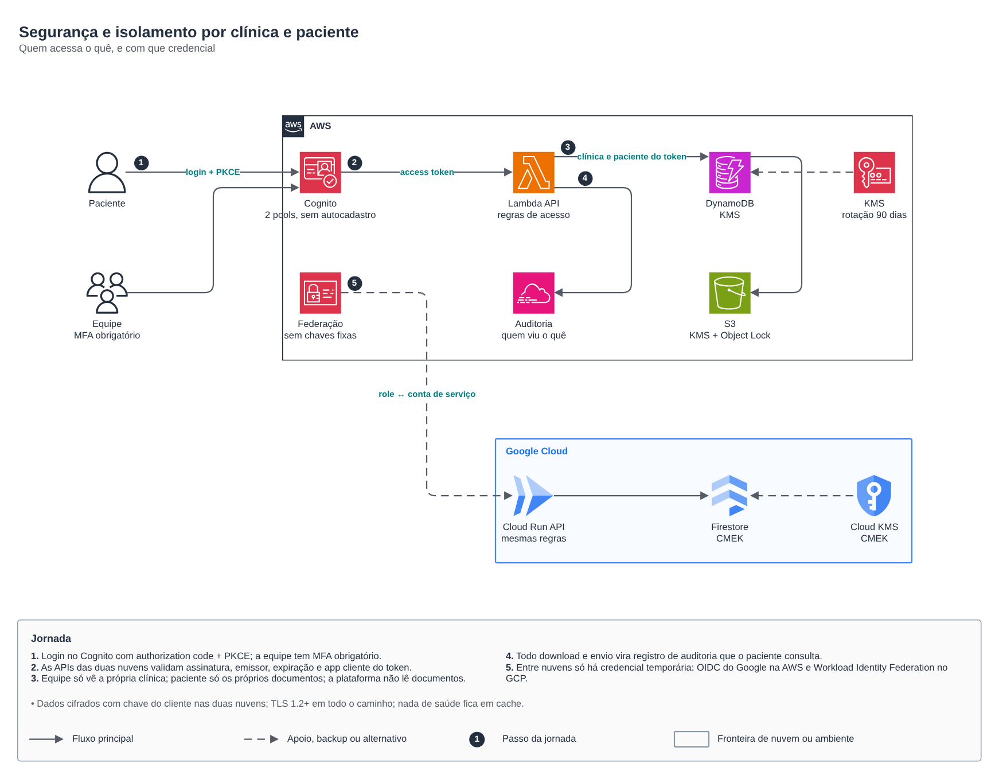

# Documentos de pacientes: app serverless ativo-ativo em AWS e Google Cloud

**Português** · [English](README.en.md)

Clínicas guardam exames, diagnósticos e receitas em PDF, e cada paciente abre os seus no celular ou no navegador. A plataforma roda ao mesmo tempo na AWS e no Google Cloud, sem servidor ligado. Ela é orientada a eventos, com dados no Brasil e segurança como prioridade, e custa menos de US$ 200 por mês até 100 clínicas.

| Pedido | Como foi atendido |
|---|---|
| Segurança dos dados da plataforma | Chave do cliente nas duas nuvens, WAF e Cloud Armor, PDFs em WORM, nenhuma chave fixa entre nuvens, TLS 1.2+ e nada de saúde em cache |
| Cada cliente acessa só o que é seu | A equipe só vê a própria clínica e o paciente só os próprios documentos. A plataforma não lê documentos. As regras têm testes |
| Exames, diagnósticos e receitas a um clique | PWA instalável (Android, iPhone, desktop) com filtro por tipo e download por URL assinada de 60 s |
| Distribuída, serverless e orientada a eventos | Lambda e Cloud Run escalam do zero. A chegada do PDF e a replicação disparam por evento (EventBridge, DynamoDB Streams, Eventarc) |
| AWS e GCP | Ativo-ativo: o DNS manda metade do tráfego para cada nuvem e tira do ar a que falhar |
| De 20 para 3.000 clínicas | Nada a reprovisionar. Banco on-demand, funções e Cloud Run com limites ajustáveis e chave de partição por clínica |
| Até US$ 200/mês com 20 a 100 clínicas | Estimado em US$ 48 (20 clínicas) e US$ 75 (100 clínicas). Veja [Custo](#custo) |

## Arquitetura







Fonte editável: [`diagram.drawio`](diagram.drawio), com as páginas 1 a 3 em português e 4 a 6 em inglês.

## Decisões

| # | Decisão | Por quê | Custo da decisão |
|---|---|---|---|
| 1 | **Ativo-ativo por DNS**: Route 53 ponderado 50/50, com health check HTTPS em `/api/health` de cada nuvem | É o único ponto de entrada que não depende de uma nuvem só. A nuvem que falha sai do DNS em cerca de 1 minuto | Clientes com DNS em cache podem levar até o TTL (60 s) para mudar de nuvem |
| 2 | **Uma identidade, no Cognito**: dois pools, equipe com MFA obrigatório e pacientes com MFA opcional, sem autocadastro | Senha não é exportável entre provedores. Um só IdP evita duas bases de usuários divergentes | Se a região AWS cair, login novo para; quem já entrou segue até o token expirar. O GCP valida os tokens sozinho, pelo JWKS em cache |
| 3 | **Tabela única replicada por eventos**: DynamoDB e Firestore com o mesmo modelo (pk, sk); último escritor vence por (instante, versão, origem) | Escrita local nas duas nuvens, sem banco multi-nuvem pago | Consistência eventual entre nuvens (segundos). O instante nunca anda para trás e a versão desempata |
| 4 | **PDF direto ao bucket por URL assinada**: formulário com tamanho exato, só PDF e origem fixada | A API não trafega arquivo: menos custo e menos superfície | O documento só aparece depois da validação automática |
| 5 | **Validação na chegada do PDF**: tamanho, SHA-256 e conteúdo (bloqueia JavaScript, Launch, arquivo embutido, XFA) | Um PDF malicioso não chega ao paciente | Não é antivírus (veja [Limitações](#limitações-e-próximos-passos)) |
| 6 | **Autorização no código, a mesma nas duas nuvens**: o tipo de usuário vem do emissor assinado do token; clínica e papel vêm do vínculo no banco | Atributo editável no IdP não decide acesso. A regra é uma só e é testada | Um vínculo a mais por usuário da equipe |
| 7 | **Nenhuma chave entre nuvens**: o GCP chega na AWS por OIDC do Google e a AWS chega no GCP por Workload Identity Federation | Não há segredo para vazar nem para rotacionar | As trust policies amarram cada lado ao ID exato da conta do outro |
| 8 | **Retenção legal**: S3 com Object Lock e GCS com política de retenção, os dois com 20 anos em produção | Prontuário: 20 anos (Resolução CFM 1.821/2007) | GOVERNANCE no S3 e retenção sem trava no GCS até o jurídico validar; depois, COMPLIANCE e trava |
| 9 | **Auditoria que o paciente vê**: todo envio e download vira registro consultável em "Quem acessou meus documentos" | Transparência ao titular (LGPD, art. 18) e trilha para investigação | Um item a mais por acesso (custo irrelevante) |
| 10 | **Dados no Brasil**: `sa-east-1` e `southamerica-east1` | Dado de saúde é dado pessoal sensível (LGPD, art. 11) | Preço um pouco maior que nas regiões dos EUA |

## Segurança

- **Borda:** AWS WAF (OWASP, entradas maliciosas, reputação de IP, limite por IP, só Brasil) e Cloud Armor (OWASP sqli/xss/lfi/rce, banimento por excesso, só Brasil). `/api/health` fica isento da regra geográfica, porque o health check do Route 53 sai dos EUA.
- **Transporte:** TLS 1.2+ (política `MODERN` no GCP), HSTS e CSP restrita (só origem própria, Cognito e os buckets).
- **Identidade:**
  - authorization code com PKCE, sem segredo no navegador;
  - o token vale só se a assinatura RS256, o emissor, a expiração, o `token_use=access` e o app cliente baterem;
  - token de outro pool, ID token, `alg=none` e HS256 são recusados, e os testes cobrem cada caso.
- **Isolamento:**
  - documento alheio responde 404, igual a documento inexistente, para não vazar se ele existe;
  - IDs entram em chave de banco e de objeto só no formato `[a-z0-9]`, o que barra path traversal.
- **Dados:**
  - KMS da AWS com rotação de 90 dias e CMEK no GCP, com rotação de 90 dias;
  - PITR nas duas bases, backup diário do Firestore e versionamento nos buckets;
  - bucket público só para a casca do app (HTML, JS e CSS).
- **Privilégio mínimo:**
  - cada Lambda e cada conta de serviço tem só o que usa;
  - nenhuma role tem `DeleteItem` nem `UpdateItem`;
  - a role federada do GCP só alcança a tabela, o prefixo `clinicas/` do bucket e os dois pools.
- **App:** o service worker guarda só a casca. Respostas da API e PDFs nunca vão para cache, e a API responde com `Cache-Control: no-store`.

## LGPD

> Isto é a visão de arquitetura, não parecer jurídico. Valide com o encarregado (DPO) e o jurídico da operação.

- Base legal típica para o tratamento: tutela da saúde (art. 11, II, f). O papel da clínica (controladora) e o da plataforma (operadora) precisam estar em contrato.
- Direitos do titular já atendidos pelo app: acesso aos documentos e a quem os acessou.
- Ainda não implementados: correção e portabilidade em lote, e o fluxo de exclusão, que conflita com a retenção legal de 20 anos e exige processo definido.
- Incidente: os logs de auditoria (banco + CloudWatch/Cloud Logging) permitem dizer quem acessou o quê e quando.

## Custo

Gerado por [`docs/custo.py`](docs/custo.py) (`python3 docs/custo.py 20 100 3000`). São preços de tabela de nov/2026 para `sa-east-1` e `southamerica-east1`, sem descontos, no 12º mês (com 12 meses de PDFs acumulados).

Premissas por clínica e por mês, editáveis no topo do script:
- 150 PDFs de 0,8 MB, cada um baixado 2 vezes;
- 100 pacientes ativos e 8 pessoas da equipe;
- 10 mil chamadas de API;
- tráfego dividido meio a meio entre as nuvens.

| Item | 20 clínicas | 100 clínicas | 3000 clínicas |
|---|---:|---:|---:|
| **AWS** | | | |
| S3 (2 classes + requisições) | 0.71 | 3.55 | 106.51 |
| DynamoDB on-demand + PITR | 0.13 | 0.66 | 19.91 |
| Lambda (API, eventos, réplica) | 0.00 | 0.00 | 46.32 |
| API Gateway HTTP | 0.19 | 0.95 | 28.50 |
| Saída de dados (downloads + réplica p/ GCP) | 0.53 | 2.64 | 79.10 |
| KMS (2 chaves + uso) | 2.35 | 3.77 | 55.10 |
| Cognito Essentials (2 pools) | 0.00 | 12.00 | 4,710.00 |
| Route 53 (zona + health checks) | 4.75 | 4.75 | 4.75 |
| WAF na CloudFront | 9.06 | 9.30 | 18.00 |
| CloudWatch (logs + 10 alarmes) | 1.75 | 1.75 | 23.50 |
| *Subtotal AWS* | *19.47* | *39.37* | *5,091.70* |
| **GCP** | | | |
| Cloud Storage (2 classes + operações) | 0.63 | 3.15 | 94.51 |
| Firestore + PITR | 0.03 | 0.13 | 34.85 |
| Cloud Run (API e eventos, mínimo 0) | 0.00 | 0.00 | 171.82 |
| Load Balancer global | 18.28 | 18.42 | 23.46 |
| Cloud Armor | 9.15 | 9.75 | 31.50 |
| Saída de dados (downloads + réplica p/ AWS) | 0.42 | 2.11 | 63.28 |
| Cloud KMS | 0.47 | 1.89 | 53.22 |
| *Subtotal GCP* | *28.99* | *35.45* | *472.64* |
| **Total por mês (USD)** | **48.46** | **74.82** | **5,564.34** |
| Por clínica | 2.42 | 0.75 | 1.85 |

O que a tabela mostra:
- **Até 100 clínicas, o custo é quase todo fixo:** Load Balancer do GCP, WAF, Cloud Armor, KMS e health checks somam cerca de US$ 45. Sobram mais de US$ 120 de margem dentro do teto.
- **Fora do modelo** (abaixo de US$ 5/mês nesse volume): CloudFront e Cloud CDN (dentro das camadas gratuitas), Eventarc e logs dentro da cota gratuita.
- **Com 3000 clínicas, o Cognito vira 85% do custo** (324 mil usuários ativos). Para essa escala:
  - o tier Lite custa cerca de US$ 1.700/mês em vez de US$ 4.700, mas o login fica em inglês;
  - outra saída é negociar desconto por volume com a AWS;
  - ou medir o MAU real: a premissa de 100 pacientes ativos por clínica é conservadora.

## Escala até 3000 clínicas

Nada muda de forma: só limites e alarmes.
- **DynamoDB:** on-demand com chave de partição `CLINICA#<id>`, que distribui a carga.
- **Firestore:** escala sozinho.
- **Computação:** subir `max_instancias_api`, a concorrência reservada das Lambdas e os limites do API Gateway, conforme o monitoramento.
- **Antes de passar de cerca de 300 clínicas:**
  - teste de carga;
  - paginação nas listagens (hoje até 200 itens por chamada);
  - revisão do Cognito, como no item de custo acima.

## Estrutura

```text
apps/docs-pacientes/
├── app/                 código único das duas nuvens (Python 3.12)
│   ├── docs_pacientes/
│   │   ├── core/        modelo, regras de acesso, validação de PDF, casos de uso, replicação, auditoria
│   │   ├── adapters/    AWS (DynamoDB, S3, Cognito), GCP (Firestore, GCS via REST), federação, memória
│   │   └── entry/       roteador HTTP único, Lambda (api, objeto_criado, stream), Cloud Run (api, eventos)
│   ├── tests/           57 testes (isolamento, PDF, replicação, JWT, HTTP, adaptadores)
│   ├── Dockerfile       imagem do Cloud Run
│   └── Makefile         make teste | make lambda | make imagem
├── web/                 PWA sem dependências (login PKCE, filtros, upload direto ao bucket)
├── infra/               roots Terraform: um estado por recurso e por ambiente
│   ├── gcp/base         KMS, Firestore, bucket, contas de serviço, federação AWS -> GCP
│   ├── aws/base         KMS, DynamoDB (stream), bucket (Object Lock), fila de falhas, alertas
│   ├── aws/identidade   Cognito: pool da equipe e pool de pacientes
│   ├── aws/app          Lambdas, API, CloudFront + WAF + certificado, role federada GCP -> AWS
│   ├── gcp/app          Cloud Run (api e eventos), Eventarc, front, LB + Cloud Armor
│   └── global/dns       Route 53 ponderado com health check e validação do certificado do GCP
│       └── envs/{dev,hml,prd}/backend.hcl + terraform.tfvars   (em cada root)
├── docs/                desenhos e modelo de custo
└── diagram.drawio
```

Os roots usam os módulos do monorepo (`aws/*` e `gcp/*`), cada um com exemplo, README, desenho e `terraform test`:
- **AWS novos:** `dynamodb-table`, `waf-web-acl`, `route53-health-routing`, `iam-role-gcp-federation`, `route53-records`, `acm-certificate`.
- **GCP novos:** `kms-key`, `gcs-bucket`, `firestore-database`, `cloud-run-service`, `eventarc-trigger`, `workload-identity-aws`, `service-accounts`, `serverless-edge`.
- **Estendidos sem quebrar quem já usa:** `s3-bucket`, `lambda-function`, `cognito-user-pool`, `cloudfront-spa`, `static-site`.

## Implantação

A ordem segue as dependências: cada root lê as saídas dos anteriores por `terraform_remote_state`.

```bash
# 0. Pré-requisitos por ambiente: bucket de estado S3 e GCS, zona do domínio no Route 53,
#    projeto GCP com as APIs (run, firestore, eventarc, certificatemanager, compute, kms, iamcredentials)
#    e repositório no Artifact Registry. Ajuste os valores de exemplo em envs/<ambiente>/terraform.tfvars.

make -C app teste lambda                           # testes + pacote da Lambda (arm64)
make -C app imagem REGISTRO=southamerica-east1-docker.pkg.dev/<projeto>/docs TAG=$(git rev-parse --short HEAD)

for root in gcp/base aws/base aws/identidade aws/app gcp/app global/dns; do
  terraform -chdir=infra/$root init -backend-config=envs/dev/backend.hcl
  terraform -chdir=infra/$root apply -var-file=envs/dev/terraform.tfvars   # gcp/app: -var imagem=...
done
```

Primeiro acesso:
1. Crie o primeiro administrador da plataforma no pool da equipe.
2. Grave o vínculo dele (`USUARIO#<sub>` / `VINCULO`, papel `plataforma_admin`).
3. Daí em diante tudo é pelo app: a plataforma cria clínicas e administradores, e a clínica cria a equipe e os pacientes.

No pipeline, o mesmo fluxo roda com OIDC (GitHub/GitLab para AWS e GCP), plan em PR e apply com aprovação por ambiente. É o padrão de [`padrao-iac/`](../../padrao-iac).

## Testes

- **App:** `make -C app teste` roda 57 testes sem nuvem. Eles cobrem:
  - isolamento entre clínicas e pacientes;
  - regras de PDF;
  - convergência ativo-ativo sem laço;
  - verificação de JWT;
  - roteador HTTP;
  - assinatura V4 do GCS e formulário do S3.
- **Módulos:** `terraform test` com providers simulados em cada módulo novo ou alterado, com asserções sobre o que importa (isolamento, retenção, regras de WAF etc.).
- **CI:** o job `apps` do `terraform-ci` roda os testes do app, `fmt`, `validate` de todos os roots e `tflint`. Os módulos rodam nos blocos AWS e Google Cloud.

## Limitações e próximos passos

- **Não foi implantado em contas reais:** o código passou nos testes e no `validate`, mas falta o primeiro apply em `dev` e um teste ponta a ponta nas duas nuvens.
- **Antivírus:** o PDF passa por validação estrutural, não por varredura de malware. Próximo passo: GuardDuty Malware Protection for S3 no bucket de documentos, e do lado do GCP só liberar depois da varredura.
- **Alarmes:** hoje só o DNS alerta quando uma nuvem sai do ar. Faltam alarmes de erro das Lambdas, da fila de falhas da replicação, de 5xx da API e do Cloud Run.
- **Identidade numa nuvem só:** veja a decisão 2.
- **App nativo:** a entrega é PWA, que instala no Android e no iPhone. App de loja (React Native/Flutter) usaria a mesma API.
- **Fluxos de titular e de equipe:** exclusão, correção, desligamento de usuário e troca de clínica ainda não têm tela nem rota.
- **Nomes de domínio e de pools:** `example.com` e os prefixos de domínio do Cognito são exemplos. Os prefixos do Cognito precisam ser únicos na região.
