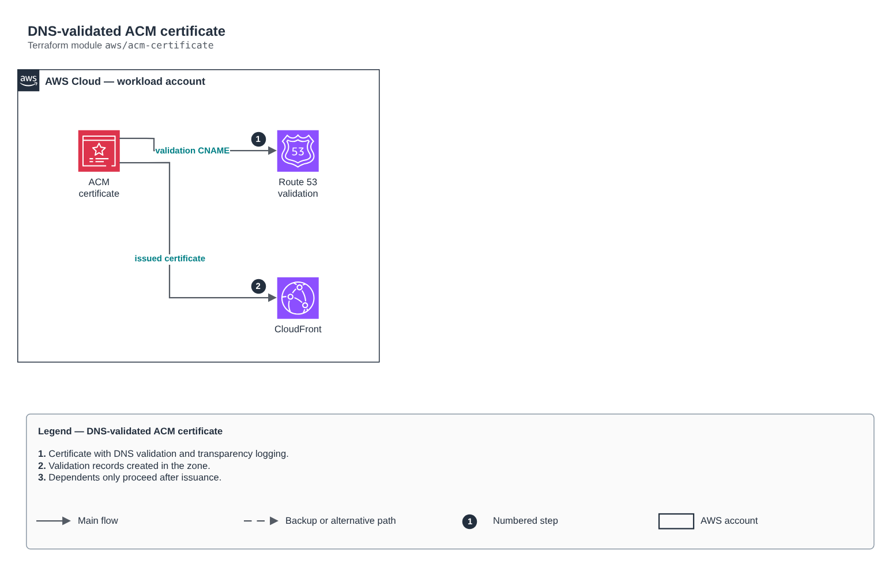

# DNS-validated ACM certificate

[Português](README.md) · **English**

> `aws/acm-certificate` · category **borda** · origin: Health records platform (2026)

> Designed in November 2026 and published now.

ACM certificate validated through DNS in a Route 53 zone. For CloudFront, create it with a us-east-1 provider. Validation waits for the certificate to be issued before releasing dependents.

## Architecture



Editable source: [`diagram.drawio`](diagram.drawio) (open it in draw.io / diagrams.net), with Portuguese and English pages.

1. Certificate with DNS validation and transparency logging.
2. Validation records created in the zone.
3. Dependents only proceed after issuance.

## Usage

```hcl
module "acm_certificate" {
  source = "git::https://github.com/raphaelfcs/automacao_terraform.git//aws/acm-certificate?ref=v1.0.0"

  domain_name = "app.example.com"
  zone_id     = "Z0123456789ABCDEFGHIJ"
  tags        = local.tags
}
```

## Examples

| Example | Files |
|---|---|
| [`cloudfront`](examples/cloudfront) | `main.tf`, `locals.tf`, `backend.tf` |

Each example has its own backend (state isolated per module and example). Different environments only use another `backend.tf`/`*.tfvars`, without duplicating code.

## Inputs

| Name | Type | Default | Required | Description |
|---|---|---|---|---|
| `domain_name` | `string` | - | **yes** | Certificate main name. |
| `subject_alternative_names` | `list(string)` | `[]` | no | Additional names. |
| `zone_id` | `string` | - | **yes** | Route 53 zone that holds the validation records. |
| `key_algorithm` | `string` | `"RSA_2048"` | no | RSA_2048 or EC_prime256v1. |
| `tags` | `map(string)` | `{}` | no | Tags applied. |

## Outputs

| Name | Description |
|---|---|
| `certificate_arn` | ARN of the already validated certificate. |

## Files

- `main.tf`: main resources
- `outputs.tf`: outputs
- `variables.tf`: inputs and validations
- `versions.tf`: Terraform and provider versions
- `examples/`: ready-to-use compositions
- `tests/`: `terraform test` with mocked providers

## Well-Architected

- Security: private origin, WAF and modern TLS at the edge.
- Performance: edge caching and compression.

## Tests

```bash
cd aws/acm-certificate
terraform init -backend=false
terraform test
```
