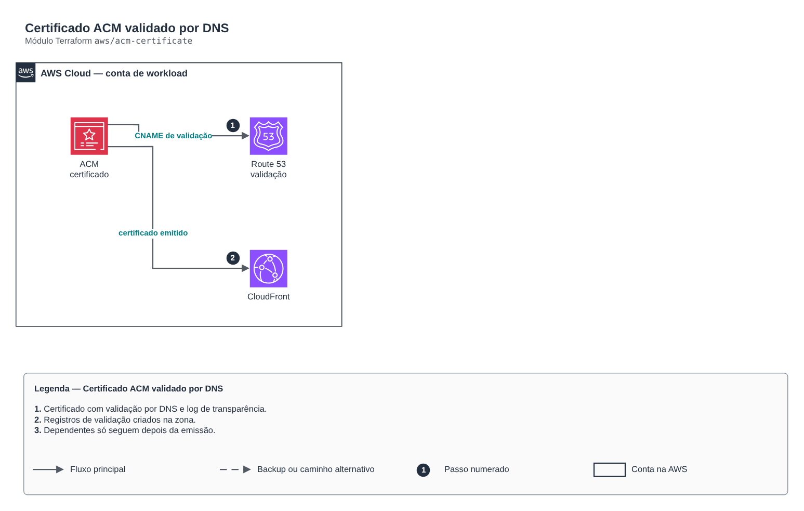

# Certificado ACM validado por DNS

**Português** · [English](README.en.md)

> `aws/acm-certificate` · categoria **borda** · origem: Plataforma de documentos de saúde (2026)

> Idealizado em novembro de 2026 e publicado agora.

Certificado ACM validado por DNS numa zona do Route 53. Para CloudFront, crie com provider em us-east-1. A validação espera o certificado ficar emitido antes de liberar dependentes.

## Arquitetura



Fonte editável: [`diagram.drawio`](diagram.drawio) (abra no draw.io / diagrams.net), com páginas em português e inglês.

1. Certificado com validação por DNS e log de transparência.
2. Registros de validação criados na zona.
3. Dependentes só seguem depois da emissão.

## Uso

```hcl
module "acm_certificate" {
  source = "git::https://github.com/raphaelfcs/automacao_terraform.git//aws/acm-certificate?ref=v1.0.0"

  domain_name = "app.example.com"
  zone_id     = "Z0123456789ABCDEFGHIJ"
  tags        = local.tags
}
```

## Exemplos

| Exemplo | Arquivos |
|---|---|
| [`cloudfront`](examples/cloudfront) | `main.tf`, `locals.tf`, `backend.tf` |

Cada exemplo tem seu próprio backend (state isolado por módulo e exemplo). Ambientes diferentes usam apenas outro `backend.tf`/`*.tfvars`, sem duplicar código.

## Entradas

| Nome | Tipo | Padrão | Obrigatória | Descrição |
|---|---|---|---|---|
| `domain_name` | `string` | - | **sim** | Nome principal do certificado. |
| `subject_alternative_names` | `list(string)` | `[]` | não | Nomes adicionais. |
| `zone_id` | `string` | - | **sim** | Zona do Route 53 onde ficam os registros de validação. |
| `key_algorithm` | `string` | `"RSA_2048"` | não | RSA_2048 ou EC_prime256v1. |
| `tags` | `map(string)` | `{}` | não | Tags aplicadas. |

## Saídas

| Nome | Descrição |
|---|---|
| `certificate_arn` | ARN do certificado já validado. |

## Arquivos

- `main.tf`: recursos principais
- `outputs.tf`: saídas
- `variables.tf`: entradas e validações
- `versions.tf`: versões do Terraform e providers
- `examples/`: composições prontas para uso
- `tests/`: `terraform test` com providers simulados

## Well-Architected

- Segurança: origem privada, WAF e TLS moderno na borda.
- Performance: cache na borda e compressão.

## Testes

```bash
cd aws/acm-certificate
terraform init -backend=false
terraform test
```
