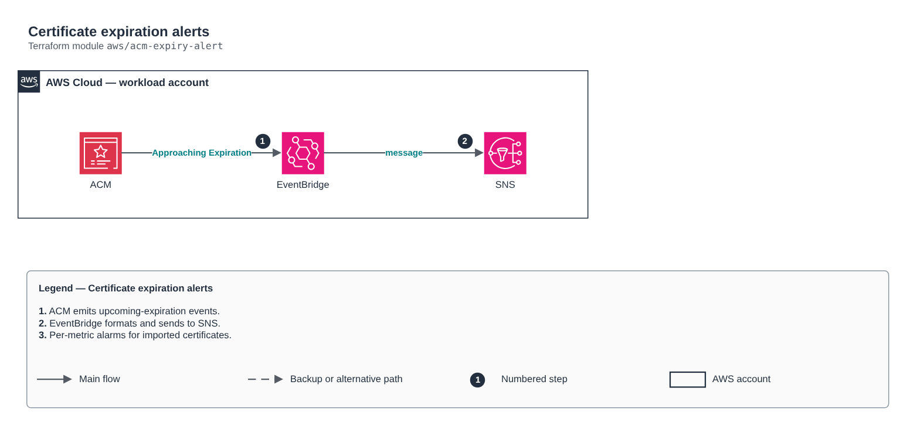

# Certificate expiration alerts

[Português](README.md) · **English**

> `aws/acm-expiry-alert` · category **automacao** · origin: Retail, migration to AWS (2017-2018)

> Designed in December 2017. With no time to keep the repository up to date back then, it is being published and updated now.

Code-free certificate expiration alerts: ACM emits "ACM Certificate Approaching Expiration" events (45 days ahead by default, daily until expiry), routed through EventBridge to SNS. Replaces the Lambda that scanned ACM and counted remaining days. Includes a DaysToExpiry metric alarm for imported certificates.

## Architecture



Editable source: [`diagram.drawio`](diagram.drawio) (open it in draw.io / diagrams.net), with Portuguese and English pages.

1. ACM emits upcoming-expiration events.
2. EventBridge formats and sends to SNS.
3. Per-metric alarms for imported certificates.

## Usage

```hcl
module "acm_expiry_alert" {
  source = "git::https://github.com/raphaelfcs/automacao_terraform.git//aws/acm-expiry-alert?ref=v1.0.0"

  name_prefix     = local.name_prefix
  alert_topic_arn = "arn:aws:sns:sa-east-1:123456789012:demo-dev-alertas"
  tags            = local.tags
}
```

## Examples

| Example | Files |
|---|---|
| [`basico`](examples/basico) | `main.tf`, `locals.tf`, `backend.tf` |

Each example has its own backend (state isolated per module and example). Different environments only use another `backend.tf`/`*.tfvars`, without duplicating code.

## Inputs

| Name | Type | Default | Required | Description |
|---|---|---|---|---|
| `name_prefix` | `string` | - | **yes** | Resource prefix. |
| `alert_topic_arn` | `string` | - | **yes** | SNS topic (its policy must allow events.amazonaws.com and cloudwatch.amazonaws.com). |
| `certificate_arns` | `list(string)` | `[]` | no | Certificates monitored by a DaysToExpiry alarm (optional). |
| `days_threshold` | `number` | `30` | no | Minimum days before expiration for the alarm. |
| `tags` | `map(string)` | `{}` | no | Tags applied. |

## Outputs

| Name | Description |
|---|---|
| `event_rule_arn` | EventBridge rule ARN. |

## Files

- `main.tf`: main resources
- `outputs.tf`: outputs
- `variables.tf`: inputs and validations
- `versions.tf`: Terraform and provider versions
- `examples/`: ready-to-use compositions
- `tests/`: `terraform test` with mocked providers

## Well-Architected

- Operational excellence: manual routine replaced by a managed service or a least-privilege function.
- Cost optimization: on-demand/scheduled execution, no servers running.

## Tests

```bash
cd aws/acm-expiry-alert
terraform init -backend=false
terraform test
```
