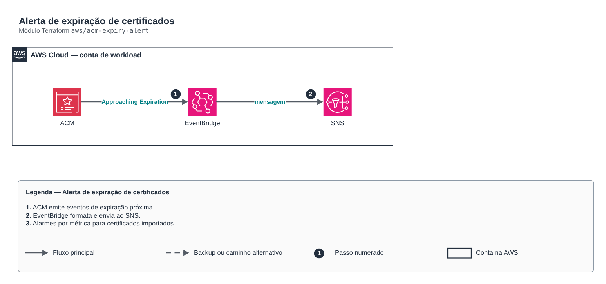

# Alerta de expiração de certificados

**Português** · [English](README.en.md)

> `aws/acm-expiry-alert` · categoria **automacao** · origem: Varejo, migração para AWS (2017-2018)

> Idealizado em dezembro de 2017. Por falta de tempo para manter o repositório em dia na época, está sendo publicado e atualizado agora.

Alerta de expiração de certificados sem código: o ACM emite eventos "ACM Certificate Approaching Expiration" (45 dias antes por padrão, diariamente até expirar) e o Security Hub/Config podem complementar. Substitui a Lambda que varria o ACM e calculava os dias restantes. Inclui alarme por métrica DaysToExpiry para certificados importados.

## Arquitetura



Fonte editável: [`diagram.drawio`](diagram.drawio) (abra no draw.io / diagrams.net), com páginas em português e inglês.

1. ACM emite eventos de expiração próxima.
2. EventBridge formata e envia ao SNS.
3. Alarmes por métrica para certificados importados.

## Uso

```hcl
module "acm_expiry_alert" {
  source = "git::https://github.com/raphaelfcs/automacao_terraform.git//aws/acm-expiry-alert?ref=v1.0.0"

  name_prefix     = local.name_prefix
  alert_topic_arn = "arn:aws:sns:sa-east-1:123456789012:demo-dev-alertas"
  tags            = local.tags
}
```

## Exemplos

| Exemplo | Arquivos |
|---|---|
| [`basico`](examples/basico) | `main.tf`, `locals.tf`, `backend.tf` |

Cada exemplo tem seu próprio backend (state isolado por módulo e exemplo). Ambientes diferentes usam apenas outro `backend.tf`/`*.tfvars`, sem duplicar código.

## Entradas

| Nome | Tipo | Padrão | Obrigatória | Descrição |
|---|---|---|---|---|
| `name_prefix` | `string` | - | **sim** | Prefixo dos recursos. |
| `alert_topic_arn` | `string` | - | **sim** | Tópico SNS (a política deve permitir events.amazonaws.com e cloudwatch.amazonaws.com). |
| `certificate_arns` | `list(string)` | `[]` | não | Certificados monitorados por alarme de DaysToExpiry (opcional). |
| `days_threshold` | `number` | `30` | não | Dias mínimos antes da expiração para o alarme. |
| `tags` | `map(string)` | `{}` | não | Tags aplicadas. |

## Saídas

| Nome | Descrição |
|---|---|
| `event_rule_arn` | ARN da regra do EventBridge. |

## Arquivos

- `main.tf`: recursos principais
- `outputs.tf`: saídas
- `variables.tf`: entradas e validações
- `versions.tf`: versões do Terraform e providers
- `examples/`: composições prontas para uso
- `tests/`: `terraform test` com providers simulados

## Well-Architected

- Excelência operacional: rotina manual substituída por serviço gerenciado ou função com permissões mínimas.
- Otimização de custos: execução sob demanda/agendada, sem servidores ligados.

## Testes

```bash
cd aws/acm-expiry-alert
terraform init -backend=false
terraform test
```
