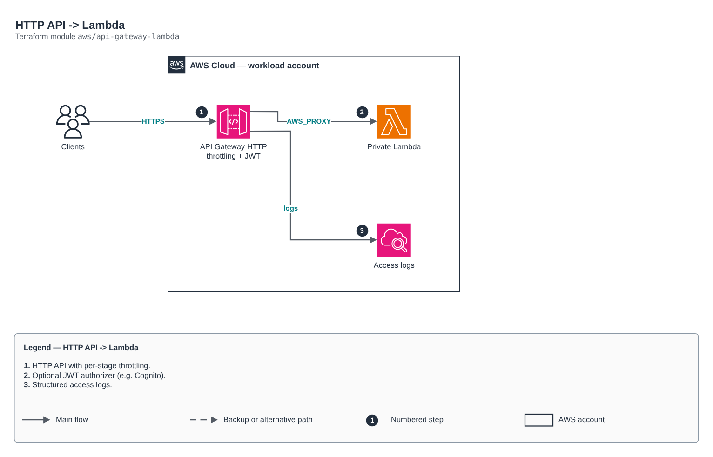

# HTTP API -> Lambda

[Português](README.md) · **English**

> `aws/api-gateway-lambda` · category **integracao** · origin: Technical challenge (2024)

> Designed in June 2024. With no time to keep the repository up to date back then, it is being published and updated now.

Public HTTP API (API Gateway v2) with proxy integration to a Lambda (which may live in a private subnet). Includes structured access logs, per-stage throttling and an optional custom domain. HTTP API costs ~70% less than REST API for simple proxying.

## Architecture



Editable source: [`diagram.drawio`](diagram.drawio) (open it in draw.io / diagrams.net), with Portuguese and English pages.

1. HTTP API with per-stage throttling.
2. Optional JWT authorizer (e.g. Cognito).
3. Structured access logs.

## Usage

```hcl
module "api_gateway_lambda" {
  source = "git::https://github.com/raphaelfcs/automacao_terraform.git//aws/api-gateway-lambda?ref=v1.0.0"

  name                 = "demo-dev-api"
  lambda_function_name = "demo-dev-processa"
  lambda_invoke_arn    = "arn:aws:apigateway:sa-east-1:lambda:path/2015-03-31/functions/arn:aws:lambda:sa-east-1:123456789012:function:demo-dev-processa/invocations"
  tags                 = local.tags
}
```

## Examples

| Example | Files |
|---|---|
| [`publica`](examples/publica) | `main.tf`, `locals.tf`, `backend.tf` |
| [`jwt-cognito`](examples/jwt-cognito) | `main.tf`, `locals.tf`, `backend.tf` |

Each example has its own backend (state isolated per module and example). Different environments only use another `backend.tf`/`*.tfvars`, without duplicating code.

## Inputs

| Name | Type | Default | Required | Description |
|---|---|---|---|---|
| `name` | `string` | - | **yes** | API name. |
| `description` | `string` | `""` | no | API description. |
| `lambda_function_name` | `string` | - | **yes** | Backend Lambda name. |
| `lambda_invoke_arn` | `string` | - | **yes** | Backend Lambda invoke_arn. |
| `routes` | `list(string)` | `["ANY /{proxy+}"]` | no | Routes ("METHOD /path"). "$default" catches everything. |
| `stage_name` | `string` | `"$default"` | no | Stage name ("$default" = no URL prefix). |
| `jwt_authorizer` | `object(...)` | `null` | no | JWT authorizer (e.g. Cognito: issuer = issuer_uri, audience = [client_id]). null = open API. |
| `cors_allow_origins` | `list(string)` | `[]` | no | Allowed CORS origins. Empty = no CORS. |
| `integration_timeout_ms` | `number` | `29000` | no | Integration timeout (max 30000). |
| `throttling_burst_limit` | `number` | `100` | no | Request burst. |
| `throttling_rate_limit` | `number` | `50` | no | Requests per second. |
| `kms_key_arn` | `string` | `null` | no | KMS key of the access log group. |
| `log_retention_days` | `number` | `30` | no | Access log retention. |
| `tags` | `map(string)` | `{}` | no | Tags applied. |

## Outputs

| Name | Description |
|---|---|
| `api_id` | API ID. |
| `invoke_url` | Stage invoke URL. |

## Files

- `iam.tf`: policies, roles and permissions
- `main.tf`: main resources
- `outputs.tf`: outputs
- `variables.tf`: inputs and validations
- `versions.tf`: Terraform and provider versions
- `examples/`: ready-to-use compositions
- `tests/`: `terraform test` with mocked providers

## Well-Architected

- Reliability: dead-letter queues (DLQ), retries and event archiving.
- Security: resource policies restricted by source and message encryption.

## Tests

```bash
cd aws/api-gateway-lambda
terraform init -backend=false
terraform test
```
