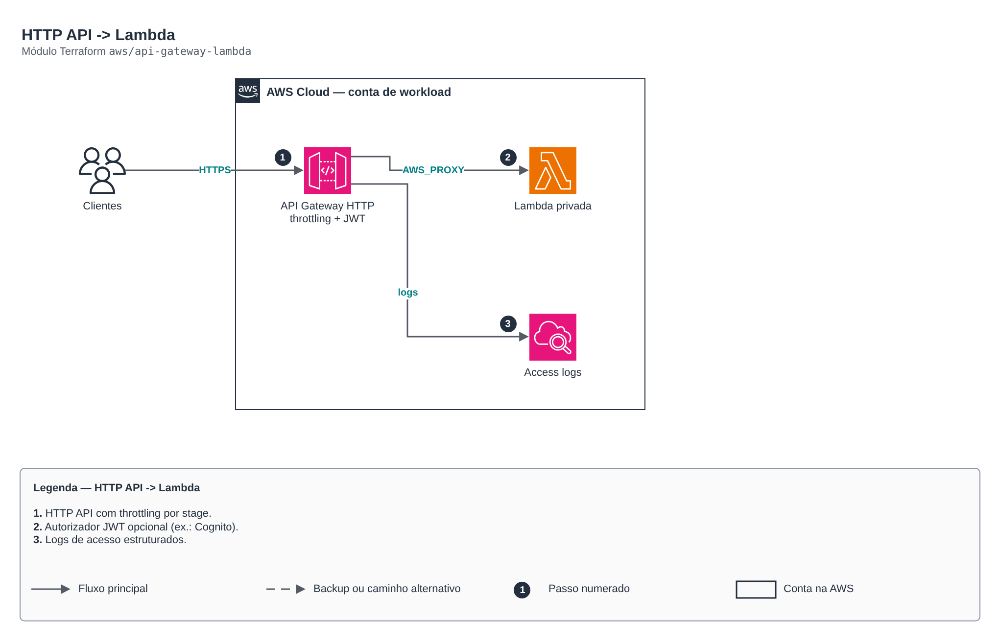

# HTTP API -> Lambda

> `aws/api-gateway-lambda` · categoria **integracao** · origem: Desafio técnico (2024)

> Idealizado em junho de 2024. Por falta de tempo para manter o repositório em dia na época, está sendo publicado e atualizado agora.

API pública HTTP (API Gateway v2) com integração proxy para uma Lambda (pode estar em subnet privada). Inclui logs de acesso estruturados, throttling por stage e domínio customizado opcional. HTTP API custa ~70% menos que REST API para proxy simples.

## Arquitetura



Fonte editável: [`diagram.drawio`](diagram.drawio) (abra no draw.io / diagrams.net).

1. HTTP API com throttling por stage.
2. Autorizador JWT opcional (ex.: Cognito).
3. Logs de acesso estruturados.

## Uso

```hcl
module "api_gateway_lambda" {
  source = "git::https://github.com/raphaelfcs/automacao_terraform.git//aws/api-gateway-lambda?ref=v1.0.0"

  name                 = "demo-dev-api"
  lambda_function_name = "demo-dev-processa"
  lambda_invoke_arn    = "arn:aws:apigateway:sa-east-1:lambda:path/2015-03-31/functions/arn:aws:lambda:sa-east-1:123456789012:function:demo-dev-processa/invocations"
  tags                 = local.tags
}
```

## Exemplos

| Exemplo | Arquivos |
|---|---|
| [`publica`](examples/publica) | `main.tf`, `locals.tf`, `backend.tf` |
| [`jwt-cognito`](examples/jwt-cognito) | `main.tf`, `locals.tf`, `backend.tf` |

Cada exemplo tem seu próprio backend (state isolado por módulo e exemplo). Ambientes diferentes usam apenas outro `backend.tf`/`*.tfvars`, sem duplicar código.

## Entradas

| Nome | Tipo | Padrão | Obrigatória | Descrição |
|---|---|---|---|---|
| `name` | `string` | - | **sim** | Nome da API. |
| `description` | `string` | `""` | não | Descrição da API. |
| `lambda_function_name` | `string` | - | **sim** | Nome da Lambda de backend. |
| `lambda_invoke_arn` | `string` | - | **sim** | invoke_arn da Lambda de backend. |
| `routes` | `list(string)` | `["ANY /{proxy+}"]` | não | Rotas ("METODO /caminho"). "$default" captura tudo. |
| `stage_name` | `string` | `"$default"` | não | Nome do stage ("$default" = sem prefixo na URL). |
| `jwt_authorizer` | `object(...)` | `null` | não | Autorizador JWT (ex.: Cognito: issuer = issuer_uri, audience = [client_id]). null = API aberta. |
| `cors_allow_origins` | `list(string)` | `[]` | não | Origens CORS permitidas. Vazio = sem CORS. |
| `integration_timeout_ms` | `number` | `29000` | não | Timeout da integração (máx. 30000). |
| `throttling_burst_limit` | `number` | `100` | não | Burst de requisições. |
| `throttling_rate_limit` | `number` | `50` | não | Requisições por segundo. |
| `kms_key_arn` | `string` | `null` | não | Chave KMS do log group de acesso. |
| `log_retention_days` | `number` | `30` | não | Retenção dos logs de acesso. |
| `tags` | `map(string)` | `{}` | não | Tags aplicadas. |

## Saídas

| Nome | Descrição |
|---|---|
| `api_id` | ID da API. |
| `invoke_url` | URL de invocação do stage. |

## Arquivos

- `iam.tf`: políticas, papéis e permissões
- `main.tf`: recursos principais
- `outputs.tf`: saídas
- `variables.tf`: entradas e validações
- `versions.tf`: versões do Terraform e providers
- `examples/`: composições prontas para uso
- `tests/`: `terraform test` com providers simulados

## Well-Architected

- Confiabilidade: filas de mensagens mortas (DLQ), retentativas e arquivamento de eventos.
- Segurança: políticas de recurso restritas por origem e cifragem das mensagens.

## Testes

```bash
cd aws/api-gateway-lambda
terraform init -backend=false
terraform test
```
