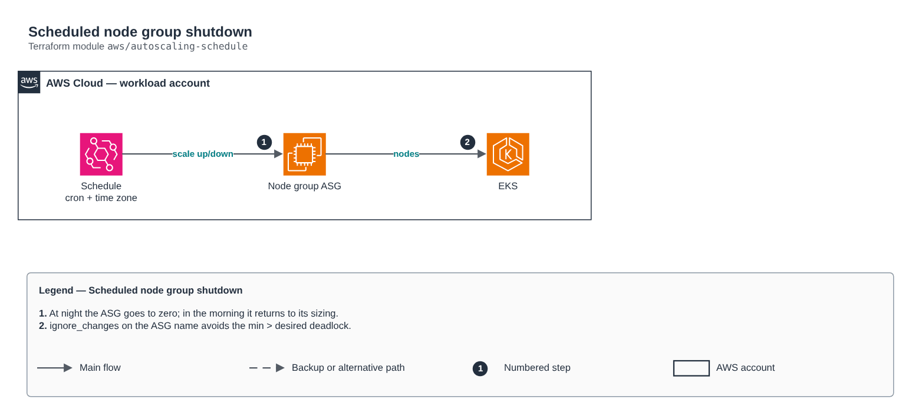

# Scheduled node group shutdown

[Português](README.md) · **English**

> `aws/autoscaling-schedule` · category **finops** · origin: Telecom microservices platform (2026)

> Designed in August 2026 and published now.

Scheduled shutdown of EKS node groups: scheduled actions on the Auto Scaling group scale the node group to zero at night and restore its sizing in the morning, in the given time zone.

## Architecture



Editable source: [`diagram.drawio`](diagram.drawio) (open it in draw.io / diagrams.net), with Portuguese and English pages.

1. At night the ASG goes to zero; in the morning it returns to its sizing.
2. ignore_changes on the ASG name avoids the min > desired deadlock.

## Usage

```hcl
module "autoscaling_schedule" {
  source = "git::https://github.com/raphaelfcs/automacao_terraform.git//aws/autoscaling-schedule?ref=v1.0.0"

  cluster_name        = "demo-dev"
  node_group_names    = { apps = "demo-dev-apps" }
  up_cron             = "0 7 * * MON-FRI"
  down_cron           = "0 20 * * MON-FRI"
  timezone            = "America/Sao_Paulo"
  up_min_size         = 1
  up_desired_capacity = 2
  up_max_size         = 4
}
```

## Examples

| Example | Files |
|---|---|
| [`horario-comercial`](examples/horario-comercial) | `main.tf`, `locals.tf`, `backend.tf` |

Each example has its own backend (state isolated per module and example). Different environments only use another `backend.tf`/`*.tfvars`, without duplicating code.

## Inputs

| Name | Type | Default | Required | Description |
|---|---|---|---|---|
| `cluster_name` | `string` | - | **yes** | Cluster whose node groups join the window. |
| `node_group_names` | `map(string)` | - | **yes** | Node groups in the window, by stable key (typically the AZ). The FULL node group name, as the eks module creates it: `<cluster>-<pool key>`. |
| `enabled` | `bool` | `true` | no | Turns on the scheduled actions. FALSE keeps the cluster 24x7 — which is what you want while the environment is in staging with a night window. |
| `up_cron` | `string` | `"0 8 * * 1-5"` | no | Scale-up cron, in the `timezone` time zone. Autoscaling format: `minute hour day month day-of-week`. |
| `down_cron` | `string` | `"45 23 * * 1-5"` | no | Scale-down cron. Friday's scale-down is what clears the weekend: there is no Saturday action, the next scale-up is only on Monday. |
| `timezone` | `string` | `"America/Sao_Paulo"` | no | Time zone of the actions. 🔴 IANA name, never an offset: survives daylight-saving rule changes without anyone reapplying. Without it AWS reads the cron as UTC and the window shifts by three hours. |
| `up_min_size` | `number` | `1` | no | Minimum restored at scale-up, PER node group. |
| `up_desired_capacity` | `number` | `1` | no | Desired restored at scale-up, PER node group. |
| `up_max_size` | `number` | `2` | no | Maximum restored at scale-up, PER node group. |

## Outputs

| Name | Description |
|---|---|
| `janela` | The window in one line, for the root output and the runbook. |
| `asg_names` | Scheduled ASGs, by pool key. Empty means no action was created. |
| `acoes` | Names of the scheduled actions created. Check in AWS with `aws autoscaling describe-scheduled-actions --auto-scaling-group-name <asg>`. |

## Files

- `locals.tf`: derived values
- `main.tf`: main resources
- `outputs.tf`: outputs
- `variables.tf`: inputs and validations
- `versions.tf`: Terraform and provider versions
- `examples/`: ready-to-use compositions
- `tests/`: `terraform test` with mocked providers

## Well-Architected

- Cost optimization: resources off after hours, tag-based allocation and FOCUS reports.
- Sustainability: less idle capacity running.

## Tests

```bash
cd aws/autoscaling-schedule
terraform init -backend=false
terraform test
```
