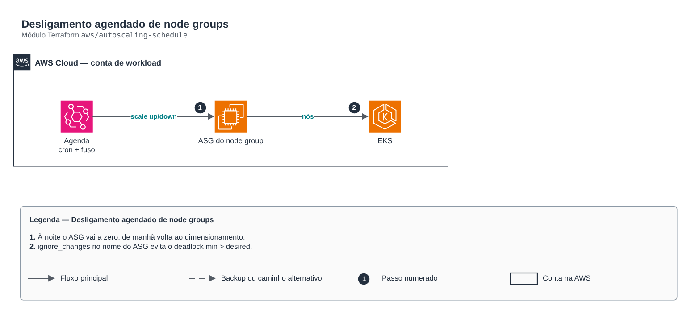

# Desligamento agendado de node groups

**Português** · [English](README.en.md)

> `aws/autoscaling-schedule` · categoria **finops** · origem: Plataforma de microsserviços em telecom (2026)

> Idealizado em agosto de 2026 e publicado agora.

Desligamento agendado de node groups EKS: ações agendadas no Auto Scaling group zeram o node group à noite e restauram o dimensionamento de manhã, no fuso informado.

## Arquitetura



Fonte editável: [`diagram.drawio`](diagram.drawio) (abra no draw.io / diagrams.net), com páginas em português e inglês.

1. À noite o ASG vai a zero; de manhã volta ao dimensionamento.
2. ignore_changes no nome do ASG evita o deadlock min > desired.

## Uso

```hcl
module "autoscaling_schedule" {
  source = "git::https://github.com/raphaelfcs/automacao_terraform.git//aws/autoscaling-schedule?ref=v1.0.0"

  cluster_name        = "demo-dev"
  node_group_names    = { apps = "demo-dev-apps" }
  up_cron             = "0 7 * * MON-FRI"
  down_cron           = "0 20 * * MON-FRI"
  timezone            = "America/Sao_Paulo"
  up_min_size         = 1
  up_desired_capacity = 2
  up_max_size         = 4
}
```

## Exemplos

| Exemplo | Arquivos |
|---|---|
| [`horario-comercial`](examples/horario-comercial) | `main.tf`, `locals.tf`, `backend.tf` |

Cada exemplo tem seu próprio backend (state isolado por módulo e exemplo). Ambientes diferentes usam apenas outro `backend.tf`/`*.tfvars`, sem duplicar código.

## Entradas

| Nome | Tipo | Padrão | Obrigatória | Descrição |
|---|---|---|---|---|
| `cluster_name` | `string` | - | **sim** | Cluster cujos node groups entram na janela. |
| `node_group_names` | `map(string)` | - | **sim** | Node groups da janela, por chave estavel (tipicamente a AZ). O NOME COMPLETO do node group, como o modulo eks o cria: `<cluster>-<chave do pool>`. |
| `enabled` | `bool` | `true` | não | Liga as acoes agendadas. FALSE deixa o cluster 24x7 — e o que se quer quando o ambiente estiver em homologacao com janela noturna. |
| `up_cron` | `string` | `"0 8 * * 1-5"` | não | Cron da subida, no fuso de `timezone`. Formato do autoscaling: `minuto hora dia mes dia-da-semana`. |
| `down_cron` | `string` | `"45 23 * * 1-5"` | não | Cron da descida. A descida de sexta e o que zera o fim de semana: nao existe acao de sabado, a proxima subida e so na segunda. |
| `timezone` | `string` | `"America/Sao_Paulo"` | não | Fuso das acoes. 🔴 Nome IANA, nunca offset: sobrevive a mudanca de regra de horario de verao sem ninguem reaplicar. Sem este campo a AWS interpreta o cron em UTC, e a janela sai tres horas deslocada. |
| `up_min_size` | `number` | `1` | não | Minimo restaurado na subida, POR node group. |
| `up_desired_capacity` | `number` | `1` | não | Desejado restaurado na subida, POR node group. |
| `up_max_size` | `number` | `2` | não | Teto restaurado na subida, POR node group. |

## Saídas

| Nome | Descrição |
|---|---|
| `janela` | A janela em uma linha, para o output da raiz e para o runbook. |
| `asg_names` | ASGs sob agendamento, por chave de pool. Vazio significa que nenhuma acao foi criada. |
| `acoes` | Nomes das acoes agendadas criadas. Confira na AWS com `aws autoscaling describe-scheduled-actions --auto-scaling-group-name <asg>`. |

## Arquivos

- `locals.tf`: valores derivados
- `main.tf`: recursos principais
- `outputs.tf`: saídas
- `variables.tf`: entradas e validações
- `versions.tf`: versões do Terraform e providers
- `examples/`: composições prontas para uso
- `tests/`: `terraform test` com providers simulados

## Well-Architected

- Otimização de custos: recursos desligados fora do horário, alocação por tags e relatórios no padrão FOCUS.
- Sustentabilidade: menos capacidade ociosa ligada.

## Testes

```bash
cd aws/autoscaling-schedule
terraform init -backend=false
terraform test
```
