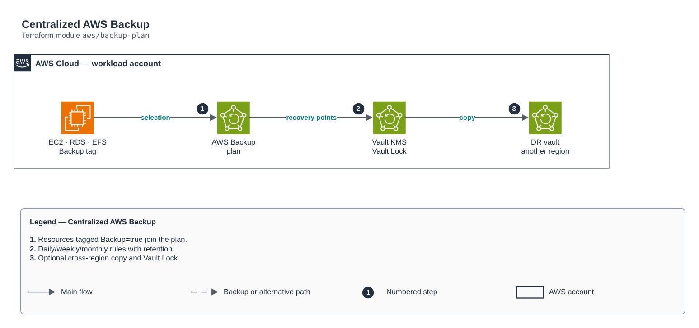

# Centralized AWS Backup

[Português](README.md) · **English**

> `aws/backup-plan` · category **automacao** · origin: Retail, migration to AWS (2017-2018)

> Designed in May 2018. With no time to keep the repository up to date back then, it is being published and updated now.

Native AWS Backup instead of the old daily AMI Lambdas: KMS-encrypted vault (optional Vault Lock for immutability/ransomware), daily/weekly/monthly rules, cross-region/account copy (DR) and tag-based selection. Covers EC2, EBS, RDS, Aurora, DynamoDB, EFS and S3 with centralized retention and lifecycle.

## Architecture



Editable source: [`diagram.drawio`](diagram.drawio) (open it in draw.io / diagrams.net), with Portuguese and English pages.

1. Resources tagged Backup=true join the plan.
2. Daily/weekly/monthly rules with retention.
3. Optional cross-region copy and Vault Lock.

## Usage

```hcl
module "backup_plan" {
  source = "git::https://github.com/raphaelfcs/automacao_terraform.git//aws/backup-plan?ref=v1.0.0"

  name_prefix            = local.name_prefix
  kms_key_arn            = "arn:aws:kms:sa-east-1:123456789012:key/11111111-2222-3333-4444-555555555555"
  notification_topic_arn = "arn:aws:sns:sa-east-1:123456789012:demo-dev-alertas"
  tags                   = local.tags
}
```

## Examples

| Example | Files |
|---|---|
| [`basico`](examples/basico) | `main.tf`, `locals.tf`, `backend.tf` |

Each example has its own backend (state isolated per module and example). Different environments only use another `backend.tf`/`*.tfvars`, without duplicating code.

## Inputs

| Name | Type | Default | Required | Description |
|---|---|---|---|---|
| `name_prefix` | `string` | - | **yes** | Resource prefix. |
| `kms_key_arn` | `string` | - | **yes** | Vault KMS key. |
| `timezone` | `string` | `"America/Sao_Paulo"` | no | Time zone of the cron expressions. |
| `rules` | `map(...)` | `{ diario = { schedule = "cron(0 3 * *...` | no | Plan rules by name. |
| `selection_tag_key` | `string` | `"Backup"` | no | Tag that includes the resource in the plan. |
| `selection_tag_value` | `string` | `"true"` | no | Selection tag value. |
| `copy_destination_vault_arn` | `string` | `null` | no | Target vault for copies (another region/account, DR). null = no copy. |
| `vault_lock` | `object(...)` | `null` | no | Vault Lock (governance mode while changeable_for_days has not expired; then compliance/immutable). |
| `vault_admin_role_arns` | `list(string)` | `[]` | no | Roles that may delete recovery points (everything else is denied). |
| `notification_topic_arn` | `string` | `null` | no | SNS topic for backup/copy failures. |
| `tags` | `map(string)` | `{}` | no | Tags applied. |

## Outputs

| Name | Description |
|---|---|
| `vault_arn` | Vault ARN. |
| `plan_id` | Plan ID. |
| `backup_role_arn` | Role used by AWS Backup. |

## Files

- `iam.tf`: policies, roles and permissions
- `main.tf`: main resources
- `outputs.tf`: outputs
- `variables.tf`: inputs and validations
- `versions.tf`: Terraform and provider versions
- `examples/`: ready-to-use compositions
- `tests/`: `terraform test` with mocked providers

## Well-Architected

- Operational excellence: manual routine replaced by a managed service or a least-privilege function.
- Cost optimization: on-demand/scheduled execution, no servers running.

## Tests

```bash
cd aws/backup-plan
terraform init -backend=false
terraform test
```
