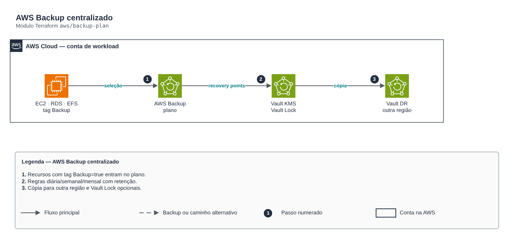

# AWS Backup centralizado

**Português** · [English](README.en.md)

> `aws/backup-plan` · categoria **automacao** · origem: Varejo, migração para AWS (2017-2018)

> Idealizado em maio de 2018. Por falta de tempo para manter o repositório em dia na época, está sendo publicado e atualizado agora.

AWS Backup nativo no lugar das antigas Lambdas de AMI diária: vault cifrado com KMS (Vault Lock opcional para imutabilidade/ransomware), plano com regras diária/semanal/ mensal, cópia para outra região/conta (DR) e seleção por tag. Cobre EC2, EBS, RDS, Aurora, DynamoDB, EFS e S3 com retenção e ciclo de vida centralizados.

## Arquitetura



Fonte editável: [`diagram.drawio`](diagram.drawio) (abra no draw.io / diagrams.net), com páginas em português e inglês.

1. Recursos com tag Backup=true entram no plano.
2. Regras diária/semanal/mensal com retenção.
3. Cópia para outra região e Vault Lock opcionais.

## Uso

```hcl
module "backup_plan" {
  source = "git::https://github.com/raphaelfcs/automacao_terraform.git//aws/backup-plan?ref=v1.0.0"

  name_prefix            = local.name_prefix
  kms_key_arn            = "arn:aws:kms:sa-east-1:123456789012:key/11111111-2222-3333-4444-555555555555"
  notification_topic_arn = "arn:aws:sns:sa-east-1:123456789012:demo-dev-alertas"
  tags                   = local.tags
}
```

## Exemplos

| Exemplo | Arquivos |
|---|---|
| [`basico`](examples/basico) | `main.tf`, `locals.tf`, `backend.tf` |

Cada exemplo tem seu próprio backend (state isolado por módulo e exemplo). Ambientes diferentes usam apenas outro `backend.tf`/`*.tfvars`, sem duplicar código.

## Entradas

| Nome | Tipo | Padrão | Obrigatória | Descrição |
|---|---|---|---|---|
| `name_prefix` | `string` | - | **sim** | Prefixo dos recursos. |
| `kms_key_arn` | `string` | - | **sim** | Chave KMS do vault. |
| `timezone` | `string` | `"America/Sao_Paulo"` | não | Fuso das expressões cron. |
| `rules` | `map(...)` | `{ diario = { schedule = "cron(0 3 * *...` | não | Regras do plano por nome. |
| `selection_tag_key` | `string` | `"Backup"` | não | Tag que inclui o recurso no plano. |
| `selection_tag_value` | `string` | `"true"` | não | Valor da tag de seleção. |
| `copy_destination_vault_arn` | `string` | `null` | não | Vault de destino para cópia (outra região/conta, DR). null = sem cópia. |
| `vault_lock` | `object(...)` | `null` | não | Vault Lock (modo governance enquanto changeable_for_days não expira; depois compliance/imutável). |
| `vault_admin_role_arns` | `list(string)` | `[]` | não | Roles que podem apagar recovery points (o resto é negado). |
| `notification_topic_arn` | `string` | `null` | não | Tópico SNS para falhas de backup/cópia. |
| `tags` | `map(string)` | `{}` | não | Tags aplicadas. |

## Saídas

| Nome | Descrição |
|---|---|
| `vault_arn` | ARN do vault. |
| `plan_id` | ID do plano. |
| `backup_role_arn` | Role usada pelo AWS Backup. |

## Arquivos

- `iam.tf`: políticas, papéis e permissões
- `main.tf`: recursos principais
- `outputs.tf`: saídas
- `variables.tf`: entradas e validações
- `versions.tf`: versões do Terraform e providers
- `examples/`: composições prontas para uso
- `tests/`: `terraform test` com providers simulados

## Well-Architected

- Excelência operacional: rotina manual substituída por serviço gerenciado ou função com permissões mínimas.
- Otimização de custos: execução sob demanda/agendada, sem servidores ligados.

## Testes

```bash
cd aws/backup-plan
terraform init -backend=false
terraform test
```
