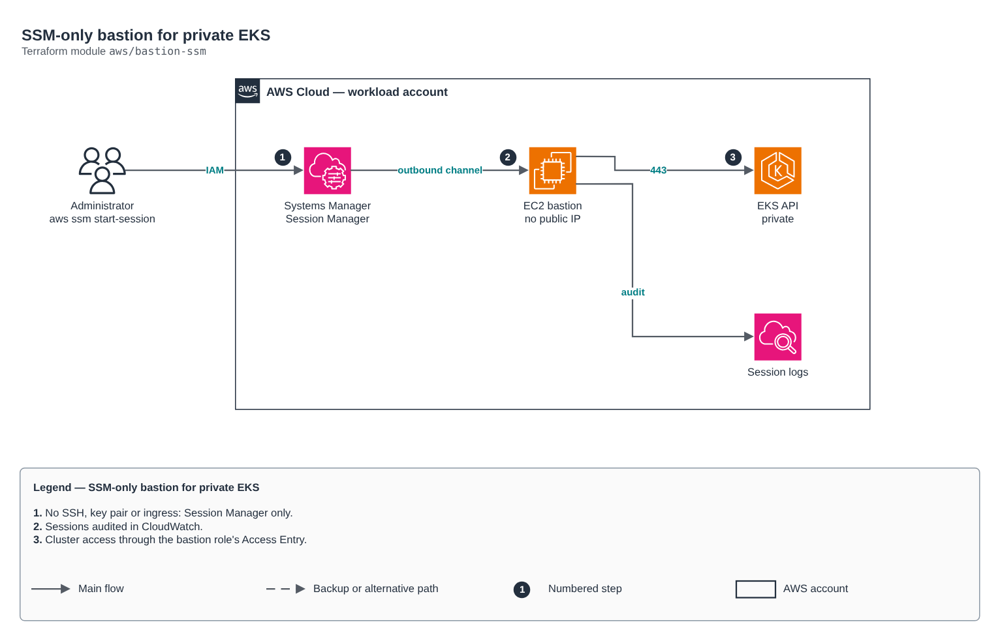

# SSM-only bastion for private EKS

[Português](README.md) · **English**

> `aws/bastion-ssm` · category **containers** · origin: Telecom microservices platform (2026)

> Designed in August 2026 and published now.

"SSM-only" bastion to manage a private EKS cluster: private subnet, no public IP, no key pair, SG without ingress, IMDSv2, encrypted disk, sessions audited in CloudWatch and cluster access through an EKS Access Entry. Tools (kubectl, awscli, helm, k9s, stern, grpcurl) installed by user data with pinned versions.

## Architecture



Editable source: [`diagram.drawio`](diagram.drawio) (open it in draw.io / diagrams.net), with Portuguese and English pages.

1. No SSH, key pair or ingress: Session Manager only.
2. Sessions audited in CloudWatch.
3. Cluster access through the bastion role's Access Entry.

## Usage

```hcl
module "bastion_ssm" {
  source = "git::https://github.com/raphaelfcs/automacao_terraform.git//aws/bastion-ssm?ref=v1.0.0"

  environment       = "dev"
  cluster_name      = "demo-dev"
  vpc_id            = "vpc-0123456789abcdef0"
  private_subnet_id = "subnet-0aaa1111bbbb2222c"
  eks_cluster_sg_id = "sg-0123456789abcdef0"
  kubectl_version   = "v1.31.2"
  enable_helm       = true
  enable_k9s        = true
  tags              = local.tags
}
```

## Examples

| Example | Files |
|---|---|
| [`basico`](examples/basico) | `main.tf`, `locals.tf`, `backend.tf` |

Each example has its own backend (state isolated per module and example). Different environments only use another `backend.tf`/`*.tfvars`, without duplicating code.

## Inputs

| Name | Type | Default | Required | Description |
|---|---|---|---|---|
| `environment` | `string` | - | **yes** | Environment name — builds resource names (log group, tags) |
| `allowed_environments` | `list(string)` | `["dev", "staging"]` | no | Environments where the bastion may exist (guard evaluated in lifecycle.precondition) |
| `cluster_name` | `string` | - | **yes** | EKS cluster name |
| `vpc_id` | `string` | - | **yes** | VPC ID |
| `private_subnet_id` | `string` | - | **yes** | Private subnet ID (the instance never sits in a public subnet) |
| `eks_cluster_sg_id` | `string` | - | **yes** | EKS control plane security group ID (eks-cluster's cluster_security_group_id output) — receives a standalone ingress rule from this module, without editing the eks module |
| `instance_type` | `string` | `"t3.small"` | no | Bastion EC2 instance type |
| `ami_id` | `string` | `null` | no | AMI to use. If null, resolves the latest Amazon Linux 2023 AMI through an SSM parameter |
| `root_volume_size` | `number` | `30` | no | Root volume size in GB |
| `kms_key_id` | `string` | `null` | no | CMK to encrypt the root volume and the CloudWatch Log Group. If null, uses the default service-managed key (aws/ebs, aws/logs) |
| `kubectl_version` | `string` | `"v1.35.0"` | no | kubectl version installed from dl.k8s.io, pinned. Keep it within the cluster's skew policy (±1 minor) |
| `awscli_version` | `string` | `"2.36.4"` | no | AWS CLI v2 version installed with the official installer (never dnf). Never lower than 2.15.10 (first version that writes apiVersion v1beta1 in the kubeconfig exec block) |
| `enable_grpcurl` | `bool` | `true` | no | Installs grpcurl (useful to debug gRPC services) |
| `enable_helm` | `bool` | `false` | no | Installs helm at bootstrap |
| `enable_k9s` | `bool` | `false` | no | Installs k9s at bootstrap |
| `enable_stern` | `bool` | `false` | no | Installs stern at bootstrap |
| `restrict_egress` | `bool` | `false` | no | When true, restricts bastion egress to an explicit set of ports/SGs instead of 0.0.0.0/0 all |
| `eks_access_policy_arn` | `string` | `"arn:aws:eks::aws:cluster-access-poli...` | no | ARN of the EKS access policy associated with the bastion role |
| `manage_session_preferences` | `bool` | `false` | no | When true, manages the singleton SSM-SessionManagerRunShell document (affects the whole account/region). |
| `session_log_retention_days` | `number` | `90` | no | Retention in days of the Session Manager session CloudWatch Log Group |
| `rds_security_group_id` | `string` | `null` | no | RDS PostgreSQL security group — used only when restrict_egress = true (egress 5432) |
| `redis_security_group_id` | `string` | `null` | no | ElastiCache Redis security group ID — used only when restrict_egress = true |
| `tags` | `map(string)` | `{}` | no | Tags applied to every resource of this module |

## Outputs

| Name | Description |
|---|---|
| `bastion_instance_id` | Bastion EC2 instance ID |
| `bastion_private_ip` | Bastion private IP — the bastion never has a public IP |
| `bastion_security_group_id` | Bastion security group ID — zero ingress rules |
| `bastion_iam_role_arn` | Bastion IAM role ARN — same principal as the EKS Access Entry |
| `bastion_ssm_start_command` | Ready-to-use command to open a Session Manager session on the instance |

## Files

- `iam.tf`: policies, roles and permissions
- `locals.tf`: derived values
- `main.tf`: main resources
- `outputs.tf`: outputs
- `security_groups.tf`: module-specific resources
- `ssm.tf`: module-specific resources
- `variables.tf`: inputs and validations
- `versions.tf`: Terraform and provider versions
- `templates/`: supporting files (code, templates or policies)
- `examples/`: ready-to-use compositions
- `tests/`: `terraform test` with mocked providers

## Well-Architected

- Security: private endpoint and nodes, workload identity (IRSA/Workload Identity) and encrypted secrets.
- Performance efficiency: automatic node and pod scaling.

## Tests

```bash
cd aws/bastion-ssm
terraform init -backend=false
terraform test
```
