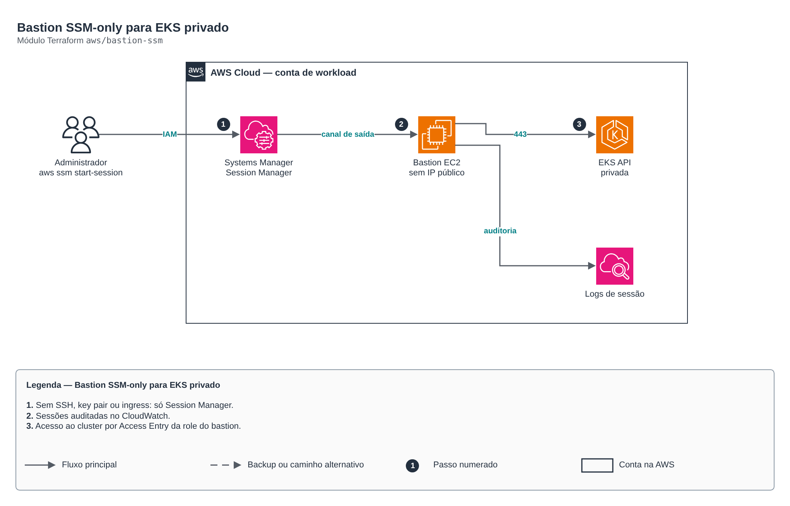

# Bastion SSM-only para EKS privado

> `aws/bastion-ssm` · categoria **containers** · origem: Plataforma de microsserviços em telecom (2026)

> Idealizado em agosto de 2026 e publicado agora.

Bastion "SSM-only" para administrar um cluster EKS privado: subnet privada, sem IP público, sem key pair, SG sem ingress, IMDSv2, disco cifrado, sessões auditadas no CloudWatch e acesso ao cluster por EKS Access Entry. Ferramentas (kubectl, awscli, helm, k9s, stern, grpcurl) instaladas por user data com versões fixadas.

## Arquitetura



Fonte editável: [`diagram.drawio`](diagram.drawio) (abra no draw.io / diagrams.net).

1. Sem SSH, key pair ou ingress: só Session Manager.
2. Sessões auditadas no CloudWatch.
3. Acesso ao cluster por Access Entry da role do bastion.

## Uso

```hcl
module "bastion_ssm" {
  source = "git::https://github.com/raphaelfcs/automacao_terraform.git//aws/bastion-ssm?ref=v1.0.0"

  environment       = "dev"
  cluster_name      = "demo-dev"
  vpc_id            = "vpc-0123456789abcdef0"
  private_subnet_id = "subnet-0aaa1111bbbb2222c"
  eks_cluster_sg_id = "sg-0123456789abcdef0"
  kubectl_version   = "v1.31.2"
  enable_helm       = true
  enable_k9s        = true
  tags              = local.tags
}
```

## Exemplos

| Exemplo | Arquivos |
|---|---|
| [`basico`](examples/basico) | `main.tf`, `locals.tf`, `backend.tf` |

Cada exemplo tem seu próprio backend (state isolado por módulo e exemplo). Ambientes diferentes usam apenas outro `backend.tf`/`*.tfvars`, sem duplicar código.

## Entradas

| Nome | Tipo | Padrão | Obrigatória | Descrição |
|---|---|---|---|---|
| `environment` | `string` | - | **sim** | Environment name — compõe nomes de recursos (log group, tags) |
| `allowed_environments` | `list(string)` | `["dev", "staging"]` | não | Ambientes em que o bastion pode existir (guarda avaliada em lifecycle.precondition) |
| `cluster_name` | `string` | - | **sim** | Nome do cluster EKS |
| `vpc_id` | `string` | - | **sim** | ID da VPC |
| `private_subnet_id` | `string` | - | **sim** | ID de uma subnet privada (a instância nunca fica em subnet pública) |
| `eks_cluster_sg_id` | `string` | - | **sim** | Security group ID do control plane EKS (output cluster_security_group_id do eks-cluster) — recebe regra de ingress standalone deste módulo, sem editar o módulo eks |
| `instance_type` | `string` | `"t3.small"` | não | Tipo de instância EC2 do bastion |
| `ami_id` | `string` | `null` | não | AMI a usar. Se null, resolve a AMI Amazon Linux 2023 mais recente via SSM parameter |
| `root_volume_size` | `number` | `30` | não | Tamanho do volume raiz em GB |
| `kms_key_id` | `string` | `null` | não | CMK para encriptar o volume raiz e o CloudWatch Log Group. Se null, usa a chave gerenciada default do serviço (aws/ebs, aws/logs) |
| `kubectl_version` | `string` | `"v1.35.0"` | não | Versão do kubectl a instalar via dl.k8s.io, pinada. Mantenha dentro da skew policy (±1 minor) do cluster |
| `awscli_version` | `string` | `"2.36.4"` | não | Versão do AWS CLI v2 a instalar via instalador oficial (nunca dnf). Nunca inferior a 2.15.10 (primeira versão que gera apiVersion v1beta1 no bloco exec do kubeconfig) |
| `enable_grpcurl` | `bool` | `true` | não | Instala grpcurl (útil para depurar serviços gRPC) |
| `enable_helm` | `bool` | `false` | não | Instala helm no bootstrap |
| `enable_k9s` | `bool` | `false` | não | Instala k9s no bootstrap |
| `enable_stern` | `bool` | `false` | não | Instala stern no bootstrap |
| `restrict_egress` | `bool` | `false` | não | Quando true, restringe o egress do bastion a um conjunto explícito de portas/SGs em vez de 0.0.0.0/0 all |
| `eks_access_policy_arn` | `string` | `"arn:aws:eks::aws:cluster-access-poli...` | não | ARN da EKS access policy associada à role do bastion |
| `manage_session_preferences` | `bool` | `false` | não | Quando true, gerencia o documento singleton SSM-SessionManagerRunShell (afeta toda a conta/região). |
| `session_log_retention_days` | `number` | `90` | não | Retenção em dias do CloudWatch Log Group de sessões Session Manager |
| `rds_security_group_id` | `string` | `null` | não | Security group do RDS PostgreSQL — usado apenas quando restrict_egress = true (egress 5432) |
| `redis_security_group_id` | `string` | `null` | não | Security group ID do ElastiCache Redis — usado apenas quando restrict_egress = true |
| `tags` | `map(string)` | `{}` | não | Tags a aplicar em todos os recursos deste módulo |

## Saídas

| Nome | Descrição |
|---|---|
| `bastion_instance_id` | ID da instância EC2 do bastion |
| `bastion_private_ip` | IP privado da instância bastion — o bastion nunca tem IP público |
| `bastion_security_group_id` | ID do security group do bastion — zero regras de ingress |
| `bastion_iam_role_arn` | ARN da role IAM do bastion — mesmo principal do EKS Access Entry |
| `bastion_ssm_start_command` | Comando pronto para abrir uma sessão Session Manager na instância |

## Arquivos

- `iam.tf`: políticas, papéis e permissões
- `locals.tf`: valores derivados
- `main.tf`: recursos principais
- `outputs.tf`: saídas
- `security_groups.tf`: recursos específicos do módulo
- `ssm.tf`: recursos específicos do módulo
- `variables.tf`: entradas e validações
- `versions.tf`: versões do Terraform e providers
- `templates/`: arquivos auxiliares (código, templates ou políticas)
- `examples/`: composições prontas para uso
- `tests/`: `terraform test` com providers simulados

## Well-Architected

- Segurança: endpoint e nós privados, identidade por workload (IRSA/Workload Identity) e segredos cifrados.
- Eficiência de performance: escalonamento automático de nós e pods.

## Testes

```bash
cd aws/bastion-ssm
terraform init -backend=false
terraform test
```
