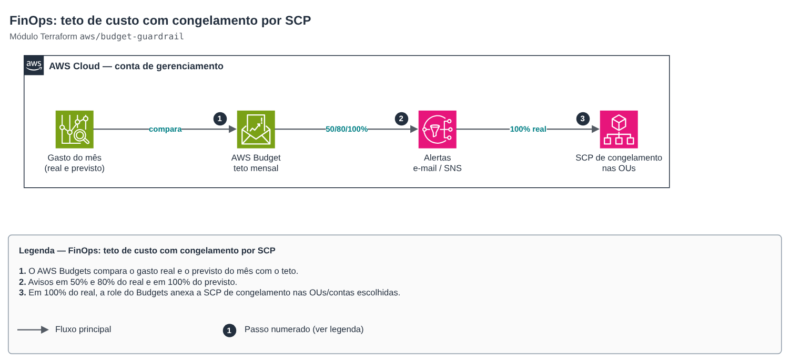

# FinOps: cost cap with SCP freeze

[Português](README.md) · **English**

> `aws/budget-guardrail` · category **finops** · origin: SaaS platform landing zone (2026)

> Created in November 2026 for the landing zone of an in-house SaaS platform.

Cost cap as a guardrail (FinOps): monthly AWS Budget with email/SNS alerts at percentages of actual and forecast spend and, optionally, an automatic action that applies a "freeze" SCP (denies creating/starting expensive resources) when actual spend reaches the cap. In the management account the budget can filter member accounts; the SCP freezes OUs or accounts.

## Architecture



Editable source: [`diagram.drawio`](diagram.drawio) (open in draw.io / diagrams.net), with pages in Portuguese and English.

1. AWS Budgets compares actual and forecast monthly spend with the cap.
2. Alerts at 50% and 80% actual and 100% forecast.
3. At 100% actual, the Budgets role attaches the freeze SCP to the chosen OUs/accounts.

To unfreeze, detach the SCP (output `freeze_policy_id`) after understanding the spend. Control Tower, AFT and break-glass roles are exempt.

## Usage

```hcl
module "teto" {
  source = "git::https://github.com/raphaelfcs/automacao_terraform.git//aws/budget-guardrail?ref=v1.1.0"

  name              = "demo-teto-mensal"
  limit_usd         = 450
  alert_emails      = ["finops@example.com"]
  freeze_target_ids = ["ou-ab12-22222222", "ou-ab12-55555555"]
  tags              = local.tags
}
```

## Examples

| Example | Files |
|---|---|
| [`teto-organizacao`](examples/teto-organizacao) | `main.tf`, `locals.tf`, `backend.tf` |

Each example has its own backend (state isolated per module and example). Other environments only change `backend.tf`/`*.tfvars`, without duplicating code.

## Inputs

| Name | Type | Default | Required | Description |
|---|---|---|---|---|
| `name` | `string` | — | yes | Budget name (prefix of the SCP and the action role). |
| `limit_usd` | `number` | — | yes | Monthly cap in dollars. |
| `linked_account_ids` | `list(string)` | `[]` | no | Filters the budget by member accounts (in the management account). Empty = whole bill. |
| `alerts` | `list(object({percent = number, type =...` | `[{"percent": 50, "type": "ACTUAL"}, {...` | no | Alerts: percentage of the cap and type (ACTUAL = actual spend, FORECASTED = month forecast). |
| `alert_emails` | `list(string)` | — | yes | Emails that receive the alerts and the action notification. |
| `alert_sns_topic_arns` | `list(string)` | `[]` | no | SNS topics that also receive the alerts (e.g. team chat). |
| `freeze_target_ids` | `list(string)` | `[]` | no | OUs/accounts that get the freeze SCP when the cap is reached. Empty = no automatic action. |
| `freeze_at_percent` | `number` | `100` | no | Percentage of the cap (actual spend) that triggers the freeze. |
| `freeze_approval_model` | `string` | `"AUTOMATIC"` | no | AUTOMATIC applies the SCP by itself; MANUAL waits for approval in the Budgets console. |
| `freeze_actions` | `list(string)` | `["ec2:RunInstances", "ec2:StartInstan...` | no | Actions denied while frozen (creating/starting resources that cost money). |
| `exempt_role_patterns` | `list(string)` | `["arn:aws:iam::*:role/AWSControlTower...` | no | Roles that keep working while frozen (Control Tower, AFT, break-glass). |
| `tags` | `map(string)` | `{}` | no | Additional tags. |

## Outputs

| Name | Description |
|---|---|
| `budget_name` | Budget name. |
| `freeze_policy_id` | Freeze SCP ID (null without automatic action). To unfreeze: detach it. |

## Files

- `iam.tf`: policies, roles and permissions
- `locals.tf`: derived values
- `main.tf`: main resources
- `outputs.tf`: outputs
- `variables.tf`: inputs and validations
- `versions.tf`: Terraform and provider versions
- `examples/`: ready-to-use compositions
- `tests/`: `terraform test` with mocked providers

## Well-Architected

- Cost optimization: a cap enforced by the platform, not just alerted.
- Security: the Budgets role can only attach/detach SCPs.

## Tests

```bash
cd aws/budget-guardrail
terraform init -backend=false
terraform test
```
