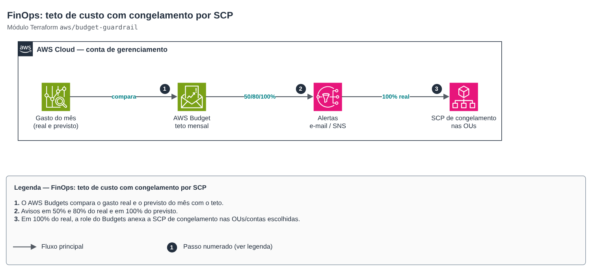

# FinOps: teto de custo com congelamento por SCP

**Português** · [English](README.en.md)

> `aws/budget-guardrail` · categoria **finops** · origem: landing zone de plataforma SaaS (2026)

> Criado em novembro de 2026, para a landing zone de uma plataforma SaaS própria.

Teto de custo como guardrail (FinOps): AWS Budget mensal com alertas por e-mail/SNS em percentuais do valor real e da previsão e, opcionalmente, uma ação automática que aplica uma SCP de "congelamento" (nega criar/ligar recursos caros) quando o gasto real atinge o limite. Na conta de gerenciamento o budget pode filtrar contas-membro; a SCP congela OUs ou contas.

## Arquitetura



Fonte editável: [`diagram.drawio`](diagram.drawio) (abra no draw.io / diagrams.net), com páginas em português e inglês.

1. O AWS Budgets compara o gasto real e o previsto do mês com o teto.
2. Avisos em 50% e 80% do real e em 100% do previsto.
3. Em 100% do real, a role do Budgets anexa a SCP de congelamento nas OUs/contas escolhidas.

Para descongelar, desanexe a SCP (saída `freeze_policy_id`) depois de entender o gasto. Roles do Control Tower, do AFT e de break-glass ficam isentas.

## Uso

```hcl
module "teto" {
  source = "git::https://github.com/raphaelfcs/automacao_terraform.git//aws/budget-guardrail?ref=v1.1.0"

  name              = "demo-teto-mensal"
  limit_usd         = 450
  alert_emails      = ["finops@example.com"]
  freeze_target_ids = ["ou-ab12-22222222", "ou-ab12-55555555"]
  tags              = local.tags
}
```

## Exemplos

| Exemplo | Arquivos |
|---|---|
| [`teto-organizacao`](examples/teto-organizacao) | `main.tf`, `locals.tf`, `backend.tf` |

Cada exemplo tem seu próprio backend (state isolado por módulo e exemplo). Ambientes diferentes usam apenas outro `backend.tf`/`*.tfvars`, sem duplicar código.

## Entradas

| Nome | Tipo | Padrão | Obrigatória | Descrição |
|---|---|---|---|---|
| `name` | `string` | — | sim | Nome do budget (prefixo da SCP e da role da ação). |
| `limit_usd` | `number` | — | sim | Teto mensal em dólares. |
| `linked_account_ids` | `list(string)` | `[]` | não | Filtra o budget por contas-membro (na conta de gerenciamento). Vazio = toda a fatura. |
| `alerts` | `list(object({percent = number, type =...` | `[{"percent": 50, "type": "ACTUAL"}, {...` | não | Alertas: percentual do teto e tipo (ACTUAL = gasto real, FORECASTED = previsão do mês). |
| `alert_emails` | `list(string)` | — | sim | E-mails que recebem os alertas e a notificação da ação. |
| `alert_sns_topic_arns` | `list(string)` | `[]` | não | Tópicos SNS que também recebem os alertas (ex.: chat da equipe). |
| `freeze_target_ids` | `list(string)` | `[]` | não | OUs/contas que recebem a SCP de congelamento ao atingir o teto. Vazio = sem ação automática. |
| `freeze_at_percent` | `number` | `100` | não | Percentual do teto (gasto real) que dispara o congelamento. |
| `freeze_approval_model` | `string` | `"AUTOMATIC"` | não | AUTOMATIC aplica a SCP sozinho; MANUAL espera aprovação no console do Budgets. |
| `freeze_actions` | `list(string)` | `["ec2:RunInstances", "ec2:StartInstan...` | não | Ações negadas durante o congelamento (criar/ligar recursos que geram custo). |
| `exempt_role_patterns` | `list(string)` | `["arn:aws:iam::*:role/AWSControlTower...` | não | Roles que continuam podendo agir durante o congelamento (Control Tower, AFT, break-glass). |
| `tags` | `map(string)` | `{}` | não | Tags adicionais. |

## Saídas

| Nome | Descrição |
|---|---|
| `budget_name` | Nome do budget. |
| `freeze_policy_id` | ID da SCP de congelamento (null sem ação automática). Para descongelar: desanexe-a. |

## Arquivos

- `iam.tf`: políticas, papéis e permissões
- `locals.tf`: valores derivados
- `main.tf`: recursos principais
- `outputs.tf`: saídas
- `variables.tf`: entradas e validações
- `versions.tf`: versões do Terraform e providers
- `examples/`: composições prontas para uso
- `tests/`: `terraform test` com providers simulados

## Well-Architected

- Otimização de custos: teto aplicado por máquina, não só alertado.
- Segurança: a role do Budgets só consegue anexar/desanexar SCPs.

## Testes

```bash
cd aws/budget-guardrail
terraform init -backend=false
terraform test
```
