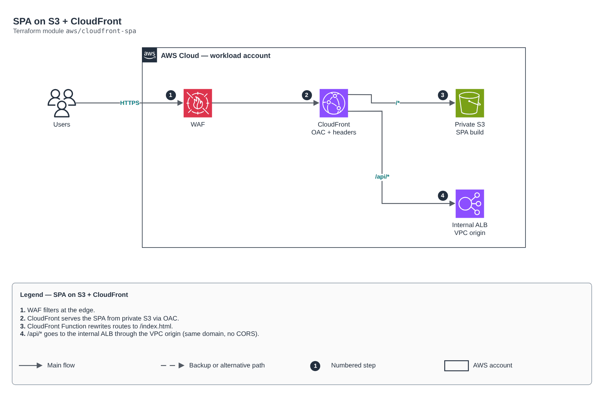

# SPA on S3 + CloudFront

[Português](README.md) · **English**

> `aws/cloudfront-spa` · category **borda** · origin: Telecom microservices platform (2026)

> Designed in August 2026 and published now.

Static SPA: private S3 behind CloudFront with Origin Access Control (the bucket is not public; the distribution is the only path to the objects), route rewrite with a CloudFront Function, security headers, optional WAF and an optional API origin (public ALB or internal ALB through a CloudFront VPC origin) to serve front end and API on the same domain.

## Architecture



Editable source: [`diagram.drawio`](diagram.drawio) (open it in draw.io / diagrams.net), with Portuguese and English pages.

1. WAF filters at the edge.
2. CloudFront serves the SPA from private S3 via OAC.
3. CloudFront Function rewrites routes to /index.html.
4. /api/* goes to the internal ALB through the VPC origin (same domain, no CORS).

## Usage

```hcl
module "cloudfront_spa" {
  source = "git::https://github.com/raphaelfcs/automacao_terraform.git//aws/cloudfront-spa?ref=v1.0.0"

  name_prefix = local.name_prefix
  app_name    = "web"
  dist_path   = "${path.module}/dist"
  tags        = local.tags
}
```

## Examples

| Example | Files |
|---|---|
| [`spa-simples`](examples/spa-simples) | `main.tf`, `locals.tf`, `backend.tf` |
| [`spa-com-api-interna`](examples/spa-com-api-interna) | `main.tf`, `locals.tf`, `backend.tf` |

Each example has its own backend (state isolated per module and example). Different environments only use another `backend.tf`/`*.tfvars`, without duplicating code.

## Inputs

| Name | Type | Default | Required | Description |
|---|---|---|---|---|
| `name_prefix` | `string` | - | **yes** | Prefix applied to hosting resources. |
| `app_name` | `string` | - | **yes** | Front-end name. Builds the bucket and origin names. |
| `dist_path` | `string` | - | **yes** | Front-end build path (must contain index.html). Run the build before apply; empty directory = empty site. To publish from a pipeline (aws s3 sync), point it to a directory without index.html. |
| `publish_source_maps` | `bool` | `false` | no | Publishes the build *.map files (they expose source code). Production: false. |
| `force_destroy` | `bool` | `false` | no | Allows destroying the bucket with objects inside (true only in sandbox). |
| `price_class` | `string` | `"PriceClass_All"` | no | PriceClass_100, PriceClass_200 or PriceClass_All (only All has edge locations in South America). |
| `aliases` | `list(string)` | `[]` | no | Custom domains (CNAMEs) of the distribution. Requires acm_certificate_arn. |
| `acm_certificate_arn` | `string` | `null` | no | ACM certificate in us-east-1 for the aliases. null = default *.cloudfront.net certificate. |
| `web_acl_id` | `string` | `null` | no | WAFv2 Web ACL ARN (CLOUDFRONT scope, us-east-1). null = no WAF. |
| `content_security_policy` | `string` | `""` | no | Content-Security-Policy header. Empty = no CSP. Validate against the real app: a wrong CSP breaks login. |
| `api_path_patterns` | `list(string)` | `["/api/*"]` | no | Paths forwarded to the API origin (no cache, Authorization preserved). |
| `api_origin_domain` | `string` | `""` | no | Hostname of a PUBLIC load balancer with the API. Serving the API on the same domain avoids mixed content and CORS preflight. Empty = no API origin. |
| `api_vpc_origin_enabled` | `bool` | `false` | no | Uses an INTERNAL ALB as origin through a CloudFront VPC origin (nothing public in the VPC). Explicit flag because the ALB ARN is unknown at plan time when it is created in the same apply. |
| `api_vpc_origin_arn` | `string` | `""` | no | ARN of the internal ALB used as VPC origin. |
| `api_vpc_origin_domain` | `string` | `""` | no | DNS of the internal ALB in api_vpc_origin_arn. |
| `api_vpc_origin_protocol_policy` | `string` | `"http-only"` | no | http-only while the internal ALB has no certificate (traffic inside the VPC); https-only with ACM. |
| `tags` | `map(string)` | `{}` | no | Tags applied to all resources. |
| `assets_cache_control` | `string` | `"public, max-age=31536000, immutable"` | no | Cache-Control for files other than index.html. The default (1 year, immutable) requires hashed names; an app without hashed names uses "no-cache". |
| `extra_objects` | `map(string)` | `{}` | no | IaC-generated objects: path -> content (e.g. { "config.json" = jsonencode(...) }), published without cache. |

## Outputs

| Name | Description |
|---|---|
| `url` | Public URL of the SPA. |
| `bucket_name` | Bucket holding the build. Used by the pipeline for incremental sync. |
| `distribution_id` | Distribution ID. Used by the pipeline to invalidate the cache after sync. |
| `published_object_count` | How many dist/ files were published. Zero means the build did not run before apply. |
| `domain_name` | Distribution *.cloudfront.net domain. Builds the Cognito callback/logout and the CORS allowlist. |
| `vpc_origin_id` | CloudFront VPC origin ID for the API (null without a VPC origin). The ALB-owning root allows the VPC origin's managed SG. |

## Files

- `headers.tf`: module-specific resources
- `iam.tf`: policies, roles and permissions
- `locals.tf`: derived values
- `main.tf`: main resources
- `outputs.tf`: outputs
- `variables.tf`: inputs and validations
- `versions.tf`: Terraform and provider versions
- `functions/`: supporting files (code, templates or policies)
- `examples/`: ready-to-use compositions
- `tests/`: `terraform test` with mocked providers

## Well-Architected

- Security: private origin, WAF and modern TLS at the edge.
- Performance: edge caching and compression.

## Tests

```bash
cd aws/cloudfront-spa
terraform init -backend=false
terraform test
```
