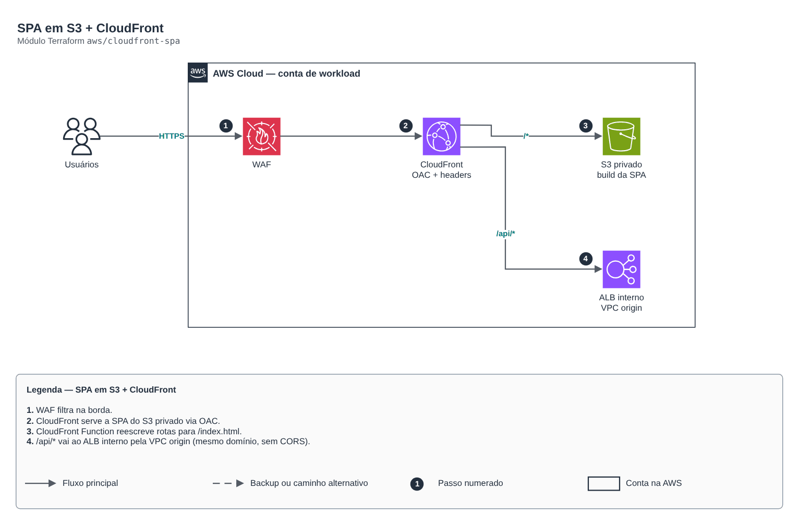

# SPA em S3 + CloudFront

**Português** · [English](README.en.md)

> `aws/cloudfront-spa` · categoria **borda** · origem: Plataforma de microsserviços em telecom (2026)

> Idealizado em agosto de 2026 e publicado agora.

SPA estática: S3 privado atrás de CloudFront com Origin Access Control (o bucket não é público; o único caminho até os objetos é a distribuição), rewrite de rotas por CloudFront Function, cabeçalhos de segurança, WAF opcional e origem de API opcional (ALB público ou ALB interno via CloudFront VPC origin) para servir front e API no mesmo domínio.

## Arquitetura



Fonte editável: [`diagram.drawio`](diagram.drawio) (abra no draw.io / diagrams.net), com páginas em português e inglês.

1. WAF filtra na borda.
2. CloudFront serve a SPA do S3 privado via OAC.
3. CloudFront Function reescreve rotas para /index.html.
4. /api/* vai ao ALB interno pela VPC origin (mesmo domínio, sem CORS).

## Uso

```hcl
module "cloudfront_spa" {
  source = "git::https://github.com/raphaelfcs/automacao_terraform.git//aws/cloudfront-spa?ref=v1.0.0"

  name_prefix = local.name_prefix
  app_name    = "web"
  dist_path   = "${path.module}/dist"
  tags        = local.tags
}
```

## Exemplos

| Exemplo | Arquivos |
|---|---|
| [`spa-simples`](examples/spa-simples) | `main.tf`, `locals.tf`, `backend.tf` |
| [`spa-com-api-interna`](examples/spa-com-api-interna) | `main.tf`, `locals.tf`, `backend.tf` |

Cada exemplo tem seu próprio backend (state isolado por módulo e exemplo). Ambientes diferentes usam apenas outro `backend.tf`/`*.tfvars`, sem duplicar código.

## Entradas

| Nome | Tipo | Padrão | Obrigatória | Descrição |
|---|---|---|---|---|
| `name_prefix` | `string` | - | **sim** | Prefixo aplicado aos recursos de hosting. |
| `app_name` | `string` | - | **sim** | Nome do front-end. Compõe o nome do bucket e das origens. |
| `dist_path` | `string` | - | **sim** | Caminho do build do front-end (deve conter index.html). Rode o build antes do apply; diretório vazio = site vazio. Para publicar por pipeline (aws s3 sync), aponte para um diretório sem index.html. |
| `publish_source_maps` | `bool` | `false` | não | Publica os *.map do build (expõem o código-fonte). Produção: false. |
| `force_destroy` | `bool` | `false` | não | Permite destruir o bucket com objetos dentro (true só em sandbox). |
| `price_class` | `string` | `"PriceClass_All"` | não | PriceClass_100, PriceClass_200 ou PriceClass_All (só a All tem borda na América do Sul). |
| `aliases` | `list(string)` | `[]` | não | Domínios próprios (CNAMEs) da distribuição. Exige acm_certificate_arn. |
| `acm_certificate_arn` | `string` | `null` | não | Certificado ACM em us-east-1 para os aliases. null = certificado padrão *.cloudfront.net. |
| `web_acl_id` | `string` | `null` | não | ARN do Web ACL WAFv2 (escopo CLOUDFRONT, us-east-1). null = sem WAF. |
| `content_security_policy` | `string` | `""` | não | Cabeçalho Content-Security-Policy. Vazio = sem CSP. Valide contra o app real: CSP errada quebra o login. |
| `api_path_patterns` | `list(string)` | `["/api/*"]` | não | Caminhos encaminhados à origem de API (sem cache, com Authorization preservado). |
| `api_origin_domain` | `string` | `""` | não | Hostname de um load balancer PÚBLICO com a API. Servir a API no mesmo domínio evita mixed content e preflight de CORS. Vazio = sem origem de API. |
| `api_vpc_origin_enabled` | `bool` | `false` | não | Usa um ALB INTERNO como origem via CloudFront VPC origin (nada público na VPC). Flag explícita porque o ARN do ALB é desconhecido no plan quando nasce no mesmo apply. |
| `api_vpc_origin_arn` | `string` | `""` | não | ARN do ALB interno usado como VPC origin. |
| `api_vpc_origin_domain` | `string` | `""` | não | DNS do ALB interno de api_vpc_origin_arn. |
| `api_vpc_origin_protocol_policy` | `string` | `"http-only"` | não | http-only enquanto o ALB interno não tem certificado (tráfego dentro da VPC); https-only com ACM. |
| `tags` | `map(string)` | `{}` | não | Tags aplicadas a todos os recursos. |
| `assets_cache_control` | `string` | `"public, max-age=31536000, immutable"` | não | Cache-Control dos arquivos que não são o index.html. O padrão (1 ano, immutable) exige nomes com hash; app sem hash nos nomes usa "no-cache". |
| `extra_objects` | `map(string)` | `{}` | não | Objetos gerados pela IaC: caminho -> conteúdo (ex.: { "config.json" = jsonencode(...) }), publicados sem cache. |

## Saídas

| Nome | Descrição |
|---|---|
| `url` | URL pública da SPA. |
| `bucket_name` | Bucket que guarda o build. Usado pelo pipeline para sync incremental. |
| `distribution_id` | ID da distribuicao. Usado pelo pipeline para invalidar o cache apos o sync. |
| `published_object_count` | Quantos arquivos do dist/ foram publicados. Zero significa que o build nao rodou antes do apply. |
| `domain_name` | Domínio *.cloudfront.net da distribuicao. Compoe callback/logout do Cognito e o allowlist de CORS. |
| `vpc_origin_id` | ID do CloudFront VPC origin da API (null sem origem VPC). A raiz dona do ALB libera o SG gerenciado do VPC origin. |

## Arquivos

- `headers.tf`: recursos específicos do módulo
- `iam.tf`: políticas, papéis e permissões
- `locals.tf`: valores derivados
- `main.tf`: recursos principais
- `outputs.tf`: saídas
- `variables.tf`: entradas e validações
- `versions.tf`: versões do Terraform e providers
- `functions/`: arquivos auxiliares (código, templates ou políticas)
- `examples/`: composições prontas para uso
- `tests/`: `terraform test` com providers simulados

## Well-Architected

- Segurança: origem privada, WAF e TLS moderno na borda.
- Performance: cache na borda e compressão.

## Testes

```bash
cd aws/cloudfront-spa
terraform init -backend=false
terraform test
```
