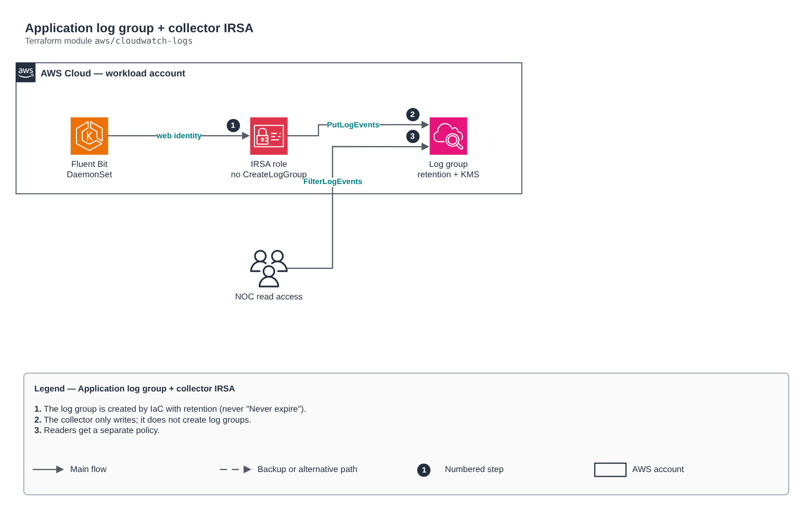

# Application log group + collector IRSA

[Português](README.md) · **English**

> `aws/cloudwatch-logs` · category **observabilidade** · origin: Telecom microservices platform (2026)

> Designed in August 2026 and published now.

Application log group created by IaC (with retention and KMS) and the IRSA role of the collector (e.g. Fluent Bit) that only WRITES to it. The group is born here, not in the collector: a group created by the collector is "Never expire" — indefinite retention of data that may contain personal identifiers. That is why the collector role does NOT get logs:CreateLogGroup.

## Architecture



Editable source: [`diagram.drawio`](diagram.drawio) (open it in draw.io / diagrams.net), with Portuguese and English pages.

1. The log group is created by IaC with retention (never "Never expire").
2. The collector only writes; it does not create log groups.
3. Readers get a separate policy.

## Usage

```hcl
module "cloudwatch_logs" {
  source = "git::https://github.com/raphaelfcs/automacao_terraform.git//aws/cloudwatch-logs?ref=v1.0.0"

  log_group_name    = "/demo/dev/application"
  retention_days    = 14
  kms_key_arn       = "arn:aws:kms:sa-east-1:123456789012:key/11111111-2222-3333-4444-555555555555"
  oidc_provider_arn = "arn:aws:iam::123456789012:oidc-provider/oidc.eks.sa-east-1.amazonaws.com/id/EXAMPLED539D4633E53DE1B71EXAMPLE"
  oidc_provider_url = "oidc.eks.sa-east-1.amazonaws.com/id/EXAMPLED539D4633E53DE1B71EXAMPLE"
  role_name_prefix  = local.name_prefix
  tags              = local.tags
}
```

## Examples

| Example | Files |
|---|---|
| [`fluent-bit`](examples/fluent-bit) | `main.tf`, `locals.tf`, `backend.tf` |

Each example has its own backend (state isolated per module and example). Different environments only use another `backend.tf`/`*.tfvars`, without duplicating code.

## Inputs

| Name | Type | Default | Required | Description |
|---|---|---|---|---|
| `log_group_name` | `string` | - | **yes** | Log group name (e.g. /app/dev/application). |
| `retention_days` | `number` | `30` | no | Retention in days. Zero is forbidden: in the provider, 0 means Never expire. |
| `kms_key_arn` | `string` | `null` | no | Log group KMS key (the key policy must allow CloudWatch Logs). |
| `oidc_provider_arn` | `string` | - | **yes** | EKS cluster OIDC provider ARN. |
| `oidc_provider_url` | `string` | - | **yes** | OIDC issuer without https://. |
| `collector_namespace` | `string` | `"observability"` | no | Collector ServiceAccount namespace. |
| `collector_service_account` | `string` | `"fluent-bit"` | no | Collector ServiceAccount. |
| `role_name_prefix` | `string` | - | **yes** | Prefix for role and policy names. |
| `tags` | `map(string)` | `{}` | no | Tags applied to all resources. |

## Outputs

| Name | Description |
|---|---|
| `log_group_name` | Log group name. |
| `log_group_arn` | Log group ARN. |
| `collector_role_arn` | Collector IRSA role (annotate the ServiceAccount: eks.amazonaws.com/role-arn). |
| `reader_policy_arn` | Read policy to attach to whoever queries the logs. |

## Files

- `iam.tf`: policies, roles and permissions
- `main.tf`: main resources
- `outputs.tf`: outputs
- `variables.tf`: inputs and validations
- `versions.tf`: Terraform and provider versions
- `examples/`: ready-to-use compositions
- `tests/`: `terraform test` with mocked providers

## Well-Architected

- Operational excellence: centralized logs and metrics with defined retention and actionable alerts.
- Cost optimization: retention per log class so you do not pay for unused data.

## Tests

```bash
cd aws/cloudwatch-logs
terraform init -backend=false
terraform test
```
