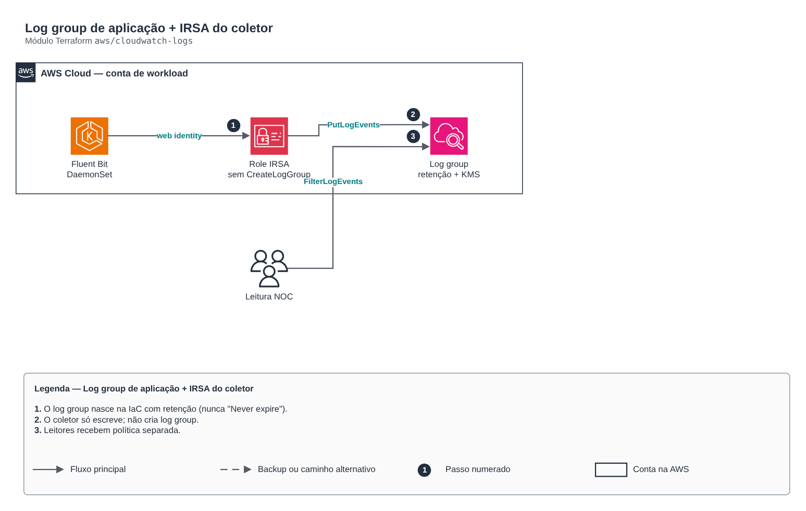

# Log group de aplicação + IRSA do coletor

**Português** · [English](README.en.md)

> `aws/cloudwatch-logs` · categoria **observabilidade** · origem: Plataforma de microsserviços em telecom (2026)

> Idealizado em agosto de 2026 e publicado agora.

Log group de aplicação criado pela IaC (com retenção e KMS) e a role IRSA do coletor (ex.: Fluent Bit) que só ESCREVE nele. O grupo nasce aqui, e não no coletor: um log group criado pelo próprio coletor nasce "Never expire" — retenção indefinida de dados que podem conter identificadores pessoais, e ninguém revisa a retenção de um grupo que já existe. Por isso a role do coletor NÃO recebe logs:CreateLogGroup: a negativa mantém o prazo dentro da IaC, onde mudar exige commit.

## Arquitetura



Fonte editável: [`diagram.drawio`](diagram.drawio) (abra no draw.io / diagrams.net), com páginas em português e inglês.

1. O log group nasce na IaC com retenção (nunca "Never expire").
2. O coletor só escreve; não cria log group.
3. Leitores recebem política separada.

## Uso

```hcl
module "cloudwatch_logs" {
  source = "git::https://github.com/raphaelfcs/automacao_terraform.git//aws/cloudwatch-logs?ref=v1.0.0"

  log_group_name    = "/demo/dev/application"
  retention_days    = 14
  kms_key_arn       = "arn:aws:kms:sa-east-1:123456789012:key/11111111-2222-3333-4444-555555555555"
  oidc_provider_arn = "arn:aws:iam::123456789012:oidc-provider/oidc.eks.sa-east-1.amazonaws.com/id/EXAMPLED539D4633E53DE1B71EXAMPLE"
  oidc_provider_url = "oidc.eks.sa-east-1.amazonaws.com/id/EXAMPLED539D4633E53DE1B71EXAMPLE"
  role_name_prefix  = local.name_prefix
  tags              = local.tags
}
```

## Exemplos

| Exemplo | Arquivos |
|---|---|
| [`fluent-bit`](examples/fluent-bit) | `main.tf`, `locals.tf`, `backend.tf` |

Cada exemplo tem seu próprio backend (state isolado por módulo e exemplo). Ambientes diferentes usam apenas outro `backend.tf`/`*.tfvars`, sem duplicar código.

## Entradas

| Nome | Tipo | Padrão | Obrigatória | Descrição |
|---|---|---|---|---|
| `log_group_name` | `string` | - | **sim** | Nome do log group (ex.: /app/dev/application). |
| `retention_days` | `number` | `30` | não | Retenção em dias. Zero é proibido: no provider, 0 significa Never expire. |
| `kms_key_arn` | `string` | `null` | não | Chave KMS do log group (a política da chave deve liberar o CloudWatch Logs). |
| `oidc_provider_arn` | `string` | - | **sim** | ARN do OIDC provider do cluster EKS. |
| `oidc_provider_url` | `string` | - | **sim** | Issuer OIDC sem https://. |
| `collector_namespace` | `string` | `"observability"` | não | Namespace do ServiceAccount do coletor. |
| `collector_service_account` | `string` | `"fluent-bit"` | não | ServiceAccount do coletor. |
| `role_name_prefix` | `string` | - | **sim** | Prefixo dos nomes de role e políticas. |
| `tags` | `map(string)` | `{}` | não | Tags aplicadas a todos os recursos. |

## Saídas

| Nome | Descrição |
|---|---|
| `log_group_name` | Nome do log group. |
| `log_group_arn` | ARN do log group. |
| `collector_role_arn` | Role IRSA do coletor (anote no ServiceAccount: eks.amazonaws.com/role-arn). |
| `reader_policy_arn` | Política de leitura para anexar a quem consulta os logs. |

## Arquivos

- `iam.tf`: políticas, papéis e permissões
- `main.tf`: recursos principais
- `outputs.tf`: saídas
- `variables.tf`: entradas e validações
- `versions.tf`: versões do Terraform e providers
- `examples/`: composições prontas para uso
- `tests/`: `terraform test` com providers simulados

## Well-Architected

- Excelência operacional: logs e métricas centralizados com retenção definida e alertas acionáveis.
- Otimização de custos: retenção por classe de log para não pagar por dado sem uso.

## Testes

```bash
cd aws/cloudwatch-logs
terraform init -backend=false
terraform test
```
