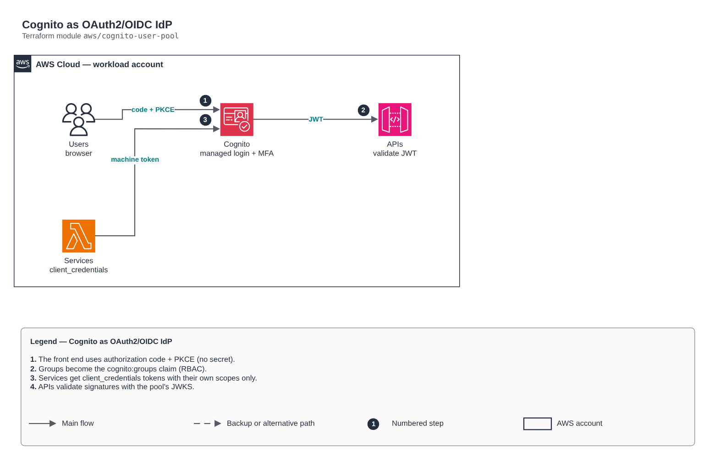

# Cognito as OAuth2/OIDC IdP

[Português](README.md) · **English**

> `aws/cognito-user-pool` · category **seguranca** · origin: Telecom microservices platform (2026)

> Designed in August 2026 and published now.

Amazon Cognito as OAuth2/OIDC IdP: user pool (human login with MFA), role-based groups (RBAC), public front-end client (authorization code + PKCE) and machine clients (client_credentials) with least-privilege scopes per service.

## Architecture



Editable source: [`diagram.drawio`](diagram.drawio) (open it in draw.io / diagrams.net), with Portuguese and English pages.

1. The front end uses authorization code + PKCE (no secret).
2. Groups become the cognito:groups claim (RBAC).
3. Services get client_credentials tokens with their own scopes only.
4. APIs validate signatures with the pool's JWKS.

## Usage

```hcl
module "cognito_user_pool" {
  source = "git::https://github.com/raphaelfcs/automacao_terraform.git//aws/cognito-user-pool?ref=v1.0.0"

  name_prefix       = local.name_prefix
  domain_prefix     = "demo-dev-login"
  callback_urls     = ["https://app.example.com/callback"]
  logout_urls       = ["https://app.example.com/"]
  custom_attributes = { tenant_id = 64 }
  roles             = { admin = "Administradores", operador = "Operacao" }
  machine_scopes    = { "pedidos.read" = "Ler pedidos", "pedidos.write" = "Gravar pedidos" }
  service_clients   = { faturamento = ["pedidos.read"] }
  tags              = local.tags
}
```

## Examples

| Example | Files |
|---|---|
| [`web-e-maquinas`](examples/web-e-maquinas) | `main.tf`, `locals.tf`, `backend.tf` |

Each example has its own backend (state isolated per module and example). Different environments only use another `backend.tf`/`*.tfvars`, without duplicating code.

## Inputs

| Name | Type | Default | Required | Description |
|---|---|---|---|---|
| `name_prefix` | `string` | - | **yes** | Prefix applied to identity resources. |
| `domain_prefix` | `string` | - | **yes** | Cognito domain prefix (<prefix>.auth.<region>.amazoncognito.com). Unique in the region. |
| `callback_urls` | `list(string)` | - | **yes** | Authorization code callback URLs. Explicit — never wildcards. |
| `logout_urls` | `list(string)` | `[]` | no | Allowed logout URLs. |
| `mfa_configuration` | `string` | `"ON"` | no | OFF, ON or OPTIONAL. Sensitive profiles require ON. |
| `admin_create_user_only` | `bool` | `true` | no | Only administrators create users (no self sign-up). |
| `advanced_security_mode` | `string` | `"AUDIT"` | no | OFF, AUDIT or ENFORCED (protection against leaked credentials/login risk). |
| `deletion_protection` | `bool` | `true` | no | Prevents accidental pool deletion. |
| `custom_attributes` | `map(number)` | `{}` | no | Custom string attributes: name -> max length (e.g. { tenant_id = 64 }). |
| `roles` | `map(string)` | `{}` | no | RBAC roles materialized as groups: code (goes into the cognito:groups claim) -> description. |
| `resource_server_identifier` | `string` | `"api-interna"` | no | Internal resource server identifier — scope prefix in the token. |
| `machine_scopes` | `map(string)` | `{}` | no | Machine scopes: name -> description. |
| `service_clients` | `map(list(string))` | `{}` | no | Machine identities: service -> list of scopes from machine_scopes. |
| `tags` | `map(string)` | `{}` | no | Tags applied to all resources. |
| `user_pool_tier` | `string` | `null` | no | LITE, ESSENTIALS or PLUS. Managed login (version 2) requires ESSENTIALS; advanced_security_mode other than OFF requires PLUS. null = AWS default. |

## Outputs

| Name | Description |
|---|---|
| `user_pool_id` | User pool ID. |
| `user_pool_arn` | User pool ARN. |
| `web_client_id` | Public front-end client ID. |
| `issuer_uri` | OIDC issuer — configure it on the resource servers that validate the JWT. |
| `jwks_uri` | JWKS endpoint to validate the token signature. |
| `hosted_ui_domain` | Managed login domain. |
| `token_uri` | /oauth2/token endpoint (exchanges client_credentials for a token). |
| `service_client_ids` | Service -> client_id map. |
| `service_client_secrets` | Service -> client_secret map (sensitive: store it in Secrets Manager). |

## Files

- `clients.tf`: module-specific resources
- `main.tf`: main resources
- `outputs.tf`: outputs
- `variables.tf`: inputs and validations
- `versions.tf`: Terraform and provider versions
- `examples/`: ready-to-use compositions
- `tests/`: `terraform test` with mocked providers

## Well-Architected

- Security: least privilege in policies, customer-managed key encryption and an audit trail.
- Operational excellence: everything declared in code, reviewed in PRs and tested with `terraform test`.

## Tests

```bash
cd aws/cognito-user-pool
terraform init -backend=false
terraform test
```
