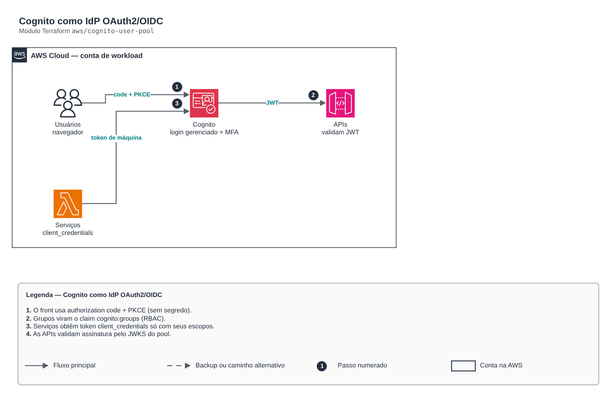

# Cognito como IdP OAuth2/OIDC

> `aws/cognito-user-pool` · categoria **seguranca** · origem: Plataforma de microsserviços em telecom (2026)

> Idealizado em agosto de 2026 e publicado agora.

Amazon Cognito como IdP OAuth2/OIDC: pool de usuários (login humano com MFA), grupos por papel (RBAC), cliente público do front (authorization code + PKCE) e clientes de máquina (client_credentials) com escopos mínimos por serviço.

## Arquitetura



Fonte editável: [`diagram.drawio`](diagram.drawio) (abra no draw.io / diagrams.net).

1. O front usa authorization code + PKCE (sem segredo).
2. Grupos viram o claim cognito:groups (RBAC).
3. Serviços obtêm token client_credentials só com seus escopos.
4. As APIs validam assinatura pelo JWKS do pool.

## Uso

```hcl
module "cognito_user_pool" {
  source = "git::https://github.com/raphaelfcs/automacao_terraform.git//aws/cognito-user-pool?ref=v1.0.0"

  name_prefix       = local.name_prefix
  domain_prefix     = "demo-dev-login"
  callback_urls     = ["https://app.example.com/callback"]
  logout_urls       = ["https://app.example.com/"]
  custom_attributes = { tenant_id = 64 }
  roles             = { admin = "Administradores", operador = "Operacao" }
  machine_scopes    = { "pedidos.read" = "Ler pedidos", "pedidos.write" = "Gravar pedidos" }
  service_clients   = { faturamento = ["pedidos.read"] }
  tags              = local.tags
}
```

## Exemplos

| Exemplo | Arquivos |
|---|---|
| [`web-e-maquinas`](examples/web-e-maquinas) | `main.tf`, `locals.tf`, `backend.tf` |

Cada exemplo tem seu próprio backend (state isolado por módulo e exemplo). Ambientes diferentes usam apenas outro `backend.tf`/`*.tfvars`, sem duplicar código.

## Entradas

| Nome | Tipo | Padrão | Obrigatória | Descrição |
|---|---|---|---|---|
| `name_prefix` | `string` | - | **sim** | Prefixo aplicado aos recursos de identidade. |
| `domain_prefix` | `string` | - | **sim** | Prefixo do domínio do Cognito (<prefixo>.auth.<regiao>.amazoncognito.com). Único na região. |
| `callback_urls` | `list(string)` | - | **sim** | URLs de callback do authorization code. Explícitas — nunca curinga. |
| `logout_urls` | `list(string)` | `[]` | não | URLs de logout autorizadas. |
| `mfa_configuration` | `string` | `"ON"` | não | OFF, ON ou OPTIONAL. Perfis sensíveis exigem ON. |
| `admin_create_user_only` | `bool` | `true` | não | Só administradores criam usuários (sem auto-cadastro). |
| `advanced_security_mode` | `string` | `"AUDIT"` | não | OFF, AUDIT ou ENFORCED (proteção contra credenciais vazadas/risco de login). |
| `deletion_protection` | `bool` | `true` | não | Impede exclusão acidental do pool. |
| `custom_attributes` | `map(number)` | `{}` | não | Atributos customizados string: nome -> tamanho máximo (ex.: { tenant_id = 64 }). |
| `roles` | `map(string)` | `{}` | não | Papéis RBAC materializados como grupos: código (vai no claim cognito:groups) -> descrição. |
| `resource_server_identifier` | `string` | `"api-interna"` | não | Identificador do resource server interno — prefixo dos escopos no token. |
| `machine_scopes` | `map(string)` | `{}` | não | Escopos de máquina: nome -> descrição. |
| `service_clients` | `map(list(string))` | `{}` | não | Identidades de máquina: serviço -> lista de escopos de machine_scopes. |
| `tags` | `map(string)` | `{}` | não | Tags aplicadas a todos os recursos. |

## Saídas

| Nome | Descrição |
|---|---|
| `user_pool_id` | ID do user pool. |
| `user_pool_arn` | ARN do user pool. |
| `web_client_id` | Client ID público do front-end. |
| `issuer_uri` | Issuer OIDC — configure nos resource servers que validam o JWT. |
| `jwks_uri` | Endpoint JWKS para validar a assinatura do token. |
| `hosted_ui_domain` | Domínio do login gerenciado. |
| `token_uri` | Endpoint /oauth2/token (troca de client_credentials por token). |
| `service_client_ids` | Mapa serviço -> client_id. |
| `service_client_secrets` | Mapa serviço -> client_secret (sensível: grave no Secrets Manager). |

## Arquivos

- `clients.tf`: recursos específicos do módulo
- `main.tf`: recursos principais
- `outputs.tf`: saídas
- `variables.tf`: entradas e validações
- `versions.tf`: versões do Terraform e providers
- `examples/`: composições prontas para uso
- `tests/`: `terraform test` com providers simulados

## Well-Architected

- Segurança: privilégio mínimo nas políticas, criptografia com chave gerenciada pelo cliente e trilha de auditoria.
- Excelência operacional: tudo declarado em código, revisado em PR e testado com `terraform test`.

## Testes

```bash
cd aws/cognito-user-pool
terraform init -backend=false
terraform test
```
