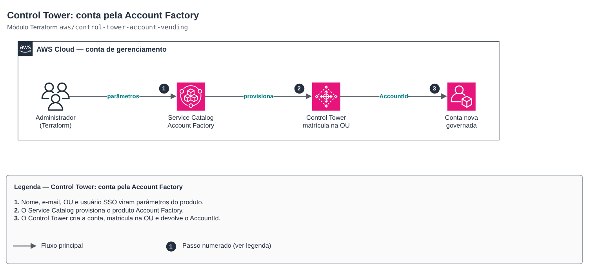

# Control Tower: account via Account Factory

[Português](README.md) · **English**

> `aws/control-tower-account-vending` · category **governanca** · origin: SaaS platform landing zone (2026)

> Created in November 2026 for the landing zone of an in-house SaaS platform.

Governed account vended by AWS Control Tower Account Factory (a Service Catalog product): the account is born enrolled in the registered OU, with its SSO owner and the OU controls. Meant for accounts that must exist **before** AFT (the AFT management account itself); after that, new accounts should come from pull requests in the AFT account request repository.

## Architecture



Editable source: [`diagram.drawio`](diagram.drawio) (open in draw.io / diagrams.net), with pages in Portuguese and English.

1. Name, email, OU and SSO user become product parameters.
2. Service Catalog provisions the Account Factory product.
3. Control Tower creates the account, enrolls it in the OU and returns the AccountId.

Whoever applies must have access to the *AWS Control Tower Account Factory Portfolio* in Service Catalog (the Control Tower admins group already does).

## Usage

```hcl
module "aft_management_account" {
  source = "git::https://github.com/raphaelfcs/automacao_terraform.git//aws/control-tower-account-vending?ref=v1.1.0"

  account_name                = "demo-aft-management"
  account_email               = "aws+demo-aft-management@example.com"
  managed_organizational_unit = "AFT"
  sso_user = {
    first_name = "Plataforma"
    last_name  = "AFT"
  }
  tags = local.tags
}
```

## Examples

| Example | Files |
|---|---|
| [`conta-aft`](examples/conta-aft) | `main.tf`, `locals.tf`, `backend.tf` |

Each example has its own backend (state isolated per module and example). Other environments only change `backend.tf`/`*.tfvars`, without duplicating code.

## Inputs

| Name | Type | Default | Required | Description |
|---|---|---|---|---|
| `account_name` | `string` | — | yes | Account name (shown in Organizations and in the Identity Center portal). |
| `account_email` | `string` | — | yes | Root email of the account (unique across AWS; use a +function alias). |
| `managed_organizational_unit` | `string` | — | yes | Target registered OU. Nested OU uses "Name (ou-xxxx-yyyyyyyy)". |
| `sso_user` | `object({first_name = string, last_nam...` | — | yes | Identity Center user that owns the account. email null = uses the account email. |
| `provisioned_product_name` | `string` | `null` | no | Service Catalog provisioned product name. null = conta-<account_name>. |
| `product_name` | `string` | `"AWS Control Tower Account Factory"` | no | Service Catalog product created by Control Tower. |
| `provisioning_artifact_name` | `string` | `"AWS Control Tower Account Factory"` | no | Account Factory product version (provisioning artifact). |
| `tags` | `map(string)` | `{}` | no | Additional tags (applied to the provisioned product). |

## Outputs

| Name | Description |
|---|---|
| `account_id` | Created account ID. |
| `provisioned_product_id` | Service Catalog provisioned product ID (to update/close the account). |
| `status` | Provisioning status (AVAILABLE when done). |

## Files

- `locals.tf`: derived values
- `main.tf`: main resources
- `outputs.tf`: outputs
- `variables.tf`: inputs and validations
- `versions.tf`: Terraform and provider versions
- `examples/`: ready-to-use compositions
- `tests/`: `terraform test` with mocked providers

## Well-Architected

- Operational excellence: the whole organization is created from code reviewed in pull requests, with no console clicks.
- Security: centralized governance (Control Tower, SCPs, Identity Center) in place before the first workload.

## Tests

```bash
cd aws/control-tower-account-vending
terraform init -backend=false
terraform test
```
