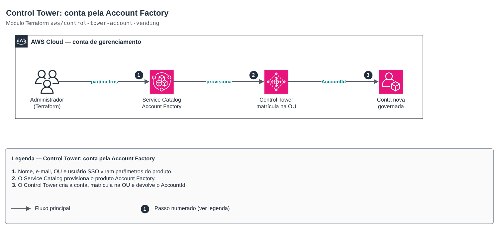

# Control Tower: conta pela Account Factory

**Português** · [English](README.en.md)

> `aws/control-tower-account-vending` · categoria **governanca** · origem: landing zone de plataforma SaaS (2026)

> Criado em novembro de 2026, para a landing zone de uma plataforma SaaS própria.

Conta governada criada pelo Account Factory do AWS Control Tower (produto do Service Catalog): a conta já nasce matriculada na OU registrada, com o usuário SSO dono e os controles da OU. Indicado para contas que precisam existir **antes** do AFT (a própria conta de gerenciamento do AFT); depois disso, novas contas devem vir por pull request no repositório de account requests do AFT.

## Arquitetura



Fonte editável: [`diagram.drawio`](diagram.drawio) (abra no draw.io / diagrams.net), com páginas em português e inglês.

1. Nome, e-mail, OU e usuário SSO viram parâmetros do produto.
2. O Service Catalog provisiona o produto Account Factory.
3. O Control Tower cria a conta, matricula na OU e devolve o AccountId.

Quem aplica precisa ter acesso ao portfólio *AWS Control Tower Account Factory Portfolio* no Service Catalog (o grupo de administradores do Control Tower já tem).

## Uso

```hcl
module "aft_management_account" {
  source = "git::https://github.com/raphaelfcs/automacao_terraform.git//aws/control-tower-account-vending?ref=v1.1.0"

  account_name                = "demo-aft-management"
  account_email               = "aws+demo-aft-management@example.com"
  managed_organizational_unit = "AFT"
  sso_user = {
    first_name = "Plataforma"
    last_name  = "AFT"
  }
  tags = local.tags
}
```

## Exemplos

| Exemplo | Arquivos |
|---|---|
| [`conta-aft`](examples/conta-aft) | `main.tf`, `locals.tf`, `backend.tf` |

Cada exemplo tem seu próprio backend (state isolado por módulo e exemplo). Ambientes diferentes usam apenas outro `backend.tf`/`*.tfvars`, sem duplicar código.

## Entradas

| Nome | Tipo | Padrão | Obrigatória | Descrição |
|---|---|---|---|---|
| `account_name` | `string` | — | sim | Nome da conta (aparece no Organizations e no portal do Identity Center). |
| `account_email` | `string` | — | sim | E-mail do root da conta (único em toda a AWS; use alias +funcao). |
| `managed_organizational_unit` | `string` | — | sim | OU registrada de destino. OU aninhada usa o formato "Nome (ou-xxxx-yyyyyyyy)". |
| `sso_user` | `object({first_name = string, last_nam...` | — | sim | Usuário do Identity Center dono da conta. email null = usa o e-mail da conta. |
| `provisioned_product_name` | `string` | `null` | não | Nome do produto provisionado no Service Catalog. null = conta-<account_name>. |
| `product_name` | `string` | `"AWS Control Tower Account Factory"` | não | Produto do Service Catalog criado pelo Control Tower. |
| `provisioning_artifact_name` | `string` | `"AWS Control Tower Account Factory"` | não | Versão (provisioning artifact) do produto do Account Factory. |
| `tags` | `map(string)` | `{}` | não | Tags adicionais (aplicadas ao produto provisionado). |

## Saídas

| Nome | Descrição |
|---|---|
| `account_id` | ID da conta criada. |
| `provisioned_product_id` | ID do produto provisionado no Service Catalog (para atualizar/encerrar a conta). |
| `status` | Situação do provisionamento (AVAILABLE quando concluído). |

## Arquivos

- `locals.tf`: valores derivados
- `main.tf`: recursos principais
- `outputs.tf`: saídas
- `variables.tf`: entradas e validações
- `versions.tf`: versões do Terraform e providers
- `examples/`: composições prontas para uso
- `tests/`: `terraform test` com providers simulados

## Well-Architected

- Excelência operacional: a organização inteira nasce de código revisado em PR, sem cliques no console.
- Segurança: governança centralizada (Control Tower, SCPs, Identity Center) antes da primeira carga de trabalho.

## Testes

```bash
cd aws/control-tower-account-vending
terraform init -backend=false
terraform test
```
