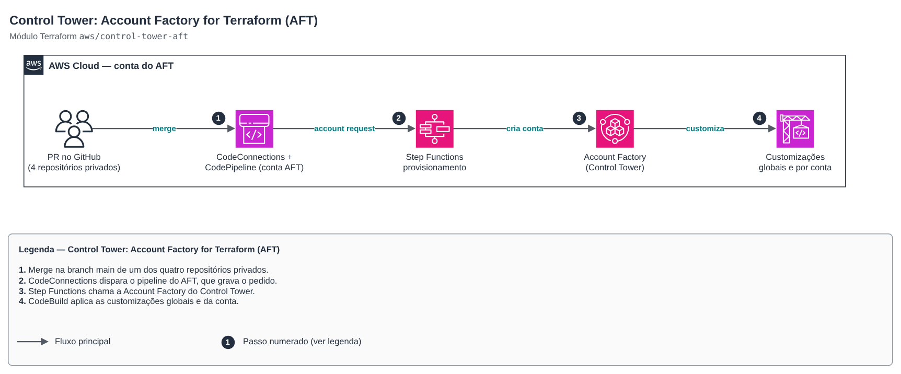

# Control Tower: Account Factory for Terraform (AFT)

[Português](README.md) · **English**

> `aws/control-tower-aft` · category **governanca** · origin: SaaS platform landing zone (2026)

> Created in November 2026 for the landing zone of an in-house SaaS platform.

AWS Control Tower Account Factory for Terraform with FinOps and security defaults. Wraps the official module (pinned 1.23.0): private GitHub through CodeConnections, Terraform OSS, **no VPC, NAT Gateways or VPC endpoints** in the AFT account (the default's largest fixed cost) and anonymous metrics off. Runs with administrator credentials in the management account; resources live in the dedicated AFT account. From then on, new accounts come from pull requests in the account request repository.

## Architecture



Editable source: [`diagram.drawio`](diagram.drawio) (open in draw.io / diagrams.net), with pages in Portuguese and English.

1. Merge to main in one of the four private repositories.
2. CodeConnections triggers the AFT pipeline, which stores the request.
3. Step Functions calls Control Tower Account Factory.
4. CodeBuild applies global and account customizations.

After the first apply: in the AFT account, *Developer Tools → Settings → Connections*, update the *Pending* connection and install the GitHub App only on the four repositories. The official module declares its own providers (management, AFT, Log Archive, Audit and secondary region), so this wrapper cannot use `count`/`for_each`.

## Usage

```hcl
module "aft" {
  source = "git::https://github.com/raphaelfcs/automacao_terraform.git//aws/control-tower-aft?ref=v1.1.0"

  ct_management_account_id    = "123456789012"
  log_archive_account_id      = "210987654321"
  audit_account_id            = "222233334444"
  aft_management_account_id   = "345678901234"
  ct_home_region              = local.region
  tf_backend_secondary_region = "us-east-1"

  vcs_provider     = "github"
  repository_owner = "demo-org"

  tags = local.tags
}
```

## Examples

| Example | Files |
|---|---|
| [`github-sem-vpc`](examples/github-sem-vpc) | `main.tf`, `locals.tf`, `backend.tf` |

Each example has its own backend (state isolated per module and example). Other environments only change `backend.tf`/`*.tfvars`, without duplicating code.

## Inputs

| Name | Type | Default | Required | Description |
|---|---|---|---|---|
| `ct_management_account_id` | `string` | — | yes | Control Tower management account (where the module is applied). |
| `log_archive_account_id` | `string` | — | yes | Landing zone Log Archive account. |
| `audit_account_id` | `string` | — | yes | Landing zone Audit account. |
| `aft_management_account_id` | `string` | — | yes | Account dedicated to AFT (vended beforehand by Account Factory, see control-tower-account-vending). |
| `ct_home_region` | `string` | — | yes | Control Tower home region (the same as the provider applying the module). |
| `tf_backend_secondary_region` | `string` | — | yes | Region of the AFT state backend replica (disaster recovery). |
| `vcs_provider` | `string` | `"github"` | no | Repository provider: github, githubenterprise, gitlab, gitlabselfmanaged, bitbucket, azuredevops or codecommit. |
| `repository_owner` | `string` | `null` | no | Organization/user that owns the repositories (ignored for codecommit). |
| `repositories` | `object({account_request = string, glo...` | `{"account_request": "aft-account-requ...` | no | Names of the four AFT repositories (without the owner). |
| `repo_branch` | `string` | `"main"` | no | Branch watched in the four repositories. |
| `terraform_version` | `string` | `"1.12.2"` | no | Terraform version used by the AFT pipelines. |
| `enable_vpc` | `bool` | `false` | no | Creates VPC, NAT Gateways and VPC endpoints in the AFT account. false = CodeBuild/Lambda outside a VPC (near-zero fixed cost). |
| `codebuild_compute_type` | `string` | `"BUILD_GENERAL1_SMALL"` | no | CodeBuild size for the AFT pipelines. |
| `maximum_concurrent_customizations` | `number` | `5` | no | Account customizations in parallel. |
| `concurrent_account_factory_actions` | `number` | `5` | no | Simultaneous Account Factory actions. |
| `log_retention_days` | `number` | `90` | no | AFT log group retention (0 = never expire). |
| `log_archive_expiration_days` | `number` | `365` | no | Expiration of AFT log objects in the buckets (days). |
| `delete_default_vpcs` | `bool` | `true` | no | Deletes the default VPCs of new accounts (smaller surface, no accidental cost). |
| `cloudtrail_data_events` | `bool` | `false` | no | Turns on CloudTrail data events (S3/Lambda) in the accounts — expensive, off by default. |
| `tags` | `map(string)` | `{}` | no | Additional tags. |

## Outputs

| Name | Description |
|---|---|
| `repositories` | Repositories watched by AFT (create them as private before applying). |
| `aft_management_account_id` | AFT account, which holds pipelines, queues and customization state. |
| `post_deploy` | Manual step after the apply. |

## Files

- `locals.tf`: derived values
- `main.tf`: main resources
- `outputs.tf`: outputs
- `variables.tf`: inputs and validations
- `versions.tf`: Terraform and provider versions
- `examples/`: ready-to-use compositions

## Well-Architected

- Operational excellence: the whole organization is created from code reviewed in pull requests, with no console clicks.
- Security: centralized governance (Control Tower, SCPs, Identity Center) in place before the first workload.
- Cost optimization: AFT without VPC/NAT/endpoints and a small CodeBuild; pipelines only cost money when an account is requested.

## Tests

The official AFT module configures its own providers with `assume_role`, so `terraform test` cannot run without credentials. The catalog check is `terraform validate`:

```bash
cd aws/control-tower-aft
terraform init -backend=false
terraform validate
```
