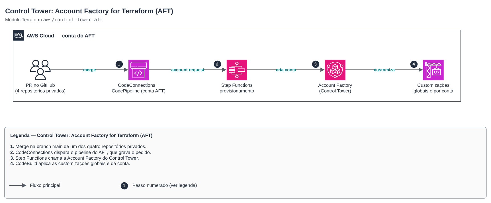

# Control Tower: Account Factory for Terraform (AFT)

**Português** · [English](README.en.md)

> `aws/control-tower-aft` · categoria **governanca** · origem: landing zone de plataforma SaaS (2026)

> Criado em novembro de 2026, para a landing zone de uma plataforma SaaS própria.

AWS Control Tower Account Factory for Terraform com padrões de FinOps e segurança. Encapsula o módulo oficial (versão fixa 1.23.0): GitHub privado via CodeConnections, Terraform OSS, **sem VPC, NAT Gateways e VPC endpoints** na conta do AFT (o maior custo fixo do padrão) e métricas anônimas desligadas. Roda autenticado como administrador na conta de gerenciamento; os recursos ficam na conta dedicada do AFT. A partir daí, contas novas nascem por pull request no repositório de account requests.

## Arquitetura



Fonte editável: [`diagram.drawio`](diagram.drawio) (abra no draw.io / diagrams.net), com páginas em português e inglês.

1. Merge na branch main de um dos quatro repositórios privados.
2. CodeConnections dispara o pipeline do AFT, que grava o pedido.
3. Step Functions chama a Account Factory do Control Tower.
4. CodeBuild aplica as customizações globais e da conta.

Depois do primeiro apply: na conta do AFT, *Developer Tools → Settings → Connections*, atualize a conexão *Pending* e instale o GitHub App só nos quatro repositórios. O módulo oficial declara os próprios providers (management, AFT, Log Archive, Audit e região secundária), por isso este wrapper não pode usar `count`/`for_each`.

## Uso

```hcl
module "aft" {
  source = "git::https://github.com/raphaelfcs/automacao_terraform.git//aws/control-tower-aft?ref=v1.1.0"

  ct_management_account_id    = "123456789012"
  log_archive_account_id      = "210987654321"
  audit_account_id            = "222233334444"
  aft_management_account_id   = "345678901234"
  ct_home_region              = local.region
  tf_backend_secondary_region = "us-east-1"

  vcs_provider     = "github"
  repository_owner = "demo-org"

  tags = local.tags
}
```

## Exemplos

| Exemplo | Arquivos |
|---|---|
| [`github-sem-vpc`](examples/github-sem-vpc) | `main.tf`, `locals.tf`, `backend.tf` |

Cada exemplo tem seu próprio backend (state isolado por módulo e exemplo). Ambientes diferentes usam apenas outro `backend.tf`/`*.tfvars`, sem duplicar código.

## Entradas

| Nome | Tipo | Padrão | Obrigatória | Descrição |
|---|---|---|---|---|
| `ct_management_account_id` | `string` | — | sim | Conta de gerenciamento do Control Tower (onde o módulo é aplicado). |
| `log_archive_account_id` | `string` | — | sim | Conta Log Archive da landing zone. |
| `audit_account_id` | `string` | — | sim | Conta Audit da landing zone. |
| `aft_management_account_id` | `string` | — | sim | Conta dedicada ao AFT (criada antes pela Account Factory, ver control-tower-account-vending). |
| `ct_home_region` | `string` | — | sim | Home region do Control Tower (a mesma do provider que aplica o módulo). |
| `tf_backend_secondary_region` | `string` | — | sim | Região da réplica do backend de estado do AFT (recuperação de desastre). |
| `vcs_provider` | `string` | `"github"` | não | Provedor dos repositórios: github, githubenterprise, gitlab, gitlabselfmanaged, bitbucket, azuredevops ou codecommit. |
| `repository_owner` | `string` | `null` | não | Organização/usuário dono dos repositórios (ignorado para codecommit). |
| `repositories` | `object({account_request = string, glo...` | `{"account_request": "aft-account-requ...` | não | Nomes dos quatro repositórios do AFT (sem o dono). |
| `repo_branch` | `string` | `"main"` | não | Branch observada nos quatro repositórios. |
| `terraform_version` | `string` | `"1.12.2"` | não | Versão do Terraform usada nos pipelines do AFT. |
| `enable_vpc` | `bool` | `false` | não | Cria VPC, NAT Gateways e VPC endpoints na conta do AFT. false = CodeBuild/Lambda fora de VPC (custo fixo perto de zero). |
| `codebuild_compute_type` | `string` | `"BUILD_GENERAL1_SMALL"` | não | Tamanho do CodeBuild dos pipelines do AFT. |
| `maximum_concurrent_customizations` | `number` | `5` | não | Customizações de conta em paralelo. |
| `concurrent_account_factory_actions` | `number` | `5` | não | Ações simultâneas na Account Factory. |
| `log_retention_days` | `number` | `90` | não | Retenção dos log groups do AFT (0 = sem expiração). |
| `log_archive_expiration_days` | `number` | `365` | não | Expiração dos objetos de log do AFT nos buckets (dias). |
| `delete_default_vpcs` | `bool` | `true` | não | Remove as VPCs padrão das contas novas (reduz superfície e evita custo acidental). |
| `cloudtrail_data_events` | `bool` | `false` | não | Liga data events do CloudTrail (S3/Lambda) nas contas — custo alto, desligado por padrão. |
| `tags` | `map(string)` | `{}` | não | Tags adicionais. |

## Saídas

| Nome | Descrição |
|---|---|
| `repositories` | Repositórios observados pelo AFT (crie-os privados antes do apply). |
| `aft_management_account_id` | Conta do AFT, onde ficam pipelines, filas e o estado das customizações. |
| `post_deploy` | Passo manual depois do apply. |

## Arquivos

- `locals.tf`: valores derivados
- `main.tf`: recursos principais
- `outputs.tf`: saídas
- `variables.tf`: entradas e validações
- `versions.tf`: versões do Terraform e providers
- `examples/`: composições prontas para uso

## Well-Architected

- Excelência operacional: a organização inteira nasce de código revisado em PR, sem cliques no console.
- Segurança: governança centralizada (Control Tower, SCPs, Identity Center) antes da primeira carga de trabalho.
- Otimização de custos: AFT sem VPC/NAT/endpoints e CodeBuild pequeno; pipelines só cobram quando há pedido de conta.

## Testes

O módulo oficial do AFT configura providers próprios com `assume_role`, então `terraform test` não roda sem credenciais. A verificação do catálogo é `terraform validate`:

```bash
cd aws/control-tower-aft
terraform init -backend=false
terraform validate
```
