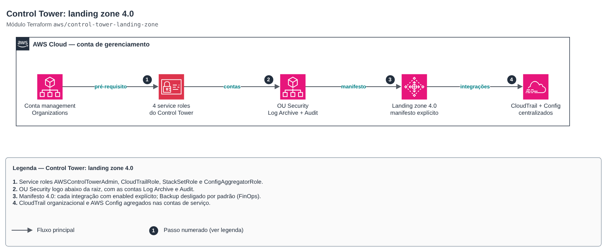

# Control Tower: landing zone 4.0

[Português](README.md) · **English**

> `aws/control-tower-landing-zone` · category **governanca** · origin: SaaS platform landing zone (2026)

> Created in November 2026 for the landing zone of an in-house SaaS platform.

AWS Control Tower landing zone (version 4.0) as code, from the management account: security OU, shared Log Archive and Audit accounts (created or reused), the four service roles the API requires and a manifest where every integration is explicitly on or off (Identity Center, AWS Config, centralized logging, security roles and Backup). Prerequisite: AWS Organizations with all features. Workload OUs and their registration live in `organizations-scp` and `control-tower-ou-registration`.

## Architecture



Editable source: [`diagram.drawio`](diagram.drawio) (open in draw.io / diagrams.net), with pages in Portuguese and English.

1. Service roles AWSControlTowerAdmin, CloudTrailRole, StackSetRole and ConfigAggregatorRole.
2. Security OU right under the root, with the Log Archive and Audit accounts.
3. 4.0 manifest: every integration with an explicit enabled flag; Backup off by default (FinOps).
4. Organization CloudTrail and AWS Config aggregated in the service accounts.

Manifest 4.0 rule checked at plan time: with AWS Config off, Identity Center, security roles and Backup must be off as well.

## Usage

```hcl
module "landing_zone" {
  source = "git::https://github.com/raphaelfcs/automacao_terraform.git//aws/control-tower-landing-zone?ref=v1.1.0"

  governed_regions = ["sa-east-1", "us-east-1"]

  log_archive_account = {
    name  = "demo-log-archive"
    email = "aws+demo-log-archive@example.com"
  }
  audit_account = {
    name  = "demo-security-audit"
    email = "aws+demo-security-audit@example.com"
  }

  log_retention_days        = 365
  access_log_retention_days = 30
  tags                      = local.tags
}
```

## Examples

| Example | Files |
|---|---|
| [`landing-zone`](examples/landing-zone) | `main.tf`, `locals.tf`, `backend.tf` |

Each example has its own backend (state isolated per module and example). Other environments only change `backend.tf`/`*.tfvars`, without duplicating code.

## Inputs

| Name | Type | Default | Required | Description |
|---|---|---|---|---|
| `governed_regions` | `list(string)` | — | yes | Regions governed by Control Tower. The first one must be the home region (where the module runs). |
| `landing_zone_version` | `string` | `"4.0"` | no | Landing zone version. This module builds the manifest in the 4.0 format. |
| `security_ou_name` | `string` | `"Security"` | no | Name of the service accounts OU (Log Archive and Audit), right under the root. |
| `existing_security_ou_id` | `string` | `null` | no | ID of an existing security OU. null = the module creates it. |
| `log_archive_account` | `object({name = string, email = string...` | — | yes | Log Archive account. Without id, the module creates it with the given name and email. |
| `audit_account` | `object({name = string, email = string...` | — | yes | Audit (Security Tooling) account. Without id, the module creates it with the given name and email. |
| `enable_identity_center` | `bool` | `true` | no | IAM Identity Center integration (accessManagement): Control Tower groups and permission sets. |
| `enable_config` | `bool` | `true` | no | AWS Config integration (aggregator in the Audit account). Turning it off requires Identity Center, security roles and Backup off. |
| `enable_security_roles` | `bool` | `true` | no | Creates the cross-account audit roles in the Audit account. |
| `enable_centralized_logging` | `bool` | `true` | no | Organization CloudTrail and log bucket in the Log Archive account. |
| `log_retention_days` | `number` | `365` | no | Retention (days) of CloudTrail and Config logs. |
| `access_log_retention_days` | `number` | `90` | no | Retention (days) of the log buckets' access logs. |
| `kms_key_arn` | `string` | `null` | no | KMS key for CloudTrail and Config logs. null = AWS managed encryption. |
| `backup` | `object({admin_account_id = string, ce...` | `null` | no | AWS Backup integration (admin and central accounts + KMS key). null = off (FinOps). |
| `tags` | `map(string)` | `{}` | no | Additional tags. |

## Outputs

| Name | Description |
|---|---|
| `landing_zone_arn` | Landing zone ARN. |
| `landing_zone_drift` | Landing zone drift status. |
| `home_region` | Home region (region the module was applied from). |
| `security_ou_id` | Security OU ID. |
| `log_archive_account_id` | Log Archive account ID. |
| `audit_account_id` | Audit account ID. |
| `organization_id` | Organization ID. |
| `manifest` | Manifest sent to Control Tower (useful for PR review). |

## Files

- `iam.tf`: policies, roles and permissions
- `locals.tf`: derived values
- `main.tf`: main resources
- `outputs.tf`: outputs
- `variables.tf`: inputs and validations
- `versions.tf`: Terraform and provider versions
- `examples/`: ready-to-use compositions
- `tests/`: `terraform test` with mocked providers

## Well-Architected

- Operational excellence: the whole organization is created from code reviewed in pull requests, with no console clicks.
- Security: centralized governance (Control Tower, SCPs, Identity Center) in place before the first workload.
- Cost optimization: optional integrations (Backup, long retention) off by default and enabled by decision.

## Tests

```bash
cd aws/control-tower-landing-zone
terraform init -backend=false
terraform test
```
