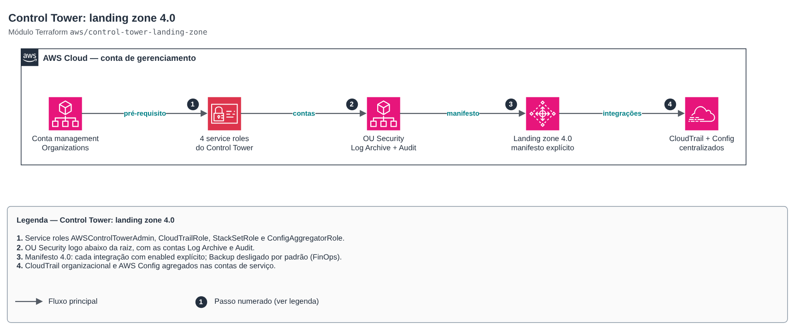

# Control Tower: landing zone 4.0

**Português** · [English](README.en.md)

> `aws/control-tower-landing-zone` · categoria **governanca** · origem: landing zone de plataforma SaaS (2026)

> Criado em novembro de 2026, para a landing zone de uma plataforma SaaS própria.

Landing zone do AWS Control Tower (versão 4.0) como código, a partir da conta de gerenciamento: OU de segurança, contas compartilhadas Log Archive e Audit (criadas ou reaproveitadas), as quatro service roles exigidas pela API e o manifesto com cada integração ligada ou desligada de forma explícita (Identity Center, AWS Config, logs centralizados, security roles e Backup). Pré-requisito: AWS Organizations com todas as features. As OUs de workload e o registro delas ficam nos módulos `organizations-scp` e `control-tower-ou-registration`.

## Arquitetura



Fonte editável: [`diagram.drawio`](diagram.drawio) (abra no draw.io / diagrams.net), com páginas em português e inglês.

1. Service roles AWSControlTowerAdmin, CloudTrailRole, StackSetRole e ConfigAggregatorRole.
2. OU Security logo abaixo da raiz, com as contas Log Archive e Audit.
3. Manifesto 4.0: cada integração com enabled explícito; Backup desligado por padrão (FinOps).
4. CloudTrail organizacional e AWS Config agregados nas contas de serviço.

Regra do manifesto 4.0 validada no plan: com AWS Config desligado, Identity Center, security roles e Backup também precisam estar desligados.

## Uso

```hcl
module "landing_zone" {
  source = "git::https://github.com/raphaelfcs/automacao_terraform.git//aws/control-tower-landing-zone?ref=v1.1.0"

  governed_regions = ["sa-east-1", "us-east-1"]

  log_archive_account = {
    name  = "demo-log-archive"
    email = "aws+demo-log-archive@example.com"
  }
  audit_account = {
    name  = "demo-security-audit"
    email = "aws+demo-security-audit@example.com"
  }

  log_retention_days        = 365
  access_log_retention_days = 30
  tags                      = local.tags
}
```

## Exemplos

| Exemplo | Arquivos |
|---|---|
| [`landing-zone`](examples/landing-zone) | `main.tf`, `locals.tf`, `backend.tf` |

Cada exemplo tem seu próprio backend (state isolado por módulo e exemplo). Ambientes diferentes usam apenas outro `backend.tf`/`*.tfvars`, sem duplicar código.

## Entradas

| Nome | Tipo | Padrão | Obrigatória | Descrição |
|---|---|---|---|---|
| `governed_regions` | `list(string)` | — | sim | Regiões governadas pelo Control Tower. A primeira deve ser a home region (de onde o módulo roda). |
| `landing_zone_version` | `string` | `"4.0"` | não | Versão da landing zone. Este módulo monta o manifesto no formato 4.0. |
| `security_ou_name` | `string` | `"Security"` | não | Nome da OU das contas de serviço (Log Archive e Audit), logo abaixo da raiz. |
| `existing_security_ou_id` | `string` | `null` | não | ID de uma OU de segurança já existente. null = o módulo cria a OU. |
| `log_archive_account` | `object({name = string, email = string...` | — | sim | Conta Log Archive. Sem id, o módulo cria a conta com nome e e-mail informados. |
| `audit_account` | `object({name = string, email = string...` | — | sim | Conta Audit (Security Tooling). Sem id, o módulo cria a conta com nome e e-mail informados. |
| `enable_identity_center` | `bool` | `true` | não | Integração com o IAM Identity Center (accessManagement): grupos e permission sets do Control Tower. |
| `enable_config` | `bool` | `true` | não | Integração com o AWS Config (agregador na conta Audit). Desligar obriga a desligar Identity Center, security roles e Backup. |
| `enable_security_roles` | `bool` | `true` | não | Cria as roles de auditoria cross-account na conta Audit. |
| `enable_centralized_logging` | `bool` | `true` | não | CloudTrail organizacional e bucket de logs na conta Log Archive. |
| `log_retention_days` | `number` | `365` | não | Retenção (dias) dos logs do CloudTrail e do Config. |
| `access_log_retention_days` | `number` | `90` | não | Retenção (dias) dos access logs dos buckets de log. |
| `kms_key_arn` | `string` | `null` | não | Chave KMS para os logs do CloudTrail e do Config. null = criptografia gerenciada pela AWS. |
| `backup` | `object({admin_account_id = string, ce...` | `null` | não | Integração com AWS Backup (contas admin e central + chave KMS). null = desligada (FinOps). |
| `tags` | `map(string)` | `{}` | não | Tags adicionais. |

## Saídas

| Nome | Descrição |
|---|---|
| `landing_zone_arn` | ARN da landing zone. |
| `landing_zone_drift` | Situação de drift da landing zone. |
| `home_region` | Home region (região de onde o módulo foi aplicado). |
| `security_ou_id` | ID da OU de segurança. |
| `log_archive_account_id` | ID da conta Log Archive. |
| `audit_account_id` | ID da conta Audit. |
| `organization_id` | ID da organização. |
| `manifest` | Manifesto enviado ao Control Tower (útil para revisão em PR). |

## Arquivos

- `iam.tf`: políticas, papéis e permissões
- `locals.tf`: valores derivados
- `main.tf`: recursos principais
- `outputs.tf`: saídas
- `variables.tf`: entradas e validações
- `versions.tf`: versões do Terraform e providers
- `examples/`: composições prontas para uso
- `tests/`: `terraform test` com providers simulados

## Well-Architected

- Excelência operacional: a organização inteira nasce de código revisado em PR, sem cliques no console.
- Segurança: governança centralizada (Control Tower, SCPs, Identity Center) antes da primeira carga de trabalho.
- Otimização de custos: integrações opcionais (Backup, retenções longas) desligadas por padrão e ligadas por decisão.

## Testes

```bash
cd aws/control-tower-landing-zone
terraform init -backend=false
terraform test
```
