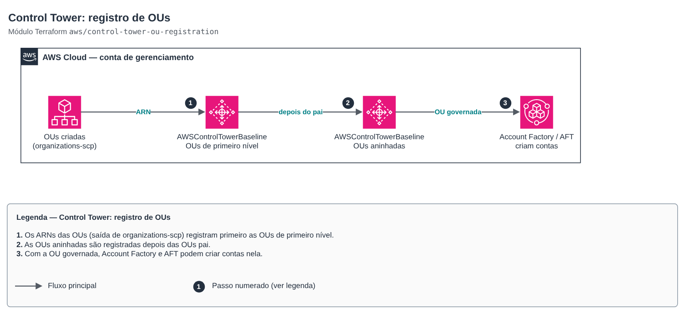

# Control Tower: OU registration

[Português](README.md) · **English**

> `aws/control-tower-ou-registration` · category **governanca** · origin: SaaS platform landing zone (2026)

> Created in November 2026 for the landing zone of an in-house SaaS platform.

OU registration in AWS Control Tower through the API: enables the AWSControlTowerBaseline on each OU (the console's *Register OU*). Accounts in the OU become governed by Control Tower controls and Account Factory/AFT can vend accounts into it. OUs are created outside this module (e.g. `organizations-scp`); child OUs are registered only after their parents.

## Architecture



Editable source: [`diagram.drawio`](diagram.drawio) (open in draw.io / diagrams.net), with pages in Portuguese and English.

1. The OU ARNs (output of organizations-scp) register the first-level OUs first.
2. Nested OUs are registered after their parents.
3. Once governed, Account Factory and AFT can vend accounts into the OU.

Control Tower processes one registration at a time: apply with `terraform apply -parallelism=1`. With Identity Center integrated, set `identity_center_enabled_baseline_arn` (`aws controltower list-enabled-baselines`).

## Usage

```hcl
module "ou_registration" {
  source = "git::https://github.com/raphaelfcs/automacao_terraform.git//aws/control-tower-ou-registration?ref=v1.1.0"

  organizational_units = {
    Infrastructure = { arn = "arn:aws:organizations::123456789012:ou/o-abcd123456/ou-ab12-11111111" }
    Workloads      = { arn = "arn:aws:organizations::123456789012:ou/o-abcd123456/ou-ab12-22222222" }
    Dev            = { arn = "arn:aws:organizations::123456789012:ou/o-abcd123456/ou-ab12-33333333", parent = "Workloads" }
    Prd            = { arn = "arn:aws:organizations::123456789012:ou/o-abcd123456/ou-ab12-44444444", parent = "Workloads" }
  }

  identity_center_enabled_baseline_arn = "arn:aws:controltower:sa-east-1:123456789012:enabledbaseline/XAHCR4CJTSI4W07MZ"
  tags                                 = local.tags
}
```

## Examples

| Example | Files |
|---|---|
| [`registrar-ous`](examples/registrar-ous) | `main.tf`, `locals.tf`, `backend.tf` |

Each example has its own backend (state isolated per module and example). Other environments only change `backend.tf`/`*.tfvars`, without duplicating code.

## Inputs

| Name | Type | Default | Required | Description |
|---|---|---|---|---|
| `organizational_units` | `map(object({arn = string, parent = op...` | — | yes | OUs to register by name: OU ARN and, for nested OUs, the parent OU name (also in the map or already registered). |
| `identity_center_enabled_baseline_arn` | `string` | `null` | no | ARN of the Identity Center baseline enabled by the landing zone (required when accessManagement is on). Get it with: aws controltower list-enabled-baselines. |
| `baseline_version` | `string` | `"4.0"` | no | AWSControlTowerBaseline version (follows the landing zone version). |
| `baseline_arn` | `string` | `null` | no | AWSControlTowerBaseline ARN. null = built from AWS's standard identifier in the provider region. |
| `tags` | `map(string)` | `{}` | no | Additional tags. |

## Outputs

| Name | Description |
|---|---|
| `enabled_baseline_arns` | Enabled baseline ARN per OU (use with reset-enabled-baseline to re-register). |
| `registered_ous` | Names of the OUs registered in Control Tower. |

## Files

- `locals.tf`: derived values
- `main.tf`: main resources
- `outputs.tf`: outputs
- `variables.tf`: inputs and validations
- `versions.tf`: Terraform and provider versions
- `examples/`: ready-to-use compositions
- `tests/`: `terraform test` with mocked providers

## Well-Architected

- Operational excellence: the whole organization is created from code reviewed in pull requests, with no console clicks.
- Security: centralized governance (Control Tower, SCPs, Identity Center) in place before the first workload.

## Tests

```bash
cd aws/control-tower-ou-registration
terraform init -backend=false
terraform test
```
