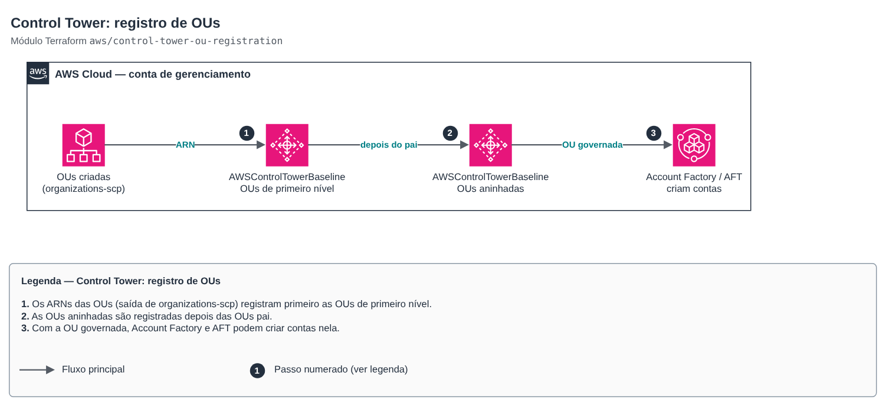

# Control Tower: registro de OUs

**Português** · [English](README.en.md)

> `aws/control-tower-ou-registration` · categoria **governanca** · origem: landing zone de plataforma SaaS (2026)

> Criado em novembro de 2026, para a landing zone de uma plataforma SaaS própria.

Registro de OUs no AWS Control Tower pela API: habilita o AWSControlTowerBaseline em cada OU (equivalente ao *Register OU* do console). As contas da OU passam a ser governadas pelos controles do Control Tower e o Account Factory/AFT pode criar contas nela. As OUs nascem fora deste módulo (ex.: `organizations-scp`); OUs filhas só são registradas depois das OUs pai.

## Arquitetura



Fonte editável: [`diagram.drawio`](diagram.drawio) (abra no draw.io / diagrams.net), com páginas em português e inglês.

1. Os ARNs das OUs (saída de organizations-scp) registram primeiro as OUs de primeiro nível.
2. As OUs aninhadas são registradas depois das OUs pai.
3. Com a OU governada, Account Factory e AFT podem criar contas nela.

O Control Tower processa um registro por vez: aplique com `terraform apply -parallelism=1`. Com o Identity Center integrado, informe `identity_center_enabled_baseline_arn` (`aws controltower list-enabled-baselines`).

## Uso

```hcl
module "ou_registration" {
  source = "git::https://github.com/raphaelfcs/automacao_terraform.git//aws/control-tower-ou-registration?ref=v1.1.0"

  organizational_units = {
    Infrastructure = { arn = "arn:aws:organizations::123456789012:ou/o-abcd123456/ou-ab12-11111111" }
    Workloads      = { arn = "arn:aws:organizations::123456789012:ou/o-abcd123456/ou-ab12-22222222" }
    Dev            = { arn = "arn:aws:organizations::123456789012:ou/o-abcd123456/ou-ab12-33333333", parent = "Workloads" }
    Prd            = { arn = "arn:aws:organizations::123456789012:ou/o-abcd123456/ou-ab12-44444444", parent = "Workloads" }
  }

  identity_center_enabled_baseline_arn = "arn:aws:controltower:sa-east-1:123456789012:enabledbaseline/XAHCR4CJTSI4W07MZ"
  tags                                 = local.tags
}
```

## Exemplos

| Exemplo | Arquivos |
|---|---|
| [`registrar-ous`](examples/registrar-ous) | `main.tf`, `locals.tf`, `backend.tf` |

Cada exemplo tem seu próprio backend (state isolado por módulo e exemplo). Ambientes diferentes usam apenas outro `backend.tf`/`*.tfvars`, sem duplicar código.

## Entradas

| Nome | Tipo | Padrão | Obrigatória | Descrição |
|---|---|---|---|---|
| `organizational_units` | `map(object({arn = string, parent = op...` | — | sim | OUs a registrar, por nome: ARN da OU e, para OUs aninhadas, o nome da OU pai (que também precisa estar no mapa ou já registrada). |
| `identity_center_enabled_baseline_arn` | `string` | `null` | não | ARN do baseline do Identity Center já habilitado pela landing zone (obrigatório quando o accessManagement está ligado). Obtenha com: aws controltower list-enabled-baselines. |
| `baseline_version` | `string` | `"4.0"` | não | Versão do AWSControlTowerBaseline (acompanha a versão da landing zone). |
| `baseline_arn` | `string` | `null` | não | ARN do AWSControlTowerBaseline. null = monta pelo identificador padrão da AWS na região do provider. |
| `tags` | `map(string)` | `{}` | não | Tags adicionais. |

## Saídas

| Nome | Descrição |
|---|---|
| `enabled_baseline_arns` | ARN do baseline habilitado por OU (use em reset-enabled-baseline para re-registrar). |
| `registered_ous` | Nomes das OUs registradas no Control Tower. |

## Arquivos

- `locals.tf`: valores derivados
- `main.tf`: recursos principais
- `outputs.tf`: saídas
- `variables.tf`: entradas e validações
- `versions.tf`: versões do Terraform e providers
- `examples/`: composições prontas para uso
- `tests/`: `terraform test` com providers simulados

## Well-Architected

- Excelência operacional: a organização inteira nasce de código revisado em PR, sem cliques no console.
- Segurança: governança centralizada (Control Tower, SCPs, Identity Center) antes da primeira carga de trabalho.

## Testes

```bash
cd aws/control-tower-ou-registration
terraform init -backend=false
terraform test
```
