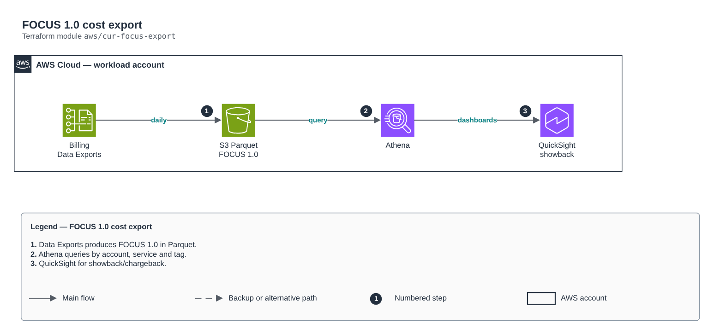

# FOCUS 1.0 cost export

[Português](README.md) · **English**

> `aws/cur-focus-export` · category **finops** · origin: Telecom CCoE and landing zone (2025)

> Designed in April 2025. With no time to keep the repository up to date back then, it is being published and updated now.

FOCUS 1.0 (FinOps Open Cost & Usage Specification) cost export through AWS Data Exports to S3 in Parquet, the basis for Athena/QuickSight or FinOps tools. Replaces the legacy CUR. The Data Exports API (bcm-data-exports) only exists in us-east-1.

## Architecture



Editable source: [`diagram.drawio`](diagram.drawio) (open it in draw.io / diagrams.net), with Portuguese and English pages.

1. Data Exports produces FOCUS 1.0 in Parquet.
2. Athena queries by account, service and tag.
3. QuickSight for showback/chargeback.

## Usage

```hcl
module "cur_focus_export" {
  source = "git::https://github.com/raphaelfcs/automacao_terraform.git//aws/cur-focus-export?ref=v1.0.0"

  bucket_name    = "demo-finops-focus-123456789012"
  retention_days = 730
  tags           = local.tags
}
```

## Examples

| Example | Files |
|---|---|
| [`basico`](examples/basico) | `main.tf`, `locals.tf`, `backend.tf` |

Each example has its own backend (state isolated per module and example). Different environments only use another `backend.tf`/`*.tfvars`, without duplicating code.

## Inputs

| Name | Type | Default | Required | Description |
|---|---|---|---|---|
| `export_name` | `string` | `"focus-1-0"` | no | FOCUS export name. |
| `bucket_name` | `string` | - | **yes** | Target bucket (created here or existing). |
| `create_bucket` | `bool` | `true` | no | Creates the bucket with the Data Exports policy. false = use an existing bucket that already has the policy. |
| `bucket_region` | `string` | `"us-east-1"` | no | Target bucket region. |
| `s3_prefix` | `string` | `"focus"` | no | Prefix of the exported files. |
| `retention_days` | `number` | `0` | no | Expiration of the exported files (0 = no expiration). |
| `focus_columns` | `list(string)` | `[ "BilledCost", "BillingAccountId", "...` | no | Selected FOCUS columns. Default: essential set for showback/chargeback. |
| `tags` | `map(string)` | `{}` | no | Tags applied. |

## Outputs

| Name | Description |
|---|---|
| `export_arn` | FOCUS export ARN. |
| `bucket_name` | Bucket with the Parquet files. |
| `athena_location` | S3 location to create the Athena/Glue table. |

## Files

- `iam.tf`: policies, roles and permissions
- `locals.tf`: derived values
- `main.tf`: main resources
- `outputs.tf`: outputs
- `variables.tf`: inputs and validations
- `versions.tf`: Terraform and provider versions
- `examples/`: ready-to-use compositions
- `tests/`: `terraform test` with mocked providers

## Well-Architected

- Cost optimization: resources off after hours, tag-based allocation and FOCUS reports.
- Sustainability: less idle capacity running.

## Tests

```bash
cd aws/cur-focus-export
terraform init -backend=false
terraform test
```
