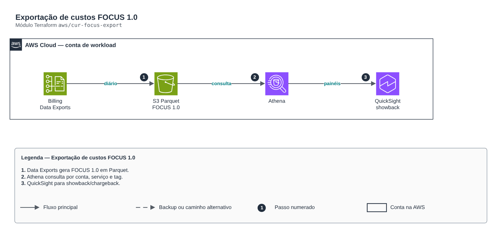

# Exportação de custos FOCUS 1.0

**Português** · [English](README.en.md)

> `aws/cur-focus-export` · categoria **finops** · origem: CCoE e landing zone de telecom (2025)

> Idealizado em abril de 2025. Por falta de tempo para manter o repositório em dia na época, está sendo publicado e atualizado agora.

Exportação de custos no padrão FOCUS 1.0 (FinOps Open Cost & Usage Specification) via AWS Data Exports para S3 em Parquet, base para Athena/QuickSight ou ferramentas FinOps. Substitui o antigo CUR legado. A API do Data Exports (bcm-data-exports) só existe em us-east-1.

## Arquitetura



Fonte editável: [`diagram.drawio`](diagram.drawio) (abra no draw.io / diagrams.net), com páginas em português e inglês.

1. Data Exports gera FOCUS 1.0 em Parquet.
2. Athena consulta por conta, serviço e tag.
3. QuickSight para showback/chargeback.

## Uso

```hcl
module "cur_focus_export" {
  source = "git::https://github.com/raphaelfcs/automacao_terraform.git//aws/cur-focus-export?ref=v1.0.0"

  bucket_name    = "demo-finops-focus-123456789012"
  retention_days = 730
  tags           = local.tags
}
```

## Exemplos

| Exemplo | Arquivos |
|---|---|
| [`basico`](examples/basico) | `main.tf`, `locals.tf`, `backend.tf` |

Cada exemplo tem seu próprio backend (state isolado por módulo e exemplo). Ambientes diferentes usam apenas outro `backend.tf`/`*.tfvars`, sem duplicar código.

## Entradas

| Nome | Tipo | Padrão | Obrigatória | Descrição |
|---|---|---|---|---|
| `export_name` | `string` | `"focus-1-0"` | não | Nome da exportação FOCUS. |
| `bucket_name` | `string` | - | **sim** | Bucket de destino (criado aqui ou existente). |
| `create_bucket` | `bool` | `true` | não | Cria o bucket com a política para o Data Exports. false = use um bucket existente já com a política. |
| `bucket_region` | `string` | `"us-east-1"` | não | Região do bucket de destino. |
| `s3_prefix` | `string` | `"focus"` | não | Prefixo dos arquivos exportados. |
| `retention_days` | `number` | `0` | não | Expiração dos arquivos exportados (0 = sem expiração). |
| `focus_columns` | `list(string)` | `[ "BilledCost", "BillingAccountId", "...` | não | Colunas FOCUS selecionadas. Padrão: conjunto essencial para showback/chargeback. |
| `tags` | `map(string)` | `{}` | não | Tags aplicadas. |

## Saídas

| Nome | Descrição |
|---|---|
| `export_arn` | ARN da exportação FOCUS. |
| `bucket_name` | Bucket com os arquivos Parquet. |
| `athena_location` | Local S3 para criar a tabela no Athena/Glue. |

## Arquivos

- `iam.tf`: políticas, papéis e permissões
- `locals.tf`: valores derivados
- `main.tf`: recursos principais
- `outputs.tf`: saídas
- `variables.tf`: entradas e validações
- `versions.tf`: versões do Terraform e providers
- `examples/`: composições prontas para uso
- `tests/`: `terraform test` com providers simulados

## Well-Architected

- Otimização de custos: recursos desligados fora do horário, alocação por tags e relatórios no padrão FOCUS.
- Sustentabilidade: menos capacidade ociosa ligada.

## Testes

```bash
cd aws/cur-focus-export
terraform init -backend=false
terraform test
```
