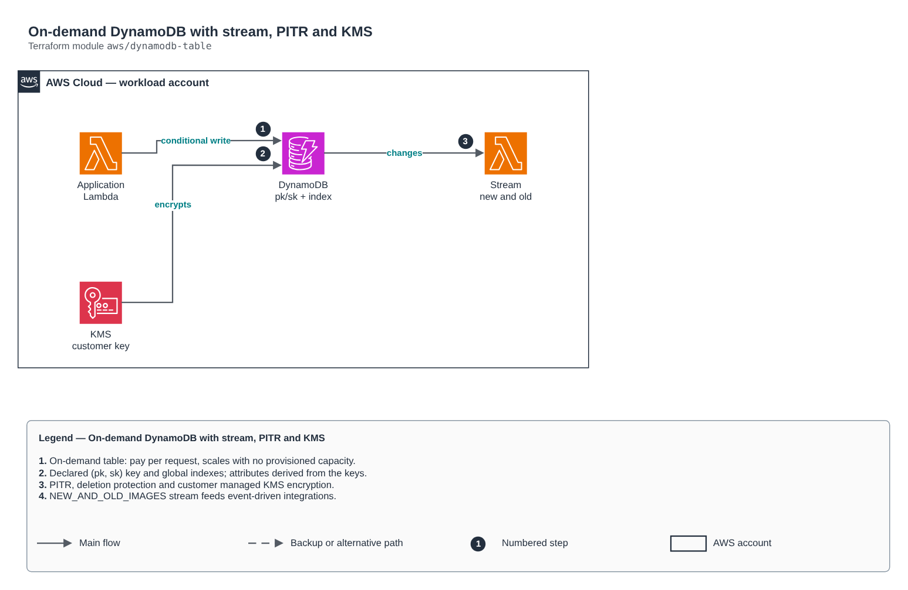

# On-demand DynamoDB with stream, PITR and KMS

[Português](README.md) · **English**

> `aws/dynamodb-table` · category **dados** · origin: Health records platform (2026)

> Designed in November 2026 and published now.

Production-ready on-demand DynamoDB table: (pk, sk) key, global indexes, optional stream (NEW_AND_OLD_IMAGES) for event-driven integration, PITR, customer managed KMS encryption, deletion protection and optional TTL.

## Architecture



Editable source: [`diagram.drawio`](diagram.drawio) (open it in draw.io / diagrams.net), with Portuguese and English pages.

1. On-demand table: pay per request, scales with no provisioned capacity.
2. Declared (pk, sk) key and global indexes; attributes derived from the keys.
3. PITR, deletion protection and customer managed KMS encryption.
4. NEW_AND_OLD_IMAGES stream feeds event-driven integrations.

## Usage

```hcl
module "dynamodb_table" {
  source = "git::https://github.com/raphaelfcs/automacao_terraform.git//aws/dynamodb-table?ref=v1.0.0"

  name             = "${local.name_prefix}-itens"
  kms_key_arn      = "arn:aws:kms:sa-east-1:123456789012:key/11111111-2222-3333-4444-555555555555"
  stream_view_type = "NEW_AND_OLD_IMAGES"
  global_secondary_indexes = {
    por_paciente = { hash_key = "paciente_sub", range_key = "sk" }
  }
  tags = local.tags
}
```

## Examples

| Example | Files |
|---|---|
| [`tabela-unica`](examples/tabela-unica) | `main.tf`, `locals.tf`, `backend.tf` |

Each example has its own backend (state isolated per module and example). Different environments only use another `backend.tf`/`*.tfvars`, without duplicating code.

## Inputs

| Name | Type | Default | Required | Description |
|---|---|---|---|---|
| `name` | `string` | - | **yes** | Table name. |
| `hash_key` | `string` | `"pk"` | no | Partition key. |
| `range_key` | `string` | `"sk"` | no | Sort key (null = none). |
| `attribute_types` | `map(string)` | `{}` | no | Type of key attributes that are not strings: name -> S, N or B. |
| `global_secondary_indexes` | `map(...)` | `{}` | no | Global indexes: name -> { hash_key, range_key, projection_type }. |
| `stream_view_type` | `string` | `null` | no | Turns on the stream (NEW_AND_OLD_IMAGES, NEW_IMAGE, OLD_IMAGE, KEYS_ONLY). null = no stream. |
| `kms_key_arn` | `string` | - | **yes** | Customer managed KMS key to encrypt the table. |
| `point_in_time_recovery` | `bool` | `true` | no | Recovery to any second of the last 35 days. |
| `deletion_protection` | `bool` | `true` | no | Prevents deleting the table by mistake (turn off only to destroy on purpose). |
| `ttl_attribute` | `string` | `null` | no | Expiration attribute (epoch seconds). null = no TTL. |
| `table_class` | `string` | `"STANDARD"` | no | STANDARD or STANDARD_INFREQUENT_ACCESS (cheaper storage, more expensive reads/writes). |
| `tags` | `map(string)` | `{}` | no | Tags applied. |

## Outputs

| Name | Description |
|---|---|
| `name` | Table name. |
| `arn` | Table ARN. |
| `stream_arn` | Stream ARN (null without a stream). |
| `index_arns` | Global index ARNs (for IAM policies). |

## Files

- `locals.tf`: derived values
- `main.tf`: main resources
- `outputs.tf`: outputs
- `variables.tf`: inputs and validations
- `versions.tf`: Terraform and provider versions
- `examples/`: ready-to-use compositions
- `tests/`: `terraform test` with mocked providers

## Well-Architected

- Reliability: automatic backups, configurable Multi-AZ/high availability and deletion protection.
- Security: private-only access, mandatory TLS and data encrypted at rest with KMS/CMK.

## Tests

```bash
cd aws/dynamodb-table
terraform init -backend=false
terraform test
```
