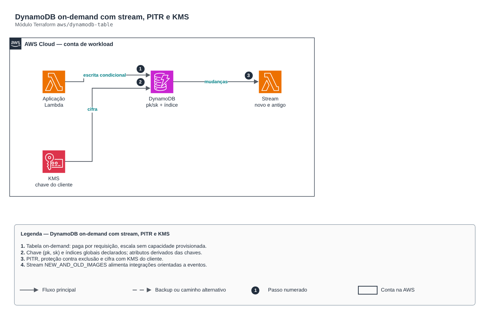

# DynamoDB on-demand com stream, PITR e KMS

**Português** · [English](README.en.md)

> `aws/dynamodb-table` · categoria **dados** · origem: Plataforma de documentos de saúde (2026)

> Idealizado em novembro de 2026 e publicado agora.

Tabela DynamoDB on-demand pronta para produção: chave (pk, sk), índices globais, stream opcional (NEW_AND_OLD_IMAGES) para integração orientada a eventos, PITR, cifra com KMS do cliente, proteção contra exclusão e TTL opcional.

## Arquitetura



Fonte editável: [`diagram.drawio`](diagram.drawio) (abra no draw.io / diagrams.net), com páginas em português e inglês.

1. Tabela on-demand: paga por requisição, escala sem capacidade provisionada.
2. Chave (pk, sk) e índices globais declarados; atributos derivados das chaves.
3. PITR, proteção contra exclusão e cifra com KMS do cliente.
4. Stream NEW_AND_OLD_IMAGES alimenta integrações orientadas a eventos.

## Uso

```hcl
module "dynamodb_table" {
  source = "git::https://github.com/raphaelfcs/automacao_terraform.git//aws/dynamodb-table?ref=v1.0.0"

  name             = "${local.name_prefix}-itens"
  kms_key_arn      = "arn:aws:kms:sa-east-1:123456789012:key/11111111-2222-3333-4444-555555555555"
  stream_view_type = "NEW_AND_OLD_IMAGES"
  global_secondary_indexes = {
    por_paciente = { hash_key = "paciente_sub", range_key = "sk" }
  }
  tags = local.tags
}
```

## Exemplos

| Exemplo | Arquivos |
|---|---|
| [`tabela-unica`](examples/tabela-unica) | `main.tf`, `locals.tf`, `backend.tf` |

Cada exemplo tem seu próprio backend (state isolado por módulo e exemplo). Ambientes diferentes usam apenas outro `backend.tf`/`*.tfvars`, sem duplicar código.

## Entradas

| Nome | Tipo | Padrão | Obrigatória | Descrição |
|---|---|---|---|---|
| `name` | `string` | - | **sim** | Nome da tabela. |
| `hash_key` | `string` | `"pk"` | não | Chave de partição. |
| `range_key` | `string` | `"sk"` | não | Chave de ordenação (null = sem). |
| `attribute_types` | `map(string)` | `{}` | não | Tipo dos atributos de chave que não são string: nome -> S, N ou B. |
| `global_secondary_indexes` | `map(...)` | `{}` | não | Índices globais: nome -> { hash_key, range_key, projection_type }. |
| `stream_view_type` | `string` | `null` | não | Liga o stream (NEW_AND_OLD_IMAGES, NEW_IMAGE, OLD_IMAGE, KEYS_ONLY). null = sem stream. |
| `kms_key_arn` | `string` | - | **sim** | Chave KMS do cliente para cifrar a tabela. |
| `point_in_time_recovery` | `bool` | `true` | não | Recuperação para qualquer segundo dos últimos 35 dias. |
| `deletion_protection` | `bool` | `true` | não | Impede excluir a tabela por engano (desligue só para destruir de propósito). |
| `ttl_attribute` | `string` | `null` | não | Atributo de expiração (epoch em segundos). null = sem TTL. |
| `table_class` | `string` | `"STANDARD"` | não | STANDARD ou STANDARD_INFREQUENT_ACCESS (armazenamento mais barato, leitura/escrita mais cara). |
| `tags` | `map(string)` | `{}` | não | Tags aplicadas. |

## Saídas

| Nome | Descrição |
|---|---|
| `name` | Nome da tabela. |
| `arn` | ARN da tabela. |
| `stream_arn` | ARN do stream (null sem stream). |
| `index_arns` | ARNs dos índices globais (para políticas IAM). |

## Arquivos

- `locals.tf`: valores derivados
- `main.tf`: recursos principais
- `outputs.tf`: saídas
- `variables.tf`: entradas e validações
- `versions.tf`: versões do Terraform e providers
- `examples/`: composições prontas para uso
- `tests/`: `terraform test` com providers simulados

## Well-Architected

- Confiabilidade: backups automáticos, Multi-AZ/alta disponibilidade configuráveis e proteção contra exclusão.
- Segurança: acesso somente privado, TLS obrigatório e dados cifrados em repouso com KMS/CMK.

## Testes

```bash
cd aws/dynamodb-table
terraform init -backend=false
terraform test
```
