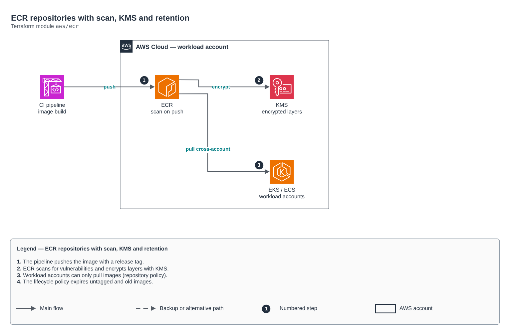

# ECR repositories with scan, KMS and retention

[Português](README.md) · **English**

> `aws/ecr` · category **containers** · origin: Benefits platform on AWS (2023-2024)

> Designed in September 2023. With no time to keep the repository up to date back then, it is being published and updated now.

ECR repositories — one per containerized service. The CI pipeline builds and pushes the image; IaC only declares where it lives and how it is encrypted, scanned and expired.

## Architecture



Editable source: [`diagram.drawio`](diagram.drawio) (open it in draw.io / diagrams.net), with Portuguese and English pages.

1. The pipeline pushes the image with a release tag.
2. ECR scans for vulnerabilities and encrypts layers with KMS.
3. Workload accounts can only pull images (repository policy).
4. The lifecycle policy expires untagged and old images.

## Usage

```hcl
module "ecr" {
  source = "git::https://github.com/raphaelfcs/automacao_terraform.git//aws/ecr?ref=v1.0.0"

  name_prefix      = "demo"
  repository_names = ["api", "worker"]
  tags             = local.tags
}
```

## Examples

| Example | Files |
|---|---|
| [`basico`](examples/basico) | `main.tf`, `locals.tf`, `backend.tf` |
| [`cross-account`](examples/cross-account) | `main.tf`, `locals.tf`, `backend.tf` |

Each example has its own backend (state isolated per module and example). Different environments only use another `backend.tf`/`*.tfvars`, without duplicating code.

## Inputs

| Name | Type | Default | Required | Description |
|---|---|---|---|---|
| `name_prefix` | `string` | `""` | no | Repository namespace (<name_prefix>/<service>). Empty = no namespace. |
| `repository_names` | `list(string)` | - | **yes** | Repository names — one per containerized service. |
| `image_tag_mutability` | `string` | `"IMMUTABLE"` | no | MUTABLE or IMMUTABLE. In production prefer IMMUTABLE (tags are never overwritten). |
| `scan_on_push` | `bool` | `true` | no | Scans for vulnerabilities on every push. |
| `force_delete` | `bool` | `false` | no | Allows destroying the repository even with images (true only in sandbox). |
| `kms_key_arn` | `string` | `null` | no | KMS key to encrypt layers. null = AWS-managed AES256. |
| `max_image_count` | `number` | `30` | no | How many images to keep per repository before expiring old ones. |
| `release_tag_prefixes` | `list(string)` | `[]` | no | Release tag prefixes (e.g. ["v"]). Empty = counts all images. |
| `untagged_expiration_days` | `number` | `7` | no | Days until untagged images expire. |
| `pull_principal_arns` | `list(string)` | `[]` | no | ARNs (accounts or roles) allowed to pull images across accounts. |
| `push_principal_arns` | `list(string)` | `[]` | no | ARNs allowed to push images (pipeline role). |
| `tags` | `map(string)` | `{}` | no | Tags applied to all repositories. |

## Outputs

| Name | Description |
|---|---|
| `repository_urls` | Service -> repository URL map. The pipeline uses these values to tag and push. |
| `repository_arns` | Service -> repository ARN map. |

## Files

- `iam.tf`: policies, roles and permissions
- `lifecycle.tf`: module-specific resources
- `main.tf`: main resources
- `outputs.tf`: outputs
- `variables.tf`: inputs and validations
- `versions.tf`: Terraform and provider versions
- `examples/`: ready-to-use compositions
- `tests/`: `terraform test` with mocked providers

## Well-Architected

- Security: private endpoint and nodes, workload identity (IRSA/Workload Identity) and encrypted secrets.
- Performance efficiency: automatic node and pod scaling.

## Tests

```bash
cd aws/ecr
terraform init -backend=false
terraform test
```
