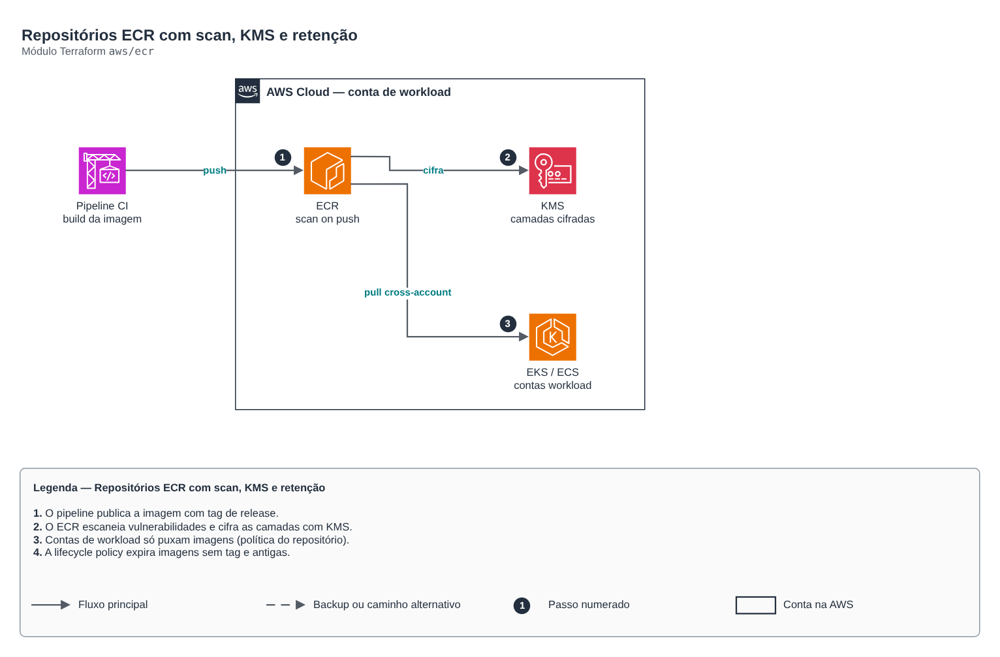

# Repositórios ECR com scan, KMS e retenção

**Português** · [English](README.en.md)

> `aws/ecr` · categoria **containers** · origem: Plataforma de benefícios em AWS (2023-2024)

> Idealizado em setembro de 2023. Por falta de tempo para manter o repositório em dia na época, está sendo publicado e atualizado agora.

Repositórios ECR — um por serviço containerizado. O pipeline de CI constrói e publica a imagem; a IaC só declara onde ela mora, como é cifrada, escaneada e expirada.

## Arquitetura



Fonte editável: [`diagram.drawio`](diagram.drawio) (abra no draw.io / diagrams.net), com páginas em português e inglês.

1. O pipeline publica a imagem com tag de release.
2. O ECR escaneia vulnerabilidades e cifra as camadas com KMS.
3. Contas de workload só puxam imagens (política do repositório).
4. A lifecycle policy expira imagens sem tag e antigas.

## Uso

```hcl
module "ecr" {
  source = "git::https://github.com/raphaelfcs/automacao_terraform.git//aws/ecr?ref=v1.0.0"

  name_prefix      = "demo"
  repository_names = ["api", "worker"]
  tags             = local.tags
}
```

## Exemplos

| Exemplo | Arquivos |
|---|---|
| [`basico`](examples/basico) | `main.tf`, `locals.tf`, `backend.tf` |
| [`cross-account`](examples/cross-account) | `main.tf`, `locals.tf`, `backend.tf` |

Cada exemplo tem seu próprio backend (state isolado por módulo e exemplo). Ambientes diferentes usam apenas outro `backend.tf`/`*.tfvars`, sem duplicar código.

## Entradas

| Nome | Tipo | Padrão | Obrigatória | Descrição |
|---|---|---|---|---|
| `name_prefix` | `string` | `""` | não | Namespace dos repositórios (<name_prefix>/<servico>). Vazio = sem namespace. |
| `repository_names` | `list(string)` | - | **sim** | Nomes dos repositórios — um por serviço containerizado. |
| `image_tag_mutability` | `string` | `"IMMUTABLE"` | não | MUTABLE ou IMMUTABLE. Em produção prefira IMMUTABLE (tag nunca é sobrescrita). |
| `scan_on_push` | `bool` | `true` | não | Escaneia vulnerabilidades a cada push. |
| `force_delete` | `bool` | `false` | não | Permite destruir o repositório mesmo com imagens (use true só em sandbox). |
| `kms_key_arn` | `string` | `null` | não | Chave KMS para cifrar as camadas. null = AES256 gerenciado pela AWS. |
| `max_image_count` | `number` | `30` | não | Quantas imagens manter por repositório antes de expirar as antigas. |
| `release_tag_prefixes` | `list(string)` | `[]` | não | Prefixos de tag de release (ex.: ["v"]). Vazio = conta todas as imagens. |
| `untagged_expiration_days` | `number` | `7` | não | Dias até expirar imagens sem tag. |
| `pull_principal_arns` | `list(string)` | `[]` | não | ARNs (contas ou roles) autorizados a puxar imagens entre contas. |
| `push_principal_arns` | `list(string)` | `[]` | não | ARNs autorizados a publicar imagens (role do pipeline). |
| `tags` | `map(string)` | `{}` | não | Tags aplicadas a todos os repositórios. |

## Saídas

| Nome | Descrição |
|---|---|
| `repository_urls` | Mapa serviço -> URL do repositório. O pipeline usa estes valores para taguear e publicar. |
| `repository_arns` | Mapa serviço -> ARN do repositório. |

## Arquivos

- `iam.tf`: políticas, papéis e permissões
- `lifecycle.tf`: recursos específicos do módulo
- `main.tf`: recursos principais
- `outputs.tf`: saídas
- `variables.tf`: entradas e validações
- `versions.tf`: versões do Terraform e providers
- `examples/`: composições prontas para uso
- `tests/`: `terraform test` com providers simulados

## Well-Architected

- Segurança: endpoint e nós privados, identidade por workload (IRSA/Workload Identity) e segredos cifrados.
- Eficiência de performance: escalonamento automático de nós e pods.

## Testes

```bash
cd aws/ecr
terraform init -backend=false
terraform test
```
