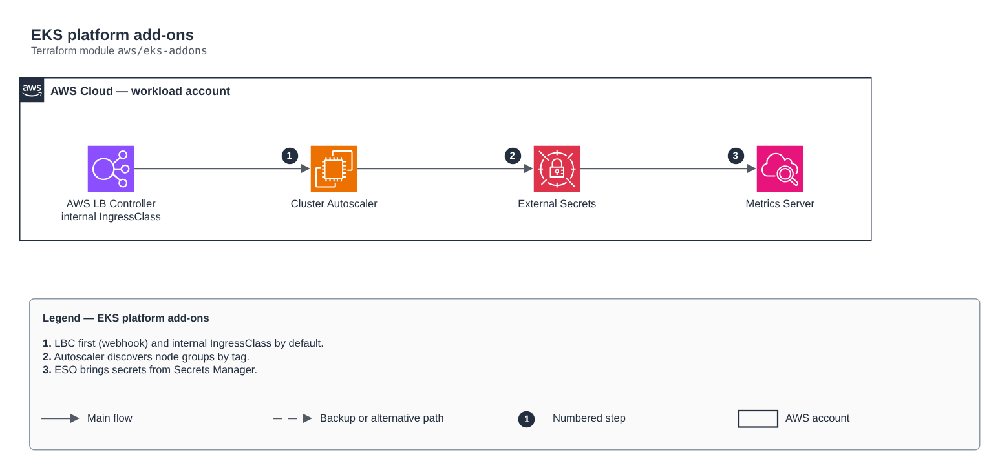

# EKS platform add-ons

[Português](README.md) · **English**

> `aws/eks-addons` · category **containers** · origin: Telecom microservices platform (2026)

> Designed in August 2026 and published now.

EKS cluster platform add-ons: Cluster Autoscaler, AWS Load Balancer Controller (default internal IngressClass), Metrics Server and External Secrets Operator. The LBC is installed first: its webhook intercepts Services/Pods and any chart installed before it fails with "no endpoints available".

## Architecture



Editable source: [`diagram.drawio`](diagram.drawio) (open it in draw.io / diagrams.net), with Portuguese and English pages.

1. LBC first (webhook) and internal IngressClass by default.
2. Autoscaler discovers node groups by tag.
3. ESO brings secrets from Secrets Manager.

## Usage

```hcl
module "eks_addons" {
  source = "git::https://github.com/raphaelfcs/automacao_terraform.git//aws/eks-addons?ref=v1.0.0"

  cluster_name                = "demo-dev"
  aws_region                  = local.region
  vpc_id                      = "vpc-0123456789abcdef0"
  cluster_autoscaler_role_arn = "arn:aws:iam::123456789012:role/demo-dev-cluster-autoscaler"
  aws_lbc_role_arn            = "arn:aws:iam::123456789012:role/demo-dev-aws-lbc"
  external_secrets_role_arn   = "arn:aws:iam::123456789012:role/demo-dev-external-secrets"
}
```

## Examples

| Example | Files |
|---|---|
| [`basico`](examples/basico) | `main.tf`, `locals.tf`, `backend.tf` |

Each example has its own backend (state isolated per module and example). Different environments only use another `backend.tf`/`*.tfvars`, without duplicating code.

## Inputs

| Name | Type | Default | Required | Description |
|---|---|---|---|---|
| `cluster_name` | `string` | - | **yes** | EKS cluster name — used in the autoscaler autoDiscovery and in the LBC |
| `aws_region` | `string` | - | **yes** | AWS region |
| `vpc_id` | `string` | - | **yes** | Cluster VPC — the AWS LBC needs it to discover subnets |
| `cluster_autoscaler_role_arn` | `string` | - | **yes** | cluster-autoscaler IRSA role ARN |
| `aws_lbc_role_arn` | `string` | - | **yes** | AWS Load Balancer Controller IRSA role ARN |
| `external_secrets_role_arn` | `string` | - | **yes** | External Secrets Operator IRSA role ARN |
| `cluster_autoscaler_chart_version` | `string` | `"9.43.2"` | no | cluster-autoscaler chart version (the app must match the cluster's minor). |
| `aws_lbc_chart_version` | `string` | `"1.10.1"` | no | aws-load-balancer-controller chart version. |
| `metrics_server_chart_version` | `string` | `"3.12.2"` | no | metrics-server chart version. |
| `external_secrets_chart_version` | `string` | `"2.8.0"` | no | Pinned external-secrets chart version — 2.8.0 serves CRDs at apiVersion v1 |
| `helm_release_atomic` | `bool` | `false` | no | atomic + cleanup_on_fail on the releases. With false, a failing release stays `failed` at revision 1 and the next apply needs a manual `helm uninstall` — but the partial state can be inspected, which is what you want on a new cluster |

## Outputs

| Name | Description |
|---|---|
| `ingress_class_name` | IngressClass created by the AWS LBC chart and set as the cluster default |
| `cluster_secret_store_name` | ESO ClusterSecretStore name (same in every cluster) |
| `addon_versions` | Installed chart versions |

## Files

- `external-secrets.tf`: module-specific resources
- `main.tf`: main resources
- `outputs.tf`: outputs
- `variables.tf`: inputs and validations
- `versions.tf`: Terraform and provider versions
- `examples/`: ready-to-use compositions
- `tests/`: `terraform test` with mocked providers

## Well-Architected

- Security: private endpoint and nodes, workload identity (IRSA/Workload Identity) and encrypted secrets.
- Performance efficiency: automatic node and pod scaling.

## Tests

```bash
cd aws/eks-addons
terraform init -backend=false
terraform test
```
