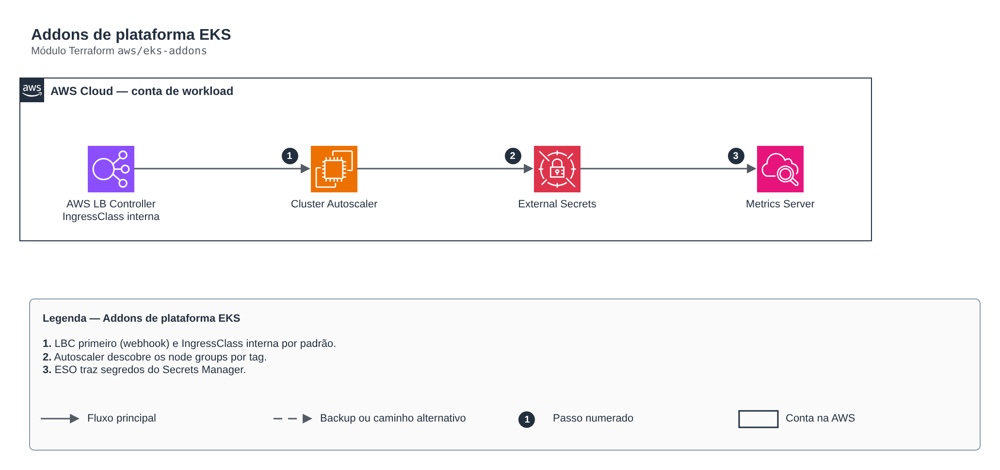

# Addons de plataforma EKS

> `aws/eks-addons` · categoria **containers** · origem: Plataforma de microsserviços em telecom (2026)

> Idealizado em agosto de 2026 e publicado agora.

Addons de plataforma de um cluster EKS: Cluster Autoscaler, AWS Load Balancer Controller (IngressClass interna padrão), Metrics Server e External Secrets Operator. As roles IRSA de cada controlador são criadas fora (ex.: módulo eks-cluster + políticas próprias). O LBC é instalado PRIMEIRO: seu webhook de mutação intercepta Services/Pods; se outro chart sobe enquanto o webhook não responde, o apply falha com "no endpoints available". ── Cluster Autoscaler ────────────────────────────────────────────────────────

## Arquitetura



Fonte editável: [`diagram.drawio`](diagram.drawio) (abra no draw.io / diagrams.net).

1. LBC primeiro (webhook) e IngressClass interna por padrão.
2. Autoscaler descobre os node groups por tag.
3. ESO traz segredos do Secrets Manager.

## Uso

```hcl
module "eks_addons" {
  source = "git::https://github.com/raphaelfcs/automacao_terraform.git//aws/eks-addons?ref=v1.0.0"

  cluster_name                = "demo-dev"
  aws_region                  = local.region
  vpc_id                      = "vpc-0123456789abcdef0"
  cluster_autoscaler_role_arn = "arn:aws:iam::123456789012:role/demo-dev-cluster-autoscaler"
  aws_lbc_role_arn            = "arn:aws:iam::123456789012:role/demo-dev-aws-lbc"
  external_secrets_role_arn   = "arn:aws:iam::123456789012:role/demo-dev-external-secrets"
}
```

## Exemplos

| Exemplo | Arquivos |
|---|---|
| [`basico`](examples/basico) | `main.tf`, `locals.tf`, `backend.tf` |

Cada exemplo tem seu próprio backend (state isolado por módulo e exemplo). Ambientes diferentes usam apenas outro `backend.tf`/`*.tfvars`, sem duplicar código.

## Entradas

| Nome | Tipo | Padrão | Obrigatória | Descrição |
|---|---|---|---|---|
| `cluster_name` | `string` | - | **sim** | Nome do cluster EKS — usado no autoDiscovery do autoscaler e no LBC |
| `aws_region` | `string` | - | **sim** | Região AWS |
| `vpc_id` | `string` | - | **sim** | VPC do cluster — o AWS LBC precisa dela para descobrir subnets |
| `cluster_autoscaler_role_arn` | `string` | - | **sim** | ARN da role IRSA do cluster-autoscaler |
| `aws_lbc_role_arn` | `string` | - | **sim** | ARN da role IRSA do AWS Load Balancer Controller |
| `external_secrets_role_arn` | `string` | - | **sim** | ARN da role IRSA do External Secrets Operator |
| `cluster_autoscaler_chart_version` | `string` | `"9.43.2"` | não | Versão do chart cluster-autoscaler (o app deve casar com o minor do cluster). |
| `aws_lbc_chart_version` | `string` | `"1.10.1"` | não | Versão do chart aws-load-balancer-controller. |
| `metrics_server_chart_version` | `string` | `"3.12.2"` | não | Versão do chart metrics-server. |
| `external_secrets_chart_version` | `string` | `"2.8.0"` | não | Versão pinada do chart external-secrets — 2.8.0 serve CRDs em apiVersion v1 |
| `helm_release_atomic` | `bool` | `false` | não | atomic + cleanup_on_fail nos releases. Com false, release que falha fica `failed` na revision 1 e o apply seguinte exige `helm uninstall` manual — mas o estado parcial fica inspecionável, que é o que se quer num cluster novo |

## Saídas

| Nome | Descrição |
|---|---|
| `ingress_class_name` | IngressClass criada pelo chart do AWS LBC e marcada como padrão do cluster |
| `cluster_secret_store_name` | Nome do ClusterSecretStore do ESO (mesmo nome em todos os clusters) |
| `addon_versions` | Versões dos charts instalados |

## Arquivos

- `external-secrets.tf`: recursos específicos do módulo
- `main.tf`: recursos principais
- `outputs.tf`: saídas
- `variables.tf`: entradas e validações
- `versions.tf`: versões do Terraform e providers
- `examples/`: composições prontas para uso
- `tests/`: `terraform test` com providers simulados

## Well-Architected

- Segurança: endpoint e nós privados, identidade por workload (IRSA/Workload Identity) e segredos cifrados.
- Eficiência de performance: escalonamento automático de nós e pods.

## Testes

```bash
cd aws/eks-addons
terraform init -backend=false
terraform test
```
