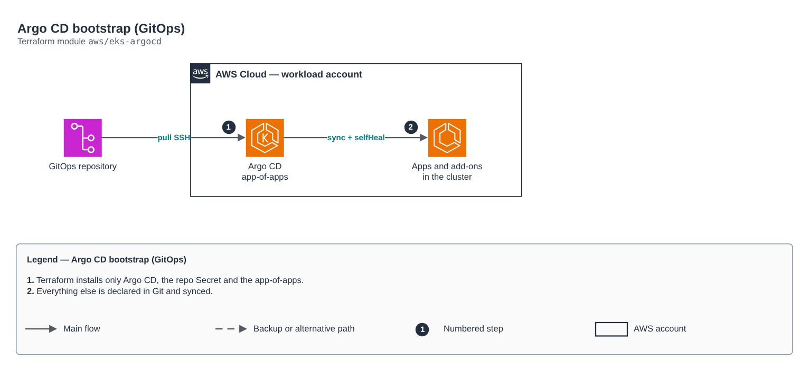

# Argo CD bootstrap (GitOps)

[Português](README.md) · **English**

> `aws/eks-argocd` · category **devops** · origin: Telecom microservices platform (2026)

> Designed in August 2026 and published now.

Argo CD installed by Terraform (GitOps bootstrap): Helm release, GitOps repository Secret (SSH deploy key) and the app-of-apps that syncs everything else. After bootstrap, everything is managed by Argo CD from Git. Optional IRSA role for a "hub" Argo CD managing other clusters.

## Architecture



Editable source: [`diagram.drawio`](diagram.drawio) (open it in draw.io / diagrams.net), with Portuguese and English pages.

1. Terraform installs only Argo CD, the repo Secret and the app-of-apps.
2. Everything else is declared in Git and synced.

## Usage

```hcl
module "eks_argocd" {
  source = "git::https://github.com/raphaelfcs/automacao_terraform.git//aws/eks-argocd?ref=v1.0.0"

  gitops_repo_url       = "git@github.com:minha-org/gitops.git"
  gitops_repo_ssh_key   = var.gitops_repo_ssh_key
  gitops_bootstrap_path = "clusters/dev"
  hostname              = "argocd.dev.example.com"
}
```

## Examples

| Example | Files |
|---|---|
| [`basico`](examples/basico) | `main.tf`, `locals.tf`, `backend.tf` |

Each example has its own backend (state isolated per module and example). Different environments only use another `backend.tf`/`*.tfvars`, without duplicating code.

## Inputs

| Name | Type | Default | Required | Description |
|---|---|---|---|---|
| `namespace` | `string` | `"argocd"` | no | Argo CD namespace. |
| `argocd_chart_version` | `string` | `"7.7.11"` | no | Pinned argo-cd chart version. |
| `hostname` | `string` | `null` | no | Argo CD Ingress hostname. null = no Ingress (port-forward access). |
| `ingress_class_name` | `string` | `"alb-internal"` | no | Argo CD IngressClass (e.g. alb-internal). |
| `server_insecure` | `bool` | `true` | no | TLS terminated at the LB (true) or at argocd-server itself (false). |
| `irsa_role_arn` | `string` | `null` | no | Controller/server IRSA role (multi-cluster Argo CD hub). null = no annotation. |
| `gitops_repo_url` | `string` | - | **yes** | GitOps repository SSH URL. |
| `gitops_repo_ssh_key` | `string` | - | **yes** | SSH private key (read-only deploy key). |
| `gitops_target_revision` | `string` | `"main"` | no | Branch or tag tracked by the app-of-apps. |
| `gitops_bootstrap_path` | `string` | `"gitops/bootstrap"` | no | Path of THIS Argo CD's app-of-apps in the repository. |

## Outputs

| Name | Description |
|---|---|
| `namespace` | Argo CD namespace. |
| `chart_version` | Installed chart version. |
| `bootstrap_path` | Synced app-of-apps path. |

## Files

- `main.tf`: main resources
- `outputs.tf`: outputs
- `variables.tf`: inputs and validations
- `versions.tf`: Terraform and provider versions
- `examples/`: ready-to-use compositions
- `tests/`: `terraform test` with mocked providers

## Well-Architected

- Operational excellence: GitOps, the desired state lives in Git and is reconciled continuously.
- Security: repository credentials kept out of the code.

## Tests

```bash
cd aws/eks-argocd
terraform init -backend=false
terraform test
```
