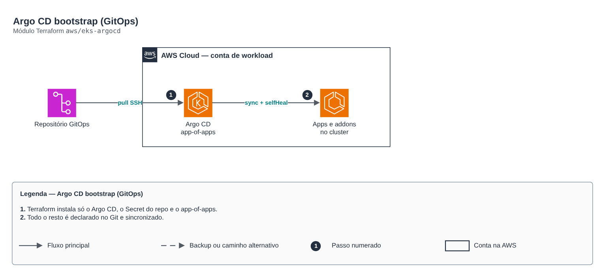

# Argo CD bootstrap (GitOps)

**Português** · [English](README.en.md)

> `aws/eks-argocd` · categoria **devops** · origem: Plataforma de microsserviços em telecom (2026)

> Idealizado em agosto de 2026 e publicado agora.

Argo CD instalado por Terraform (bootstrap do GitOps): release Helm, Secret do repositório GitOps (deploy key SSH) e o app-of-apps que sincroniza todo o resto. Tudo depois do bootstrap é gerenciado pelo próprio Argo CD a partir do Git. Opcional: role IRSA para o application-controller/server, para um Argo CD "hub" gerenciar outros clusters (awsAuthConfig nos Secrets de cluster). Sem a annotation o Argo CD cai na credencial do NÓ — funciona, mas dá a qualquer pod do node group o mesmo acesso do hub aos clusters alvo.

## Arquitetura



Fonte editável: [`diagram.drawio`](diagram.drawio) (abra no draw.io / diagrams.net), com páginas em português e inglês.

1. Terraform instala só o Argo CD, o Secret do repo e o app-of-apps.
2. Todo o resto é declarado no Git e sincronizado.

## Uso

```hcl
module "eks_argocd" {
  source = "git::https://github.com/raphaelfcs/automacao_terraform.git//aws/eks-argocd?ref=v1.0.0"

  gitops_repo_url       = "git@github.com:minha-org/gitops.git"
  gitops_repo_ssh_key   = var.gitops_repo_ssh_key
  gitops_bootstrap_path = "clusters/dev"
  hostname              = "argocd.dev.example.com"
}
```

## Exemplos

| Exemplo | Arquivos |
|---|---|
| [`basico`](examples/basico) | `main.tf`, `locals.tf`, `backend.tf` |

Cada exemplo tem seu próprio backend (state isolado por módulo e exemplo). Ambientes diferentes usam apenas outro `backend.tf`/`*.tfvars`, sem duplicar código.

## Entradas

| Nome | Tipo | Padrão | Obrigatória | Descrição |
|---|---|---|---|---|
| `namespace` | `string` | `"argocd"` | não | Namespace do Argo CD. |
| `argocd_chart_version` | `string` | `"7.7.11"` | não | Versão fixada do chart argo-cd. |
| `hostname` | `string` | `null` | não | Hostname do Ingress do Argo CD. null = sem Ingress (acesso por port-forward). |
| `ingress_class_name` | `string` | `"alb-internal"` | não | IngressClass do Argo CD (ex.: alb-internal). |
| `server_insecure` | `bool` | `true` | não | TLS terminado no LB (true) ou no próprio argocd-server (false). |
| `irsa_role_arn` | `string` | `null` | não | Role IRSA do controller/server (Argo CD hub multi-cluster). null = sem annotation. |
| `gitops_repo_url` | `string` | - | **sim** | URL SSH do repositório GitOps. |
| `gitops_repo_ssh_key` | `string` | - | **sim** | Chave privada SSH (deploy key somente leitura). |
| `gitops_target_revision` | `string` | `"main"` | não | Branch ou tag acompanhada pelo app-of-apps. |
| `gitops_bootstrap_path` | `string` | `"gitops/bootstrap"` | não | Caminho do app-of-apps DESTE Argo CD no repositório. |

## Saídas

| Nome | Descrição |
|---|---|
| `namespace` | Namespace do Argo CD. |
| `chart_version` | Versão do chart instalada. |
| `bootstrap_path` | Caminho do app-of-apps sincronizado. |

## Arquivos

- `main.tf`: recursos principais
- `outputs.tf`: saídas
- `variables.tf`: entradas e validações
- `versions.tf`: versões do Terraform e providers
- `examples/`: composições prontas para uso
- `tests/`: `terraform test` com providers simulados

## Well-Architected

- Excelência operacional: GitOps, o estado desejado vive no Git e é reconciliado continuamente.
- Segurança: credenciais do repositório fora do código.

## Testes

```bash
cd aws/eks-argocd
terraform init -backend=false
terraform test
```
