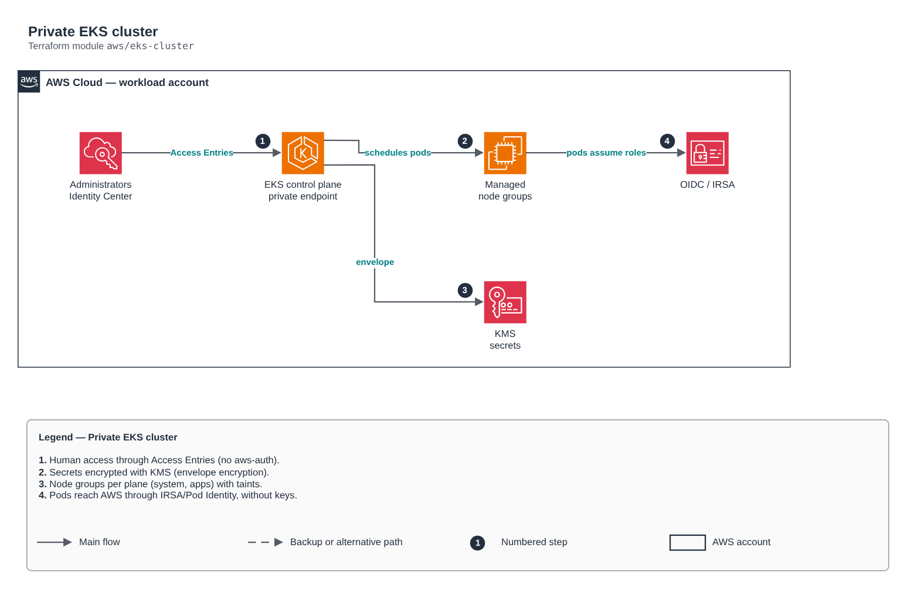

# Private EKS cluster

[Português](README.md) · **English**

> `aws/eks-cluster` · category **containers** · origin: Telecom microservices platform (2026)

> Designed in September 2026 and published now.

EKS cluster with the control plane in private subnets, KMS-encrypted secrets (envelope encryption), audit logs, Access Entries (API) authentication and managed node groups declared as a map.

## Architecture



Editable source: [`diagram.drawio`](diagram.drawio) (open it in draw.io / diagrams.net), with Portuguese and English pages.

1. Human access through Access Entries (no aws-auth).
2. Secrets encrypted with KMS (envelope encryption).
3. Node groups per plane (system, apps) with taints.
4. Pods reach AWS through IRSA/Pod Identity, without keys.

## Usage

```hcl
module "eks_cluster" {
  source = "git::https://github.com/raphaelfcs/automacao_terraform.git//aws/eks-cluster?ref=v1.0.0"

  cluster_name       = "demo-dev"
  kubernetes_version = "1.31"
  subnet_ids         = ["subnet-0aaa1111bbbb2222c", "subnet-0ddd3333eeee4444f"]
  kms_key_arn        = "arn:aws:kms:sa-east-1:123456789012:key/11111111-2222-3333-4444-555555555555"
  node_pools = {
    sistema = { instance_types = ["t3.medium"], desired_size = 2, min_size = 1, max_size = 3, labels = { role = "system" }, taints = [{ key = "CriticalAddonsOnly", value = "true", effect = "NO_SCHEDULE" }] }
    apps    = { instance_types = ["m7i.large"], desired_size = 2, min_size = 2, max_size = 10 }
  }
  tags = local.tags
}
```

## Examples

| Example | Files |
|---|---|
| [`basico`](examples/basico) | `main.tf`, `locals.tf`, `backend.tf` |
| [`access-entries`](examples/access-entries) | `main.tf`, `locals.tf`, `backend.tf` |

Each example has its own backend (state isolated per module and example). Different environments only use another `backend.tf`/`*.tfvars`, without duplicating code.

## Inputs

| Name | Type | Default | Required | Description |
|---|---|---|---|---|
| `cluster_name` | `string` | - | **yes** | EKS cluster name. |
| `kubernetes_version` | `string` | - | **yes** | Control plane version (e.g. 1.31). Upgrade one minor at a time. |
| `subnet_ids` | `list(string)` | - | **yes** | Private subnets for the control plane and nodes (at least two AZs). |
| `kms_key_arn` | `string` | - | **yes** | KMS key for secrets envelope encryption and the log group. |
| `endpoint_public_access` | `bool` | `false` | no | Turns on the public API endpoint. Production: false (access through VPN/bastion/SSM). |
| `endpoint_public_access_cidrs` | `list(string)` | `[]` | no | CIDRs allowed on the public endpoint (CI and team egress). |
| `service_ipv4_cidr` | `string` | `null` | no | Cluster service CIDR. null = EKS default. |
| `authentication_mode` | `string` | `"API"` | no | API (recommended), API_AND_CONFIG_MAP or CONFIG_MAP. |
| `bootstrap_creator_admin` | `bool` | `true` | no | Gives admin to the principal that created the cluster. Prefer false + access_entries. |
| `cluster_log_types` | `list(string)` | `["api", "audit", "authenticator"]` | no | Control plane logs sent to CloudWatch. |
| `log_retention_days` | `number` | `30` | no | Control plane log retention. |
| `managed_addons` | `list(string)` | `["vpc-cni", "coredns", "kube-proxy", ...` | no | Managed add-ons installed in the cluster. |
| `pre_node_addons` | `list(string)` | `[]` | no | Add-ons created before node groups (never coredns). |
| `addon_configuration_values` | `map(string)` | `{}` | no | configuration_values (JSON) per add-on name. |
| `node_pools` | `map(...)` | `{}` | no | Managed node groups. Separate planes (system, apps, data) with labels and taints. |
| `access_entries` | `map(...)` | `{}` | no | Principals with cluster access. policy: AmazonEKSClusterAdminPolicy, AmazonEKSAdminPolicy, AmazonEKSEditPolicy or AmazonEKSViewPolicy. |
| `tags` | `map(string)` | `{}` | no | Tags applied to all cluster resources. |

## Outputs

| Name | Description |
|---|---|
| `cluster_name` | EKS cluster name. |
| `cluster_endpoint` | Cluster API endpoint. |
| `cluster_certificate_authority_data` | Cluster CA (base64) for the kubernetes/helm providers. |
| `cluster_security_group_id` | EKS-managed SG — source for the data tier ingress rules. |
| `node_role_arn` | Node IAM role ARN. |
| `oidc_provider_arn` | OIDC provider ARN — federated principal for IRSA roles. |
| `oidc_provider_url` | OIDC issuer without https://, as it appears in the trust policy sub condition. |

## Files

- `addons.tf`: module-specific resources
- `iam.tf`: policies, roles and permissions
- `locals.tf`: derived values
- `main.tf`: main resources
- `node-groups.tf`: module-specific resources
- `outputs.tf`: outputs
- `variables.tf`: inputs and validations
- `versions.tf`: Terraform and provider versions
- `examples/`: ready-to-use compositions
- `tests/`: `terraform test` with mocked providers

## Well-Architected

- Security: private endpoint and nodes, workload identity (IRSA/Workload Identity) and encrypted secrets.
- Performance efficiency: automatic node and pod scaling.

## Tests

```bash
cd aws/eks-cluster
terraform init -backend=false
terraform test
```
