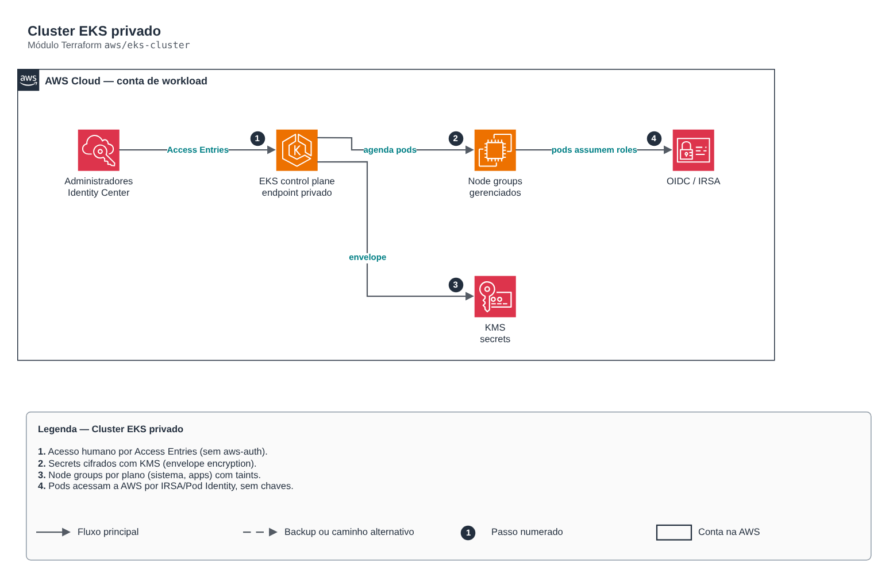

# Cluster EKS privado

> `aws/eks-cluster` · categoria **containers** · origem: Plataforma de microsserviços em telecom (2026)

> Idealizado em setembro de 2026 e publicado agora.

Cluster EKS com control plane em subnets privadas, secrets cifrados com KMS (envelope encryption), logs de auditoria, autenticação por Access Entries (API) e node groups gerenciados declarados por mapa.

## Arquitetura



Fonte editável: [`diagram.drawio`](diagram.drawio) (abra no draw.io / diagrams.net).

1. Acesso humano por Access Entries (sem aws-auth).
2. Secrets cifrados com KMS (envelope encryption).
3. Node groups por plano (sistema, apps) com taints.
4. Pods acessam a AWS por IRSA/Pod Identity, sem chaves.

## Uso

```hcl
module "eks_cluster" {
  source = "git::https://github.com/raphaelfcs/automacao_terraform.git//aws/eks-cluster?ref=v1.0.0"

  cluster_name       = "demo-dev"
  kubernetes_version = "1.31"
  subnet_ids         = ["subnet-0aaa1111bbbb2222c", "subnet-0ddd3333eeee4444f"]
  kms_key_arn        = "arn:aws:kms:sa-east-1:123456789012:key/11111111-2222-3333-4444-555555555555"
  node_pools = {
    sistema = { instance_types = ["t3.medium"], desired_size = 2, min_size = 1, max_size = 3, labels = { role = "system" }, taints = [{ key = "CriticalAddonsOnly", value = "true", effect = "NO_SCHEDULE" }] }
    apps    = { instance_types = ["m7i.large"], desired_size = 2, min_size = 2, max_size = 10 }
  }
  tags = local.tags
}
```

## Exemplos

| Exemplo | Arquivos |
|---|---|
| [`basico`](examples/basico) | `main.tf`, `locals.tf`, `backend.tf` |
| [`access-entries`](examples/access-entries) | `main.tf`, `locals.tf`, `backend.tf` |

Cada exemplo tem seu próprio backend (state isolado por módulo e exemplo). Ambientes diferentes usam apenas outro `backend.tf`/`*.tfvars`, sem duplicar código.

## Entradas

| Nome | Tipo | Padrão | Obrigatória | Descrição |
|---|---|---|---|---|
| `cluster_name` | `string` | - | **sim** | Nome do cluster EKS. |
| `kubernetes_version` | `string` | - | **sim** | Versão do control plane (ex.: 1.31). Atualize um minor por vez. |
| `subnet_ids` | `list(string)` | - | **sim** | Subnets privadas do control plane e dos nós (mínimo duas AZs). |
| `kms_key_arn` | `string` | - | **sim** | Chave KMS do envelope encryption dos secrets e do log group. |
| `endpoint_public_access` | `bool` | `false` | não | Liga o endpoint público da API. Produção: false (acesso via VPN/bastion/SSM). |
| `endpoint_public_access_cidrs` | `list(string)` | `[]` | não | CIDRs autorizados no endpoint público (egress do CI e da equipe). |
| `service_ipv4_cidr` | `string` | `null` | não | Service CIDR do cluster. null = padrão do EKS. |
| `authentication_mode` | `string` | `"API"` | não | API (recomendado), API_AND_CONFIG_MAP ou CONFIG_MAP. |
| `bootstrap_creator_admin` | `bool` | `true` | não | Dá admin ao principal que criou o cluster. Prefira false + access_entries. |
| `cluster_log_types` | `list(string)` | `["api", "audit", "authenticator"]` | não | Logs do control plane enviados ao CloudWatch. |
| `log_retention_days` | `number` | `30` | não | Retenção dos logs do control plane. |
| `managed_addons` | `list(string)` | `["vpc-cni", "coredns", "kube-proxy", ...` | não | Addons gerenciados instalados no cluster. |
| `pre_node_addons` | `list(string)` | `[]` | não | Addons criados antes dos node groups (nunca coredns). |
| `addon_configuration_values` | `map(string)` | `{}` | não | configuration_values (JSON) por nome de addon. |
| `node_pools` | `map(...)` | `{}` | não | Node groups gerenciados. Separe planos (sistema, apps, dados) com labels e taints. |
| `access_entries` | `map(...)` | `{}` | não | Principais com acesso ao cluster. policy: AmazonEKSClusterAdminPolicy, AmazonEKSAdminPolicy, AmazonEKSEditPolicy ou AmazonEKSViewPolicy. |
| `tags` | `map(string)` | `{}` | não | Tags aplicadas a todos os recursos do cluster. |

## Saídas

| Nome | Descrição |
|---|---|
| `cluster_name` | Nome do cluster EKS. |
| `cluster_endpoint` | Endpoint da API do cluster. |
| `cluster_certificate_authority_data` | CA do cluster (base64) para os providers kubernetes/helm. |
| `cluster_security_group_id` | SG gerenciado pelo EKS — origem das regras de ingress da camada de dados. |
| `node_role_arn` | ARN da role IAM dos nós. |
| `oidc_provider_arn` | ARN do OIDC provider — principal federado das roles IRSA. |
| `oidc_provider_url` | Issuer OIDC sem https://, como aparece na condição sub da trust policy. |

## Arquivos

- `addons.tf`: recursos específicos do módulo
- `iam.tf`: políticas, papéis e permissões
- `locals.tf`: valores derivados
- `main.tf`: recursos principais
- `node-groups.tf`: recursos específicos do módulo
- `outputs.tf`: saídas
- `variables.tf`: entradas e validações
- `versions.tf`: versões do Terraform e providers
- `examples/`: composições prontas para uso
- `tests/`: `terraform test` com providers simulados

## Well-Architected

- Segurança: endpoint e nós privados, identidade por workload (IRSA/Workload Identity) e segredos cifrados.
- Eficiência de performance: escalonamento automático de nós e pods.

## Testes

```bash
cd aws/eks-cluster
terraform init -backend=false
terraform test
```
