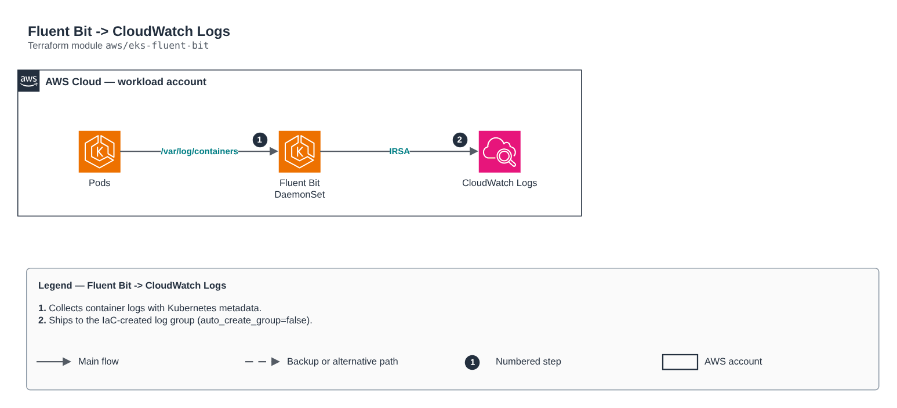

# Fluent Bit -> CloudWatch Logs

[Português](README.md) · **English**

> `aws/eks-fluent-bit` · category **observabilidade** · origin: Telecom microservices platform (2026)

> Designed in September 2026 and published now.

Fluent Bit (DaemonSet) shipping container logs to CloudWatch Logs. The IRSA role and the log group come from the cloudwatch-logs module (the collector does NOT create log groups).

## Architecture



Editable source: [`diagram.drawio`](diagram.drawio) (open it in draw.io / diagrams.net), with Portuguese and English pages.

1. Collects container logs with Kubernetes metadata.
2. Ships to the IaC-created log group (auto_create_group=false).

## Usage

```hcl
module "eks_fluent_bit" {
  source = "git::https://github.com/raphaelfcs/automacao_terraform.git//aws/eks-fluent-bit?ref=v1.0.0"

  cluster_name       = "demo-dev"
  region             = local.region
  log_group_name     = "/demo/dev/application"
  collector_role_arn = "arn:aws:iam::123456789012:role/demo-dev-log-collector"
}
```

## Examples

| Example | Files |
|---|---|
| [`basico`](examples/basico) | `main.tf`, `locals.tf`, `backend.tf` |

Each example has its own backend (state isolated per module and example). Different environments only use another `backend.tf`/`*.tfvars`, without duplicating code.

## Inputs

| Name | Type | Default | Required | Description |
|---|---|---|---|---|
| `cluster_name` | `string` | - | **yes** | Cluster name (log stream prefix). |
| `region` | `string` | - | **yes** | CloudWatch Logs region. |
| `log_group_name` | `string` | - | **yes** | Target log group (created by the cloudwatch-logs module). |
| `collector_role_arn` | `string` | - | **yes** | Collector IRSA role (collector_role_arn output of the cloudwatch-logs module). |
| `namespace` | `string` | `"observability"` | no | Release namespace (must match the role's trust policy). |
| `service_account` | `string` | `"fluent-bit"` | no | Collector ServiceAccount (must match the role's trust policy). |
| `create_namespace` | `bool` | `true` | no | Creates the namespace if it does not exist. |
| `chart_version` | `string` | `"0.47.10"` | no | Pinned fluent/fluent-bit chart version. |
| `excluded_namespaces` | `list(string)` | `["kube-system"]` | no | Namespaces whose logs are not shipped. |

## Outputs

| Name | Description |
|---|---|
| `release_name` | Helm release name. |
| `release_status` | Release status. |

## Files

- `main.tf`: main resources
- `outputs.tf`: outputs
- `variables.tf`: inputs and validations
- `versions.tf`: Terraform and provider versions
- `examples/`: ready-to-use compositions
- `tests/`: `terraform test` with mocked providers

## Well-Architected

- Operational excellence: centralized logs and metrics with defined retention and actionable alerts.
- Cost optimization: retention per log class so you do not pay for unused data.

## Tests

```bash
cd aws/eks-fluent-bit
terraform init -backend=false
terraform test
```
