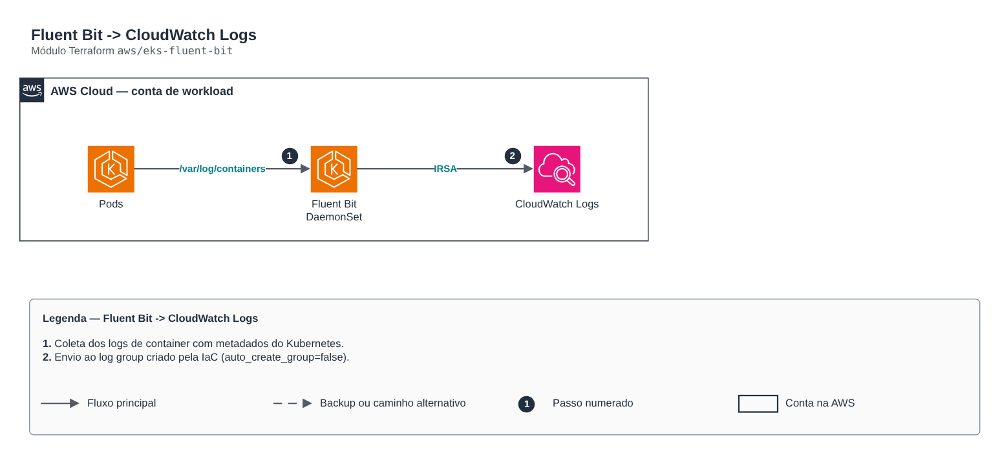

# Fluent Bit -> CloudWatch Logs

> `aws/eks-fluent-bit` · categoria **observabilidade** · origem: Plataforma de microsserviços em telecom (2026)

> Idealizado em setembro de 2026 e publicado agora.

Fluent Bit (DaemonSet) enviando logs de container ao CloudWatch Logs. A role IRSA e o log group vêm do módulo cloudwatch-logs (o coletor NÃO cria log group).

## Arquitetura



Fonte editável: [`diagram.drawio`](diagram.drawio) (abra no draw.io / diagrams.net).

1. Coleta dos logs de container com metadados do Kubernetes.
2. Envio ao log group criado pela IaC (auto_create_group=false).

## Uso

```hcl
module "eks_fluent_bit" {
  source = "git::https://github.com/raphaelfcs/automacao_terraform.git//aws/eks-fluent-bit?ref=v1.0.0"

  cluster_name       = "demo-dev"
  region             = local.region
  log_group_name     = "/demo/dev/application"
  collector_role_arn = "arn:aws:iam::123456789012:role/demo-dev-log-collector"
}
```

## Exemplos

| Exemplo | Arquivos |
|---|---|
| [`basico`](examples/basico) | `main.tf`, `locals.tf`, `backend.tf` |

Cada exemplo tem seu próprio backend (state isolado por módulo e exemplo). Ambientes diferentes usam apenas outro `backend.tf`/`*.tfvars`, sem duplicar código.

## Entradas

| Nome | Tipo | Padrão | Obrigatória | Descrição |
|---|---|---|---|---|
| `cluster_name` | `string` | - | **sim** | Nome do cluster (prefixo dos log streams). |
| `region` | `string` | - | **sim** | Região do CloudWatch Logs. |
| `log_group_name` | `string` | - | **sim** | Log group de destino (criado pelo módulo cloudwatch-logs). |
| `collector_role_arn` | `string` | - | **sim** | Role IRSA do coletor (output collector_role_arn do módulo cloudwatch-logs). |
| `namespace` | `string` | `"observability"` | não | Namespace do release (deve casar com a trust policy da role). |
| `service_account` | `string` | `"fluent-bit"` | não | ServiceAccount do coletor (deve casar com a trust policy da role). |
| `create_namespace` | `bool` | `true` | não | Cria o namespace se não existir. |
| `chart_version` | `string` | `"0.47.10"` | não | Versão fixada do chart fluent/fluent-bit. |
| `excluded_namespaces` | `list(string)` | `["kube-system"]` | não | Namespaces cujos logs não são enviados. |

## Saídas

| Nome | Descrição |
|---|---|
| `release_name` | Nome do release Helm. |
| `release_status` | Status do release. |

## Arquivos

- `main.tf`: recursos principais
- `outputs.tf`: saídas
- `variables.tf`: entradas e validações
- `versions.tf`: versões do Terraform e providers
- `examples/`: composições prontas para uso
- `tests/`: `terraform test` com providers simulados

## Well-Architected

- Excelência operacional: logs e métricas centralizados com retenção definida e alertas acionáveis.
- Otimização de custos: retenção por classe de log para não pagar por dado sem uso.

## Testes

```bash
cd aws/eks-fluent-bit
terraform init -backend=false
terraform test
```
