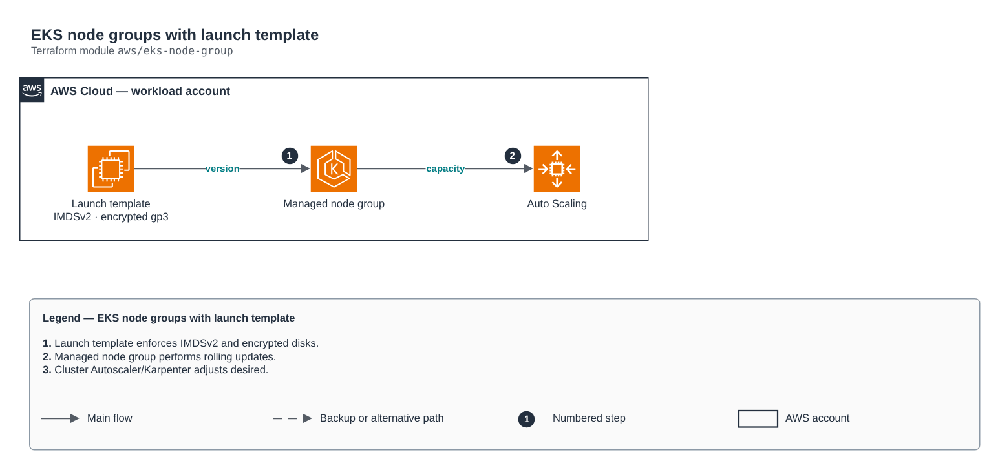

# EKS node groups with launch template

[Português](README.md) · **English**

> `aws/eks-node-group` · category **containers** · origin: Telecom microservices platform (2026)

> Designed in September 2026 and published now.

Managed node groups with their own launch template: mandatory IMDSv2 (hop limit 2 for pods using IMDS), encrypted gp3 volume and an explicit node SG. Use it when the "simple" node group of the eks-cluster module is not enough.

## Architecture



Editable source: [`diagram.drawio`](diagram.drawio) (open it in draw.io / diagrams.net), with Portuguese and English pages.

1. Launch template enforces IMDSv2 and encrypted disks.
2. Managed node group performs rolling updates.
3. Cluster Autoscaler/Karpenter adjusts desired.

## Usage

```hcl
module "eks_node_group" {
  source = "git::https://github.com/raphaelfcs/automacao_terraform.git//aws/eks-node-group?ref=v1.0.0"

  cluster_name            = "demo-dev"
  node_role_arn           = "arn:aws:iam::123456789012:role/demo-dev-node"
  subnet_ids              = ["subnet-0aaa1111bbbb2222c", "subnet-0ddd3333eeee4444f"]
  node_security_group_ids = ["sg-0123456789abcdef0"]
  kms_key_arn             = "arn:aws:kms:sa-east-1:123456789012:key/11111111-2222-3333-4444-555555555555"
  node_groups = {
    system = { instance_types = ["t3.medium"], desired_size = 2, min_size = 1, max_size = 3, taints = [{ key = "CriticalAddonsOnly", value = "true", effect = "NO_SCHEDULE" }] }
    apps   = { instance_types = ["m7i.large", "m6i.large"], capacity_type = "SPOT", desired_size = 2, min_size = 0, max_size = 10, disk_size = 100, cluster_autoscaler = true }
  }
  tags = local.tags
}
```

## Examples

| Example | Files |
|---|---|
| [`sistema-e-apps`](examples/sistema-e-apps) | `main.tf`, `locals.tf`, `backend.tf` |

Each example has its own backend (state isolated per module and example). Different environments only use another `backend.tf`/`*.tfvars`, without duplicating code.

## Inputs

| Name | Type | Default | Required | Description |
|---|---|---|---|---|
| `cluster_name` | `string` | - | **yes** | Existing EKS cluster name. |
| `node_role_arn` | `string` | - | **yes** | Node IAM role ARN (node_role_arn output of the eks-cluster module). |
| `subnet_ids` | `list(string)` | - | **yes** | Default private subnets for the nodes. |
| `node_security_group_ids` | `list(string)` | - | **yes** | Security groups attached to node ENIs through the launch template. |
| `kms_key_arn` | `string` | `null` | no | KMS key for EBS volumes. null = default EBS key. |
| `node_groups` | `map(...)` | - | **yes** | Node groups by name (e.g. system, apps). The name becomes the role label. |
| `tags` | `map(string)` | `{}` | no | Tags applied to all resources. |

## Outputs

| Name | Description |
|---|---|
| `node_group_names` | Key -> node group name map. |
| `node_groups_status` | Status of each node group — use it as a depends_on anchor for add-ons. |
| `launch_template_ids` | Key -> launch template ID map. |

## Files

- `main.tf`: main resources
- `outputs.tf`: outputs
- `variables.tf`: inputs and validations
- `versions.tf`: Terraform and provider versions
- `examples/`: ready-to-use compositions
- `tests/`: `terraform test` with mocked providers

## Well-Architected

- Security: private endpoint and nodes, workload identity (IRSA/Workload Identity) and encrypted secrets.
- Performance efficiency: automatic node and pod scaling.

## Tests

```bash
cd aws/eks-node-group
terraform init -backend=false
terraform test
```
