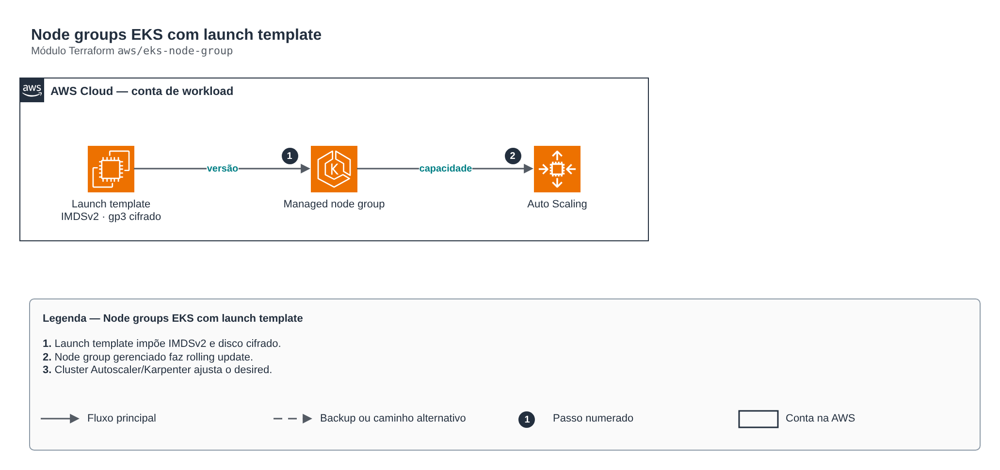

# Node groups EKS com launch template

> `aws/eks-node-group` · categoria **containers** · origem: Plataforma de microsserviços em telecom (2026)

> Idealizado em setembro de 2026 e publicado agora.

Node groups gerenciados com launch template próprio: IMDSv2 obrigatório (hop limit 2 para pods que usam o IMDS), volume gp3 cifrado e SG de nó explícito. Use quando o node group "simples" do módulo eks-cluster não basta (SG customizado, disco, user data).

## Arquitetura



Fonte editável: [`diagram.drawio`](diagram.drawio) (abra no draw.io / diagrams.net).

1. Launch template impõe IMDSv2 e disco cifrado.
2. Node group gerenciado faz rolling update.
3. Cluster Autoscaler/Karpenter ajusta o desired.

## Uso

```hcl
module "eks_node_group" {
  source = "git::https://github.com/raphaelfcs/automacao_terraform.git//aws/eks-node-group?ref=v1.0.0"

  cluster_name            = "demo-dev"
  node_role_arn           = "arn:aws:iam::123456789012:role/demo-dev-node"
  subnet_ids              = ["subnet-0aaa1111bbbb2222c", "subnet-0ddd3333eeee4444f"]
  node_security_group_ids = ["sg-0123456789abcdef0"]
  kms_key_arn             = "arn:aws:kms:sa-east-1:123456789012:key/11111111-2222-3333-4444-555555555555"
  node_groups = {
    system = { instance_types = ["t3.medium"], desired_size = 2, min_size = 1, max_size = 3, taints = [{ key = "CriticalAddonsOnly", value = "true", effect = "NO_SCHEDULE" }] }
    apps   = { instance_types = ["m7i.large", "m6i.large"], capacity_type = "SPOT", desired_size = 2, min_size = 0, max_size = 10, disk_size = 100, cluster_autoscaler = true }
  }
  tags = local.tags
}
```

## Exemplos

| Exemplo | Arquivos |
|---|---|
| [`sistema-e-apps`](examples/sistema-e-apps) | `main.tf`, `locals.tf`, `backend.tf` |

Cada exemplo tem seu próprio backend (state isolado por módulo e exemplo). Ambientes diferentes usam apenas outro `backend.tf`/`*.tfvars`, sem duplicar código.

## Entradas

| Nome | Tipo | Padrão | Obrigatória | Descrição |
|---|---|---|---|---|
| `cluster_name` | `string` | - | **sim** | Nome do cluster EKS existente. |
| `node_role_arn` | `string` | - | **sim** | ARN da role IAM dos nós (output node_role_arn do módulo eks-cluster). |
| `subnet_ids` | `list(string)` | - | **sim** | Subnets privadas padrão dos nós. |
| `node_security_group_ids` | `list(string)` | - | **sim** | Security groups anexados às ENIs dos nós via launch template. |
| `kms_key_arn` | `string` | `null` | não | Chave KMS dos volumes EBS. null = chave padrão do EBS. |
| `node_groups` | `map(...)` | - | **sim** | Node groups por nome (ex.: system, apps). O nome vira o label role. |
| `tags` | `map(string)` | `{}` | não | Tags aplicadas a todos os recursos. |

## Saídas

| Nome | Descrição |
|---|---|
| `node_group_names` | Mapa chave -> nome do node group. |
| `node_groups_status` | Status de cada node group — use como âncora de depends_on para addons. |
| `launch_template_ids` | Mapa chave -> ID do launch template. |

## Arquivos

- `main.tf`: recursos principais
- `outputs.tf`: saídas
- `variables.tf`: entradas e validações
- `versions.tf`: versões do Terraform e providers
- `examples/`: composições prontas para uso
- `tests/`: `terraform test` com providers simulados

## Well-Architected

- Segurança: endpoint e nós privados, identidade por workload (IRSA/Workload Identity) e segredos cifrados.
- Eficiência de performance: escalonamento automático de nós e pods.

## Testes

```bash
cd aws/eks-node-group
terraform init -backend=false
terraform test
```
