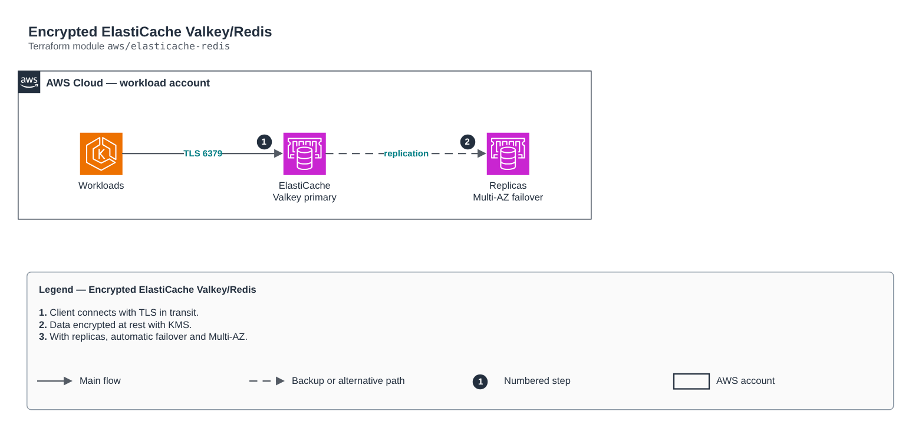

# Encrypted ElastiCache Valkey/Redis

[Português](README.md) · **English**

> `aws/elasticache-redis` · category **dados** · origin: Telecom microservices platform (2026)

> Designed in September 2026 and published now.

ElastiCache (Valkey or Redis) in private subnets, encrypted at rest and in transit. With replicas > 0 it turns on automatic failover and Multi-AZ.

## Architecture



Editable source: [`diagram.drawio`](diagram.drawio) (open it in draw.io / diagrams.net), with Portuguese and English pages.

1. Client connects with TLS in transit.
2. Data encrypted at rest with KMS.
3. With replicas, automatic failover and Multi-AZ.

## Usage

```hcl
module "elasticache_redis" {
  source = "git::https://github.com/raphaelfcs/automacao_terraform.git//aws/elasticache-redis?ref=v1.0.0"

  name_prefix             = local.name_prefix
  vpc_id                  = "vpc-0123456789abcdef0"
  subnet_ids              = ["subnet-0aaa1111bbbb2222c", "subnet-0ddd3333eeee4444f"]
  kms_key_arn             = "arn:aws:kms:sa-east-1:123456789012:key/11111111-2222-3333-4444-555555555555"
  engine_version          = "8.0"
  node_type               = "cache.t4g.micro"
  ingress_security_groups = { eks = "sg-0123456789abcdef0" }
  tags                    = local.tags
}
```

## Examples

| Example | Files |
|---|---|
| [`basico`](examples/basico) | `main.tf`, `locals.tf`, `backend.tf` |
| [`alta-disponibilidade`](examples/alta-disponibilidade) | `main.tf`, `locals.tf`, `backend.tf` |

Each example has its own backend (state isolated per module and example). Different environments only use another `backend.tf`/`*.tfvars`, without duplicating code.

## Inputs

| Name | Type | Default | Required | Description |
|---|---|---|---|---|
| `name_prefix` | `string` | - | **yes** | Prefix applied to cache resources. |
| `vpc_id` | `string` | - | **yes** | VPC where the cluster lives. |
| `subnet_ids` | `list(string)` | - | **yes** | Private subnets of the subnet group. |
| `ingress_security_groups` | `map(string)` | `{}` | no | Security groups allowed on the cache port: static name (key) -> id (value). |
| `kms_key_arn` | `string` | - | **yes** | KMS key for encryption at rest. |
| `engine` | `string` | `"valkey"` | no | valkey (recommended) or redis. |
| `engine_version` | `string` | - | **yes** | Engine version (e.g. 8.0 for Valkey). |
| `node_type` | `string` | - | **yes** | Node type (e.g. cache.t4g.micro in dev). |
| `port` | `number` | `6379` | no | Cache port. |
| `replica_count` | `number` | `0` | no | Read replicas. > 0 turns on automatic failover and Multi-AZ (production). |
| `preferred_cache_cluster_azs` | `list(string)` | `null` | no | Preferred node AZs, in order. null = AWS chooses. |
| `snapshot_retention_limit` | `number` | `1` | no | Snapshot retention days (0 disables). |
| `maintenance_window` | `string` | `"sun:07:00-sun:08:00"` | no | Weekly maintenance window (UTC). |
| `apply_immediately` | `bool` | `false` | no | Applies changes outside the maintenance window. |
| `tags` | `map(string)` | `{}` | no | Tags applied to all resources. |

## Outputs

| Name | Description |
|---|---|
| `primary_endpoint_address` | Write endpoint. |
| `reader_endpoint_address` | Read endpoint (balances across replicas). |
| `port` | Cache port. |
| `security_group_id` | Cluster security group. |

## Files

- `main.tf`: main resources
- `outputs.tf`: outputs
- `security-group.tf`: module-specific resources
- `variables.tf`: inputs and validations
- `versions.tf`: Terraform and provider versions
- `examples/`: ready-to-use compositions
- `tests/`: `terraform test` with mocked providers

## Well-Architected

- Reliability: automatic backups, configurable Multi-AZ/high availability and deletion protection.
- Security: private-only access, mandatory TLS and data encrypted at rest with KMS/CMK.

## Tests

```bash
cd aws/elasticache-redis
terraform init -backend=false
terraform test
```
