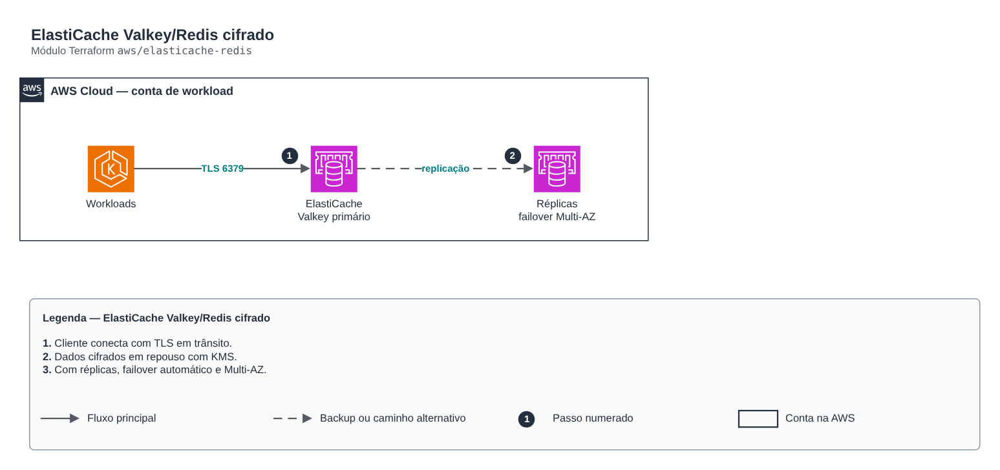

# ElastiCache Valkey/Redis cifrado

**Português** · [English](README.en.md)

> `aws/elasticache-redis` · categoria **dados** · origem: Plataforma de microsserviços em telecom (2026)

> Idealizado em setembro de 2026 e publicado agora.

ElastiCache (Valkey ou Redis) em subnets privadas, cifrado em repouso e em trânsito. Com réplicas > 0 liga failover automático e Multi-AZ.

## Arquitetura



Fonte editável: [`diagram.drawio`](diagram.drawio) (abra no draw.io / diagrams.net), com páginas em português e inglês.

1. Cliente conecta com TLS em trânsito.
2. Dados cifrados em repouso com KMS.
3. Com réplicas, failover automático e Multi-AZ.

## Uso

```hcl
module "elasticache_redis" {
  source = "git::https://github.com/raphaelfcs/automacao_terraform.git//aws/elasticache-redis?ref=v1.0.0"

  name_prefix             = local.name_prefix
  vpc_id                  = "vpc-0123456789abcdef0"
  subnet_ids              = ["subnet-0aaa1111bbbb2222c", "subnet-0ddd3333eeee4444f"]
  kms_key_arn             = "arn:aws:kms:sa-east-1:123456789012:key/11111111-2222-3333-4444-555555555555"
  engine_version          = "8.0"
  node_type               = "cache.t4g.micro"
  ingress_security_groups = { eks = "sg-0123456789abcdef0" }
  tags                    = local.tags
}
```

## Exemplos

| Exemplo | Arquivos |
|---|---|
| [`basico`](examples/basico) | `main.tf`, `locals.tf`, `backend.tf` |
| [`alta-disponibilidade`](examples/alta-disponibilidade) | `main.tf`, `locals.tf`, `backend.tf` |

Cada exemplo tem seu próprio backend (state isolado por módulo e exemplo). Ambientes diferentes usam apenas outro `backend.tf`/`*.tfvars`, sem duplicar código.

## Entradas

| Nome | Tipo | Padrão | Obrigatória | Descrição |
|---|---|---|---|---|
| `name_prefix` | `string` | - | **sim** | Prefixo aplicado aos recursos de cache. |
| `vpc_id` | `string` | - | **sim** | VPC onde o cluster vive. |
| `subnet_ids` | `list(string)` | - | **sim** | Subnets privadas do subnet group. |
| `ingress_security_groups` | `map(string)` | `{}` | não | Security groups autorizados na porta do cache: nome estático (chave) -> id (valor). |
| `kms_key_arn` | `string` | - | **sim** | Chave KMS para criptografia em repouso. |
| `engine` | `string` | `"valkey"` | não | valkey (recomendado) ou redis. |
| `engine_version` | `string` | - | **sim** | Versão do motor (ex.: 8.0 para Valkey). |
| `node_type` | `string` | - | **sim** | Tipo de nó (ex.: cache.t4g.micro em dev). |
| `port` | `number` | `6379` | não | Porta do cache. |
| `replica_count` | `number` | `0` | não | Réplicas de leitura. > 0 liga failover automático e Multi-AZ (produção). |
| `preferred_cache_cluster_azs` | `list(string)` | `null` | não | AZs preferidas dos nós, em ordem. null = AWS escolhe. |
| `snapshot_retention_limit` | `number` | `1` | não | Dias de retenção de snapshot (0 desliga). |
| `maintenance_window` | `string` | `"sun:07:00-sun:08:00"` | não | Janela semanal de manutenção (UTC). |
| `apply_immediately` | `bool` | `false` | não | Aplica mudanças fora da janela de manutenção. |
| `tags` | `map(string)` | `{}` | não | Tags aplicadas a todos os recursos. |

## Saídas

| Nome | Descrição |
|---|---|
| `primary_endpoint_address` | Endpoint de escrita. |
| `reader_endpoint_address` | Endpoint de leitura (balanceia entre réplicas). |
| `port` | Porta do cache. |
| `security_group_id` | Security group do cluster. |

## Arquivos

- `main.tf`: recursos principais
- `outputs.tf`: saídas
- `security-group.tf`: recursos específicos do módulo
- `variables.tf`: entradas e validações
- `versions.tf`: versões do Terraform e providers
- `examples/`: composições prontas para uso
- `tests/`: `terraform test` com providers simulados

## Well-Architected

- Confiabilidade: backups automáticos, Multi-AZ/alta disponibilidade configuráveis e proteção contra exclusão.
- Segurança: acesso somente privado, TLS obrigatório e dados cifrados em repouso com KMS/CMK.

## Testes

```bash
cd aws/elasticache-redis
terraform init -backend=false
terraform test
```
