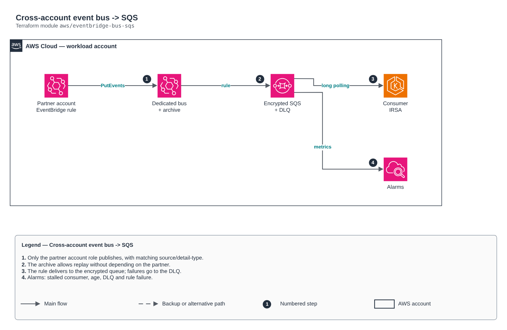

# Cross-account event bus -> SQS

[Português](README.md) · **English**

> `aws/eventbridge-bus-sqs` · category **integracao** · origin: Telecom microservices platform (2026)

> Designed in September 2026 and published now.

Event-driven cross-account integration: a producer (another AWS account) publishes to a dedicated EventBridge bus; a rule delivers to an encrypted SQS queue with a DLQ; the archive allows replay without depending on the producer. Alarms cover a stalled consumer, old messages, the DLQ and rule delivery failures.

## Architecture



Editable source: [`diagram.drawio`](diagram.drawio) (open it in draw.io / diagrams.net), with Portuguese and English pages.

1. Only the partner account role publishes, with matching source/detail-type.
2. The archive allows replay without depending on the partner.
3. The rule delivers to the encrypted queue; failures go to the DLQ.
4. Alarms: stalled consumer, age, DLQ and rule failure.

## Usage

```hcl
module "eventbridge_bus_sqs" {
  source = "git::https://github.com/raphaelfcs/automacao_terraform.git//aws/eventbridge-bus-sqs?ref=v1.0.0"

  name_prefix             = local.name_prefix
  queue_name              = "pedidos"
  event_sources           = ["parceiro.pedidos"]
  detail_types            = ["PedidoConcluido"]
  producer_principal_arns = ["arn:aws:iam::210987654321:role/parceiro-eventbridge"]
  kms_key_arn             = "arn:aws:kms:sa-east-1:123456789012:key/11111111-2222-3333-4444-555555555555"
  consumer_role_name      = "demo-dev-consumidor"
  alarm_actions           = ["arn:aws:sns:sa-east-1:123456789012:demo-dev-alertas"]
  tags                    = local.tags
}
```

## Examples

| Example | Files |
|---|---|
| [`parceiro`](examples/parceiro) | `main.tf`, `locals.tf`, `backend.tf` |

Each example has its own backend (state isolated per module and example). Different environments only use another `backend.tf`/`*.tfvars`, without duplicating code.

## Inputs

| Name | Type | Default | Required | Description |
|---|---|---|---|---|
| `name_prefix` | `string` | - | **yes** | Resource prefix (e.g. app-stg). |
| `bus_name` | `string` | `"integracao"` | no | Bus name (without the prefix). |
| `queue_name` | `string` | - | **yes** | Target queue name (without the prefix). |
| `event_sources` | `list(string)` | - | **yes** | Accepted source values (e.g. ["partner.orders"]). |
| `detail_types` | `list(string)` | `[]` | no | Accepted detail-types. Empty = any from the source. |
| `producer_principal_arns` | `list(string)` | `[]` | no | Producer account roles allowed to publish to the bus. Empty = only this account. |
| `kms_key_arn` | `string` | - | **yes** | KMS key of the queue and DLQ. The key policy must allow events.amazonaws.com for the rule (rule_arn output). |
| `consumer_role_name` | `string` | `null` | no | Consumer role that receives the read policy. null = none. |
| `archive_retention_days` | `number` | `30` | no | Archive retention for replay. 0 disables. |
| `queue_retention_seconds` | `number` | `1209600` | no | Queue retention (max 14 days). |
| `visibility_timeout_seconds` | `number` | `120` | no | Default visibility; the consumer extends it while processing. |
| `max_receive_count` | `number` | `10` | no | Deliveries before the DLQ. |
| `alarm_visible_threshold` | `number` | `500` | no | Messages visible for 15 min, indicating a stalled consumer. |
| `alarm_age_seconds` | `number` | `14400` | no | Maximum acceptable age of the oldest message. |
| `alarm_actions` | `list(string)` | `[]` | no | Alarm destinations (e.g. SNS topic). |
| `tags` | `map(string)` | `{}` | no | Common tags. |

## Outputs

| Name | Description |
|---|---|
| `event_bus_arn` | Bus ARN — target of the rule in the producer account. |
| `rule_arn` | Rule ARN (pass it in event_rule_arns of the kms-key module). |
| `queue_url` | Queue URL. |
| `queue_arn` | Queue ARN. |
| `dlq_arn` | DLQ ARN. |

## Files

- `alarms.tf`: module-specific resources
- `iam.tf`: policies, roles and permissions
- `locals.tf`: derived values
- `main.tf`: main resources
- `outputs.tf`: outputs
- `variables.tf`: inputs and validations
- `versions.tf`: Terraform and provider versions
- `examples/`: ready-to-use compositions
- `tests/`: `terraform test` with mocked providers

## Well-Architected

- Reliability: dead-letter queues (DLQ), retries and event archiving.
- Security: resource policies restricted by source and message encryption.

## Tests

```bash
cd aws/eventbridge-bus-sqs
terraform init -backend=false
terraform test
```
