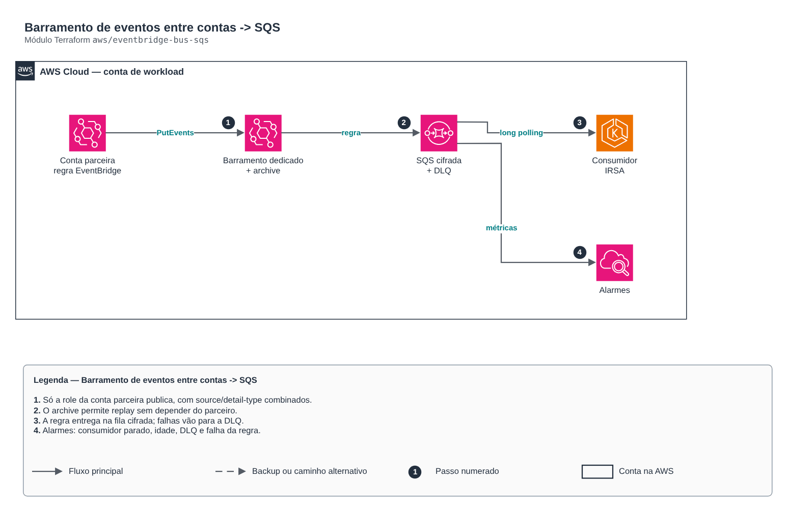

# Barramento de eventos entre contas -> SQS

**Português** · [English](README.en.md)

> `aws/eventbridge-bus-sqs` · categoria **integracao** · origem: Plataforma de microsserviços em telecom (2026)

> Idealizado em setembro de 2026 e publicado agora.

Integração orientada a eventos entre contas: um produtor (outra conta AWS) publica num barramento EventBridge dedicado; uma regra entrega numa fila SQS cifrada com DLQ; o archive permite replay sem depender do produtor. Alarmes cobrem consumidor parado, mensagens antigas, DLQ e falha de entrega da regra.

## Arquitetura



Fonte editável: [`diagram.drawio`](diagram.drawio) (abra no draw.io / diagrams.net), com páginas em português e inglês.

1. Só a role da conta parceira publica, com source/detail-type combinados.
2. O archive permite replay sem depender do parceiro.
3. A regra entrega na fila cifrada; falhas vão para a DLQ.
4. Alarmes: consumidor parado, idade, DLQ e falha da regra.

## Uso

```hcl
module "eventbridge_bus_sqs" {
  source = "git::https://github.com/raphaelfcs/automacao_terraform.git//aws/eventbridge-bus-sqs?ref=v1.0.0"

  name_prefix             = local.name_prefix
  queue_name              = "pedidos"
  event_sources           = ["parceiro.pedidos"]
  detail_types            = ["PedidoConcluido"]
  producer_principal_arns = ["arn:aws:iam::210987654321:role/parceiro-eventbridge"]
  kms_key_arn             = "arn:aws:kms:sa-east-1:123456789012:key/11111111-2222-3333-4444-555555555555"
  consumer_role_name      = "demo-dev-consumidor"
  alarm_actions           = ["arn:aws:sns:sa-east-1:123456789012:demo-dev-alertas"]
  tags                    = local.tags
}
```

## Exemplos

| Exemplo | Arquivos |
|---|---|
| [`parceiro`](examples/parceiro) | `main.tf`, `locals.tf`, `backend.tf` |

Cada exemplo tem seu próprio backend (state isolado por módulo e exemplo). Ambientes diferentes usam apenas outro `backend.tf`/`*.tfvars`, sem duplicar código.

## Entradas

| Nome | Tipo | Padrão | Obrigatória | Descrição |
|---|---|---|---|---|
| `name_prefix` | `string` | - | **sim** | Prefixo dos recursos (ex.: app-stg). |
| `bus_name` | `string` | `"integracao"` | não | Nome do barramento (sem o prefixo). |
| `queue_name` | `string` | - | **sim** | Nome da fila de destino (sem o prefixo). |
| `event_sources` | `list(string)` | - | **sim** | Valores de source aceitos (ex.: ["parceiro.pedidos"]). |
| `detail_types` | `list(string)` | `[]` | não | detail-type aceitos. Vazio = qualquer um do source. |
| `producer_principal_arns` | `list(string)` | `[]` | não | Roles da conta produtora autorizadas a publicar no barramento. Vazio = só a própria conta. |
| `kms_key_arn` | `string` | - | **sim** | Chave KMS da fila e da DLQ. A política da chave deve liberar events.amazonaws.com para a regra (output rule_arn). |
| `consumer_role_name` | `string` | `null` | não | Role do consumidor que recebe a política de leitura. null = nenhuma. |
| `archive_retention_days` | `number` | `30` | não | Retenção do archive para replay. 0 desliga. |
| `queue_retention_seconds` | `number` | `1209600` | não | Retenção da fila (máx. 14 dias). |
| `visibility_timeout_seconds` | `number` | `120` | não | Visibilidade padrão; o consumidor estende enquanto processa. |
| `max_receive_count` | `number` | `10` | não | Entregas antes da DLQ. |
| `alarm_visible_threshold` | `number` | `500` | não | Mensagens visíveis por 15 min que indicam consumidor parado. |
| `alarm_age_seconds` | `number` | `14400` | não | Idade máxima aceitável da mensagem mais antiga. |
| `alarm_actions` | `list(string)` | `[]` | não | Destinos dos alarmes (ex.: tópico SNS). |
| `tags` | `map(string)` | `{}` | não | Tags comuns. |

## Saídas

| Nome | Descrição |
|---|---|
| `event_bus_arn` | ARN do barramento — alvo da regra na conta produtora. |
| `rule_arn` | ARN da regra (informe em event_rule_arns do módulo kms-key). |
| `queue_url` | URL da fila. |
| `queue_arn` | ARN da fila. |
| `dlq_arn` | ARN da DLQ. |

## Arquivos

- `alarms.tf`: recursos específicos do módulo
- `iam.tf`: políticas, papéis e permissões
- `locals.tf`: valores derivados
- `main.tf`: recursos principais
- `outputs.tf`: saídas
- `variables.tf`: entradas e validações
- `versions.tf`: versões do Terraform e providers
- `examples/`: composições prontas para uso
- `tests/`: `terraform test` com providers simulados

## Well-Architected

- Confiabilidade: filas de mensagens mortas (DLQ), retentativas e arquivamento de eventos.
- Segurança: políticas de recurso restritas por origem e cifragem das mensagens.

## Testes

```bash
cd aws/eventbridge-bus-sqs
terraform init -backend=false
terraform test
```
